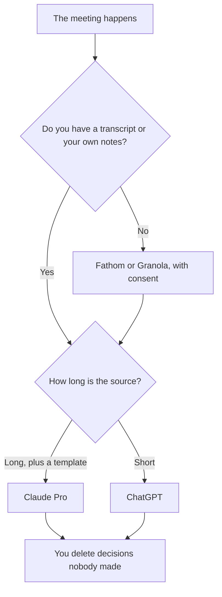

**Use Claude when the notes have to follow a long transcript plus a Project that already holds your template. Use ChatGPT when the notes are a short recap in the chat you already pay for.** Neither one joins the call. A recorder does that. The model only rewrites what you paste, and you delete anything the room did not say.

The capture workflow is [how to summarize meetings with AI](/blog/how-to-summarize-meetings-with-ai-2026/). The agenda before the meeting is [how to create meeting agendas with AI](/blog/how-to-create-meeting-agendas-with-ai-2026/). The recorder survey is [best AI meeting notetakers](/blog/best-ai-meeting-notetakers/).

Prices are US list prices excluding tax from directory pages checked October 16, 2026. Published October 24, 2026. We did not score summary quality.

## The note, then the seat

| The note | Start here | First paid step | Leave this for later |
|---|---|---|---|
| A long transcript and a standing template | [Claude](/tools/claude/) Pro | $20 a month, or $17 billed annually ($200 up front) | Claude Max, until Pro actually runs out |
| A short internal recap | [ChatGPT](/tools/chatgpt/) Plus or Go | Plus is $20. Go is $8 | A second chatbot "for tone" |
| Someone has to record the call | [Fathom](/tools/fathom/) or [Granola](/tools/granola/) | Fathom Free lists unlimited recordings. Granola Business is $14 a user a month | Pasting a memory of the meeting with no notes |
| The page the team will reopen | [Notion AI](/tools/notion-ai/) Business | $20 a seat. Plus at $10 is not the full AI tier | Leaving the only copy in a chat |
| The sentence, after the decisions are real | [Grammarly](/tools/grammarly/) | Pro is $12 a member a month billed annually | Asking it what was decided |

## What each seat is doing in this job

**Claude.** Pro is the long-paste seat. Put last month's notes format in a Project: decisions, owners, open questions. Free can hold a short paste with limits. Max at $100 or $200 is for people who already hit Pro, not for "better meeting judgment." The directory does not print a Team price. The review is [Claude review](/blog/claude-review-2026/). The container is [Claude Projects vs ChatGPT Projects](/blog/claude-projects-vs-chatgpt-projects-2026/).

**ChatGPT.** Plus at $20 is enough for a recap you will paste into the doc yourself. Go at $8 can hold a shorter one and may include ads. Business at $20 a user a month billed annually, for two or more users, is the admin seat and does not train on business data by default. A personal Plus account is a different promise if the transcript has customer names. The ladder is [ChatGPT Go vs Plus vs Pro](/blog/chatgpt-go-vs-plus-vs-pro-2026/).

**The recorder, which is not either chatbot.** Fathom Free includes unlimited recordings and summaries when a bot is allowed. Team is $15 a user a month billed annually, with a two-user minimum, when the notes must live in folders. Granola does not put a bot on the call. It uses your computer audio. Business is $14 a user a month for unlimited history. Basic is free with 30 days of history. Tell people they are being captured. The cards are [Fathom pricing explained](/blog/fathom-pricing-explained-2026/) and [Granola vs Fathom](/blog/granola-vs-fathom-2026/).

**The record.** Notion Business is worth it when the decision log already lives there. Generate in Claude or ChatGPT, then paste the approved text. The chat is not the system of record. That distinction is [what a system of record for AI is](/blog/what-is-a-system-of-record-for-ai-2026/).

A prompt that holds the line:

"Here is the transcript and our template: decisions, owners, open questions. Use only the transcript. If a decision is unclear, write Unclear. Do not invent dates, owners, or dollar amounts. Do not add a next step nobody said."

A decision the model upgraded from a joke is [a hallucination](/blog/what-is-ai-hallucination-2026/). The person who publishes the note is [what human-in-the-loop AI is](/blog/what-is-human-in-the-loop-ai-2026/).

## How to choose

If the transcript is long and the template is stable, start with Claude Pro. If you already live in ChatGPT and the recap is a page or less, stay there. Add a recorder when the failure is "we did not write anything down," not "the prose is flat."

User-research interviews are a different note. The workflow is [how to use AI for user interview notes](/blog/how-to-use-ai-for-user-interview-notes-2026/). Hiring scorecards are different again: [how to create interview scorecards with AI](/blog/how-to-create-interview-scorecards-with-ai-2026/).

## FAQ

### Which writes better notes?

This page did not measure that. The transcript you paste, and whether you delete invented decisions, matter more than the logo. A beautiful recap of a meeting that did not happen that way is a defect.

### Can I connect the model to my calendar and let it file notes?

You can draft. You should file the note yourself until the template has been boring for a month. An auto-file will eventually assign an owner who was not in the room.

### Is Gemini a third option?

Yes, when the meeting notes should land in a Google Doc. Google AI Pro is $19.99 a month. That bundle is [Gemini vs ChatGPT for Google Workspace](/blog/gemini-vs-chatgpt-for-google-workspace-2026/). It is still not a recorder.

### What about a team of five?

Five Claude Pro seats at the monthly price are 5 × $20 = $100, with no printed Team admin price on the directory card. Five ChatGPT Business seats on the annual card are also 5 × $20 = $100, with admin controls. The recorder is extra: Fathom Team at $15 is 5 × $15 = $75 a month on the annual rate, and the plan has a two-user minimum. Buy the recorder first if the notes do not exist.

## Last verified

October 16, 2026 for Claude, ChatGPT, Fathom, Granola, Notion, and Grammarly prices named above. Published October 24, 2026.

**Sources:** [Claude pricing](https://claude.com/pricing), [ChatGPT pricing](https://chatgpt.com/pricing), [Fathom pricing](https://www.fathom.ai/pricing).

*Published by Andrew for [AI Tools Optimizer](https://aitoolsoptimizer.com).*

[Fathom](/tools/fathom/) is in the [meetings and transcription directory](/tools/category/meetings-transcription/). Directory pages may use affiliate links. A purchase through them may earn us a commission at no extra cost to you.
