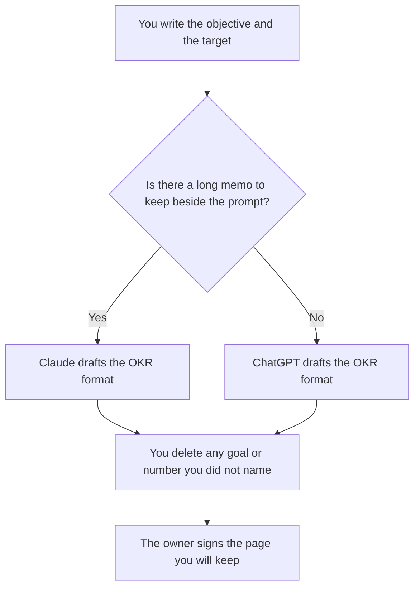

**Use Claude when the OKR has to follow a long strategy memo you keep in a Project. Use ChatGPT when the OKR is a short quarterly template you will paste into and reuse.** Both can tighten a sentence. Neither knows the target. A key result with a number the model invented is a slogan.

The workflow, once you have a seat, is [how to write OKRs with AI](/blog/how-to-write-okrs-with-ai-2026/). A sprint-sized outcome is a different sentence: [how to write a sprint goal with AI](/blog/how-to-write-a-sprint-goal-with-ai-2026/). A metric you cannot defend is [what an AI hallucination is](/blog/what-is-ai-hallucination-2026/).

Prices are US list prices excluding tax from directory pages checked October 16, 2026. Published October 24, 2026. We did not score which draft a leadership team prefers.

## Which seat matches the quarter

| The planning doc you actually have | Start here | What you still do |
|---|---|---|
| One objective and one number, no long memo | [ChatGPT](/tools/chatgpt/) Free or [Claude](/tools/claude/) Free | You type the number. The model only formats it |
| The same OKR template every quarter | ChatGPT Plus at $20 a month, projects included | Swap the objective and the target. Do not reuse last quarter's metric |
| A strategy memo, a board note, or a pile of constraints | Claude Pro at $20 a month, or $17 billed annually | The Project holds the memo. The OKR does not add a goal the memo does not contain |
| The signed OKR lives in the wiki | [Notion AI](/tools/notion-ai/) Business at $20 a seat a month | The page is the record. The chat is the draft |
| The work already lives in ClickUp | [ClickUp Brain](/tools/clickup-brain/) from $9 per user a month | Brain formats. The number is still one you typed |

Claude Max starts at $100 a month. ChatGPT Pro starts at $100. An OKR page does not need either. ChatGPT Go at $8 may include ads. Do not take an ad as a company goal. Business, at $20 a user a month billed annually with a two-user minimum, matters when the memo is confidential and a personal account is against policy.

## What the draft should contain

An OKR on this page has the objective you named, the key result with your number and your date, and a non-goal you named so the quarter does not sprawl. It does not have a fourth key result the model added to look complete. If you did not name an owner, the line says Missing.

**Claude Pro** is the right paid seat when the memo is long and you refuse to re-paste it every quarter. Projects are on Pro. Free can format one short OKR. The review is [Claude review](/blog/claude-review-2026/).

**ChatGPT Plus** is the right paid seat when you already keep templates in ChatGPT and the input is a few bullets. The review is [ChatGPT review](/blog/chatgpt-review-2026/). The product-manager shelf next to the quarter is [best AI tools for product managers](/blog/best-ai-tools-for-product-managers-2026/).

A prompt that holds the line:

"Format an OKR from the objective, the target, the date, and the non-goals I pasted. Do not add a key result. Do not change the number. If an owner is missing, write Missing. Do not invent a baseline."

## What not to delegate

Do not ask which goal the company should pick. Do not let the model "raise the target to be ambitious." Ambition is a conversation with the owner. The model can show you that a key result has no number. It cannot supply one.

A spec that should feed the objective is [how to write a PRD with AI](/blog/how-to-write-a-prd-with-ai-2026/). The OKR points at the outcome. The PRD points at the product change. Keep them as two documents.

## FAQ

### Which one writes a tighter OKR?

We did not measure planning meetings. The tight OKR is the one whose number you typed. Pick Claude for a long memo in a Project. Pick ChatGPT for a short reusable template. Read it before anyone commits to the quarter.

### Can the model suggest key results?

It can list candidates you then accept or delete. A candidate is not a target. Leave the number blank until you write it. The how-to article is the longer version of that rule.

### Is a sprint goal an OKR?

A sprint goal covers one sprint. An OKR covers the period you named, often a quarter. Use the sprint-goal article for the short sentence. Use this page for the quarterly page.

### What if we only have Free?

Use Free. One OKR fits in a paste. Pay when the memo or the template has to persist, or when the limit stops you in planning week. Max and the $100 ChatGPT tier are the wrong upgrade for a one-page OKR.

## Last verified

October 16, 2026 for Claude, ChatGPT, Notion AI, and ClickUp Brain. Published October 24, 2026.

**Sources:** [Claude pricing](https://claude.com/pricing), [ChatGPT pricing](https://chatgpt.com/pricing/), [Notion pricing](https://www.notion.com/pricing).

*Published by Andrew for [AI Tools Optimizer](https://aitoolsoptimizer.com).*

[Notion AI](/tools/notion-ai/) is in the [productivity and notes directory](/tools/category/productivity-notes/). Directory pages may use affiliate links. A purchase through them may earn us a commission at no extra cost to you.
