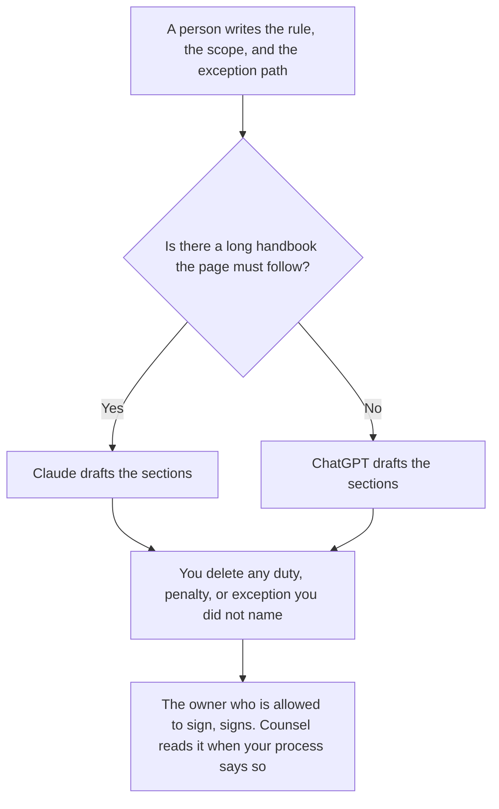

**Use Claude when the internal policy has to follow a long handbook you keep in a Project. Use ChatGPT when the policy is a short template your team reuses.** This page is drafting for an internal document. It is not legal advice, and it is not a compliance opinion. The model formats a rule a person already chose. Counsel, or the owner who is allowed to sign, still signs.

The signed list of model checks, which is a different document, is [what an AI guardrail policy is](/blog/what-is-ai-guardrail-policy-2026/). A rule the pipeline can execute is [what AI policy as code is](/blog/what-is-ai-policy-as-code-2026/). The wording you hide in a prompt is [what a system prompt is](/blog/what-is-a-system-prompt-2026/). The person who signs is [what human-in-the-loop AI is](/blog/what-is-human-in-the-loop-ai-2026/).

Prices are US list prices excluding tax from directory pages checked October 16, 2026. n8n's euro price is not converted. Published October 24, 2026. We did not score which draft a lawyer would accept. A lawyer was not asked.

## Which seat matches the handbook

| The policy you are actually writing | Start here | What you still do |
|---|---|---|
| One rule, a few sentences, no long handbook | [ChatGPT](/tools/chatgpt/) Free or [Claude](/tools/claude/) Free | You write the rule. The model only formats sections |
| The same internal template every time: purpose, scope, rule, exception, owner | ChatGPT Plus at $20 a month | Swap the rule. Do not reuse another team's exception |
| A long handbook the new page must not contradict | Claude Pro at $20 a month, or $17 billed annually | The Project holds the handbook. The draft adds no duty the handbook does not contain |
| The signed page lives in the wiki | [Notion AI](/tools/notion-ai/) Business at $20 a seat a month | The wiki is the record. The chat is the draft |
| A workflow should stop until a person approves | [n8n](/tools/n8n/) Starter cloud at €20 a month billed annually | The human node is the control. The prose is not |

Claude Max starts at $100. ChatGPT Pro starts at $100. An internal policy page does not need either. ChatGPT Business, at $20 a user a month billed annually with a two-user minimum, is the row when the handbook is confidential and a personal account is against policy. Do not paste a draft employment, privacy, or security policy into a consumer account your company forbids.

## What the draft should contain

Purpose, who it covers, the rule you wrote, the exception path with a named approver, and a review date. It should not contain a penalty you did not decide, a law you did not name, or a sentence that says the company "complies with all applicable regulations." That sentence is not a rule. If a section has no decision, the line says Not decided.

**Claude Pro** is the right paid seat when the handbook is long. Projects are on Pro. The product review is [Claude review](/blog/claude-review-2026/).

**ChatGPT Plus** is the right paid seat when the template is short and you already keep templates there. The product review is [ChatGPT review](/blog/chatgpt-review-2026/).

A prompt that holds the line:

"Format an internal policy from the purpose, scope, rule, exception, and owner I pasted. Do not add a legal citation. Do not add a penalty. Do not say we comply with a law I did not name. If a decision is missing, write Not decided. This is a draft, not legal advice, and not a signed policy."

## What not to delegate

Do not ask the model what the rule should be. Do not ask it to make the page "sound compliant." Do not ship the draft because it looks like a policy. A policy is the page the owner signed, after whatever review your company requires. The model does not know your contracts, your regulators, or your exceptions.

If the page is specifically about what an AI system may do, use the guardrail-policy article for that document. This page is the drafting seat. It is not the control list.

## FAQ

### Which one writes a safer policy?

We did not measure safety. A safe internal policy is a rule you decided, a scope you named, and a signature you are allowed to make. Pick Claude for a long handbook. Pick ChatGPT for a short template. Have the right person read it. This is not legal advice.

### Can the model add the law that applies?

Only if you paste the citation you already rely on, and counsel or the owner agrees it belongs. A statute the model guessed is not a citation. Leave the legal section to the person who is accountable for it.

### Is a system prompt the policy?

No. The system prompt can quote the policy. It cannot replace the signature, the exception log, or the review date. Hiding the rule in a prompt is how the company forgets what it signed.

### What if legal has not reviewed it?

Then it is a draft. Label it draft. Do not put it in the handbook, the bot, or the employee portal. The model cannot clear that queue.

## Last verified

October 16, 2026 for Claude, ChatGPT, Notion AI, and n8n. Published October 24, 2026.

**Sources:** [Claude pricing](https://claude.com/pricing), [ChatGPT pricing](https://chatgpt.com/pricing/), [Notion pricing](https://www.notion.com/pricing), [n8n pricing](https://n8n.io/pricing/).

*Published by Andrew for [AI Tools Optimizer](https://aitoolsoptimizer.com).*

[Notion AI](/tools/notion-ai/) is in the [productivity and notes directory](/tools/category/productivity-notes/). Directory pages may use affiliate links. A purchase through them may earn us a commission at no extra cost to you.
