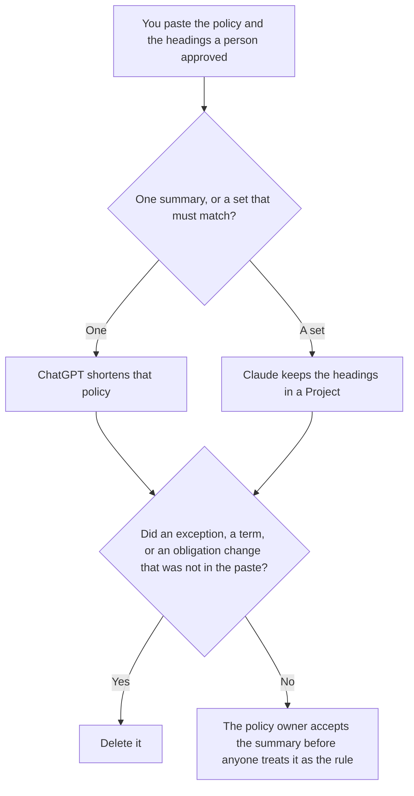

**Use Claude when several policy summaries must use the same headings, and those headings live in a Project. Use ChatGPT when you are shortening one policy from a paste.** The model may order sections a person already named. It may not add an exception, delete an obligation, or replace a defined term. Writing the rule in the first place is a different page: [Claude vs ChatGPT for policy drafts](/blog/claude-vs-chatgpt-for-policy-drafts-2026/). How long the prompt is kept is [what an AI data retention policy is](/blog/what-is-ai-data-retention-policy-2026/).

A rule the repo can check, which is not a summary, is [what AI policy as code is](/blog/what-is-ai-policy-as-code-2026/).

Claude's prices are from claude.com/pricing on October 24, 2026. ChatGPT Plus is $20 a month on learn.chatgpt.com/docs/pricing that day. Notion and Grammarly prices are from directory pages checked October 16, 2026. Published October 24, 2026. We did not score summaries. This page is not legal advice.

## Which summary is in front of you

| The page | Start here | First paid step | The limit |
|---|---|---|---|
| One policy, from a paste | [ChatGPT](/tools/chatgpt/) | Plus is $20 a month | No obligation that was not in the paste |
| A set of summaries that must share headings | [Claude](/tools/claude/) | Pro is $17 a month billed annually, $200 up front, or $20 monthly | The Project holds your headings. It does not amend the policy |
| The page employees will reopen | [Notion AI](/tools/notion-ai/) | Business is $20 a seat a month | Plus at $10 is not the full AI tier |
| A clarity pass that must not touch defined terms | [Grammarly](/tools/grammarly/) | Pro is $12 a member a month billed annually, or $30 monthly | Compare the terms before and after |

A summary that "simplifies" a duty into advice has amended the policy. If a section was not in the paste, the summary says Section not in the source. It does not sketch what the section probably says.

Claude Free can shorten a short paste. Pro is the seat with Projects. The review is [Claude review](/blog/claude-review-2026/).

ChatGPT Go is $8 a month on the October 24 plan page. Plus is the seat for a saved summary. The review is [ChatGPT review](/blog/chatgpt-review-2026/).

## What the summary is allowed to contain

The headings you named, the sentences that trace to the policy, and the date of the policy version. If the version date was not on the document, the summary says Version date not recorded. A defined term stays the term. A synonym that "reads better" is a change.

**ChatGPT Plus** is the one-policy path. Paste the policy, or the sections you are allowed to paste. A version that adds "common exceptions" is the version you delete.

**Claude Pro** is the set. Put the headings at the top: who it applies to, what is required, what is out of scope. When a heading changes, change it once, then read every summary that used it.

**Notion Business** is where the accepted summary lives if that is the wiki. Link the policy version. The invoice is [Notion AI pricing explained](/blog/notion-ai-pricing-explained-2026/).

**Grammarly Pro** is the pass after the sentences are stable. Reject a suggestion that swaps a defined term. The invoice is [Grammarly pricing explained](/blog/grammarly-pricing-explained-2026/).

A prompt that holds the line:

"Summarize this policy under the headings I pasted. If a heading has no text in the source, write Not in the source. Do not add an exception. Do not change a defined term. Do not say the summary replaces the policy."

## What not to delegate

Do not ask what the policy should say. Do not paste another company's policy into a personal account. Do not publish the summary because it is shorter. The policy owner accepts it. A short page is not the rule.

## FAQ

### How is this different from a policy draft?

A draft is where the rule is chosen. A summary is a shorter view of a rule that already exists. If the rule is not approved, you are still on the draft page. A summary must not become the draft by adding a sentence the policy does not contain.

### Which one writes a safer summary?

We did not measure that. ChatGPT fits one policy. Claude fits a set that must share headings. The summary is safer when every obligation traces to the source, and a missing section says so.

### Do I need both?

You need the seat that matches the size of the set. Running both and merging the paragraphs is how an obligation changes in one summary and stays in its neighbor. File one accepted version, and point it at the policy version.

### Who may send the summary to employees?

The policy owner, or the person that owner names. A formatted page is not an announcement. Counsel still owns the policy text. This page is not legal advice.

## Last verified

October 24, 2026 for Claude and for ChatGPT's plan page. October 16, 2026 for Notion and Grammarly. Published October 24, 2026.

**Sources:** [Claude pricing](https://claude.com/pricing), [ChatGPT and Codex pricing](https://learn.chatgpt.com/docs/pricing), [Notion pricing](https://www.notion.com/pricing), [Grammarly pricing](https://www.grammarly.com/plans).

*Published by Andrew for [AI Tools Optimizer](https://aitoolsoptimizer.com).*

[Claude](/tools/claude/) is in the [chatbots and assistants directory](/tools/category/chatbots-assistants/). Directory pages may use affiliate links. A purchase through them may earn us a commission at no extra cost to you.
