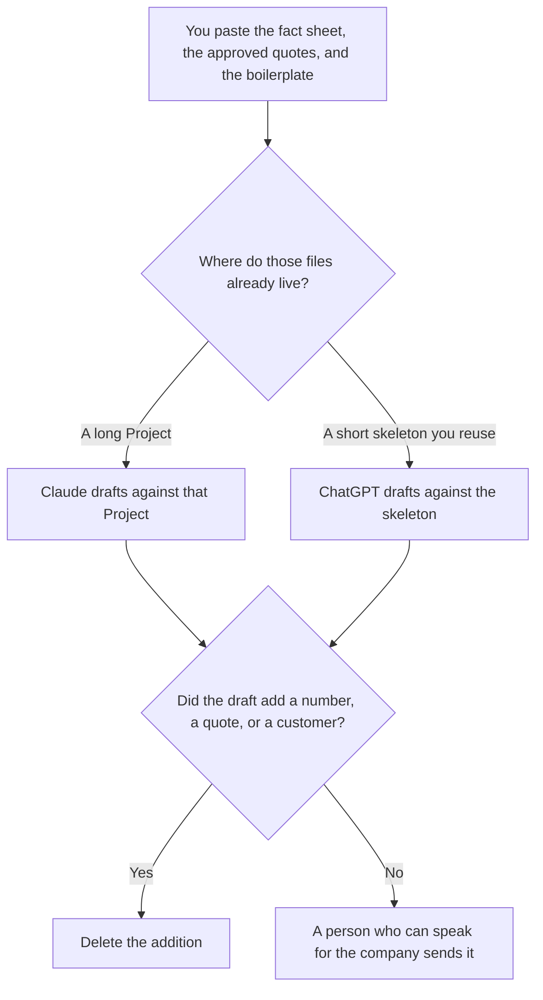

**Use Claude when the press release must follow a long fact sheet and a style doc you do not want to paste every time. Use ChatGPT when you keep a project that turns each approved fact sheet into the same release shape.** A press release is an external page: a news peg, the facts you can stand behind, and quotes from people who have approved the words. It is not a newsletter edit, and it is not a launch task list.

The internal page those claims should already match is [how to write a product one-pager with AI](/blog/how-to-write-a-product-one-pager-with-ai-2026/). The rules for wording are [how to create a style guide with AI](/blog/how-to-create-a-style-guide-with-ai-2026/). A sentence the fact sheet does not contain is [what an AI hallucination is](/blog/what-is-ai-hallucination-2026/).

Prices are US list prices excluding tax from directory pages checked October 16, 2026. A live fetch of vendor pricing pages returned HTTP 401 on October 24, 2026, so this page stays on the directory record. Published October 24, 2026. We did not measure pickup, share of voice, or which model "sounds more like a company."

## Which seat matches the release

| The draft you actually have | Start here | What you still do |
|---|---|---|
| One approved fact sheet | [Claude](/tools/claude/) Free or [ChatGPT](/tools/chatgpt/) Free | You send it, or you do not |
| A long fact sheet plus a style doc | Claude Pro at $20 a month, or $17 billed annually | The Project holds both. The release adds no fact |
| The same release skeleton every announcement | ChatGPT Plus at $20 a month | Swap the sheet. Keep the skeleton |
| A line pass before counsel or comms | [Grammarly](/tools/grammarly/) Pro at $12 a member a month billed annually, or $30 monthly | Grammarly does not approve a quote |
| The archive of what you have said | [Notion AI](/tools/notion-ai/) Business at $20 a seat a month | The page is the record of approved lines |

Claude Max starts at $100. ChatGPT Pro starts at $100. One release from a sheet you already approved does not need either. ChatGPT Business is $20 a user a month billed annually, with a two-user minimum, or $25 monthly, when the sheet is the company's and a personal account is against policy. Go at $8 may include ads. A release is a poor place for an ad.

## What the release may say

The peg, the product facts on the sheet, the quotes with the names you supplied, and the boilerplate you pasted. It may not add a market size, a customer logo, a funding figure, or a quote "in the voice of" someone who has not approved it. If a number is missing, the sentence says Not approved. Datelines and embargo times are facts. The model copies the ones you wrote.

**Claude Pro** is the paid path when the fact sheet is long and the style doc should stay attached. The review is [Claude review](/blog/claude-review-2026/).

**ChatGPT Plus** is the paid path when every release shares a skeleton and you paste this sheet. The review is [ChatGPT review](/blog/chatgpt-review-2026/).

**Grammarly Pro** is the line edit after the structure is honest. The annual price is the one to compare. Monthly at $30 is a different bill for the same Pro label. The invoice is [Grammarly pricing explained](/blog/grammarly-pricing-explained-2026/).

A prompt that holds the line:

"Draft a press release from the fact sheet, quotes, and boilerplate I pasted. Use only those facts. Do not add a number, a customer, or a quote. If a standard line has no approved fact, write Not approved. Do not invent an embargo."

## What not to delegate

Do not ask the model who should be quoted. Do not ask it to "make the news bigger." Do not ship a release no spokesperson has read. The send is a person who can stand behind the paragraph. A cleaner lede that adds a percent is a worse release than the sheet you started with. The check against the outside world, when you do cite it, is [how to fact-check AI writing](/blog/how-to-fact-check-ai-writing-2026/).

## FAQ

### Which one writes a better press release?

We did not measure that. Pick Claude when the fact sheet and the style doc are long. Pick ChatGPT when the habit is a skeleton and a paste. The release is only as true as the sheet.

### Can the model write the quote?

It can show you a tighter phrasing of a quote a person already approved, and that person has to approve the tighter line. It cannot speak for an executive who has not seen the sentence. A quote mark without a name on your sheet is Not approved.

### Where does the newsletter edit fit?

A newsletter is a different audience and a different article: [ChatGPT vs Claude for newsletter edits](/blog/chatgpt-vs-claude-for-newsletter-edits-2026/). Do not turn a release into a newsletter by adding a sign-off. Do not turn a newsletter into a release by adding a dateline.

### What about the boilerplate?

Paste the current boilerplate. The model may not recall last quarter's description from memory. If the boilerplate and the fact sheet disagree, write Conflict and stop. A person decides which sentence is current.

## Last verified

October 16, 2026 for Claude, ChatGPT, Grammarly, and Notion AI. Published October 24, 2026. Live pricing fetches returned HTTP 401 that day.

**Sources:** [Claude pricing](https://claude.com/pricing), [ChatGPT pricing](https://chatgpt.com/pricing/), [Grammarly pricing](https://www.grammarly.com/plans), [Notion pricing](https://www.notion.com/pricing).

*Published by Andrew for [AI Tools Optimizer](https://aitoolsoptimizer.com).*

[Claude](/tools/claude/) is in the [writing directory](/tools/category/writing/). Directory pages may use affiliate links. A purchase through them may earn us a commission at no extra cost to you.
