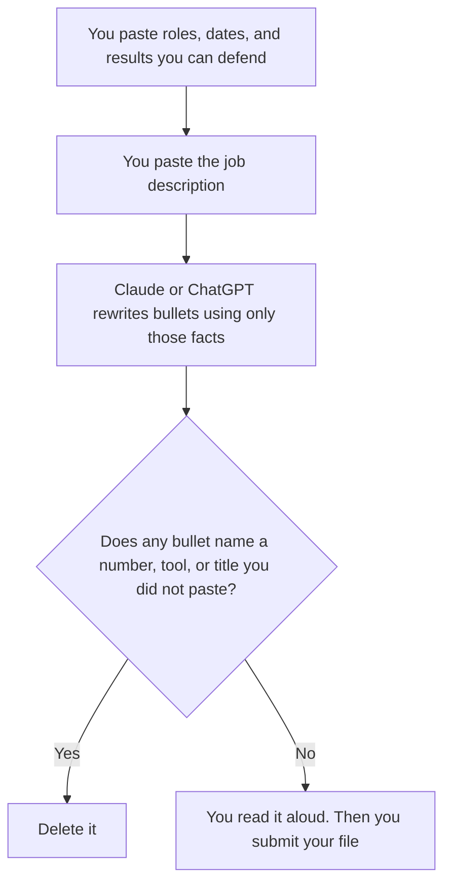

**Rewrite a resume in Claude or ChatGPT only from jobs, dates, and results you paste. The model may reorder, cut, and match language from a job description you also paste. It may not add a metric, a title, a tool, or an employer you did not have.** A fluent bullet you cannot defend in an interview is a worse resume than a plain one.

The line-by-line check is [how to fact-check AI writing](/blog/how-to-fact-check-ai-writing-2026/). The person who ships the file is [what human-in-the-loop AI is](/blog/what-is-human-in-the-loop-ai-2026/). An added percentage is [what an AI hallucination is](/blog/what-is-ai-hallucination-2026/).

Prices are US list prices excluding tax from directory pages checked October 16, 2026. Published October 24, 2026. We did not score which model gets more interviews. We do not know that, and a blog should not pretend to.

## Where the draft should live

| The file you have | Start here | What you still do |
|---|---|---|
| One resume and one job post, pasted | [Claude](/tools/claude/) Free or [ChatGPT](/tools/chatgpt/) Free | Delete any bullet you cannot say out loud with a real example |
| You will revise the same master resume for several posts | Claude Pro, $20 a month or $17 billed annually, in a Project. Or ChatGPT Plus at $20, in a project | The master file stays the source. Each rewrite is a copy |
| The master resume lives in a team wiki | [Notion AI](/tools/notion-ai/) Business at $20 a seat a month | Plus at $10 is not the full AI tier. The page in Notion wins over the chat |
| You want a grammar pass after the facts are frozen | [Grammarly](/tools/grammarly/) Pro at $12 a member a month billed annually | Grammarly will not know whether the promotion date is real |
| The paste includes someone else's performance review | The work plan your policy allows. ChatGPT Business is $20 a user a month billed annually, minimum two | A personal free account is the wrong place for another person's review |

Free on both products can take a short resume. Pay when the limit cuts the rewrite in half, or when you want a Project so the master facts do not drift between applications. Max, and ChatGPT Pro at $100 and above, are capacity tiers. One resume does not require them. The splits are [Claude Pro vs Max](/blog/claude-pro-vs-max-2026/) and [ChatGPT Go vs Plus vs Pro](/blog/chatgpt-go-vs-plus-vs-pro-2026/).

## What the $20 seats are for

**Claude Pro** includes Projects on the directory card. Put the master resume and a one-page fact sheet there: titles you have held, tools you have used, numbers you can source. Ask for a rewrite against one job post at a time. The review is [Claude review](/blog/claude-review-2026/).

**ChatGPT Plus** includes projects and is the same $20 monthly sticker. Go at $8 is the smaller step if Free stops mid-draft. Go may include ads. A resume draft is a poor place to treat an advertisement as career advice. Business is the admin step when a recruiter inside a company is rewriting with candidate materials. Read your policy before you paste a candidate's home address or government id. You do not need those fields for a bullet.

**Grammarly Pro** is the line edit after the facts are frozen: $12 a member a month billed annually, or $30 monthly. It will smooth a sentence. It will not restore a metric you correctly deleted. The invoice is [Grammarly pricing explained](/blog/grammarly-pricing-explained-2026/).

**Notion Business** is the system of record if several people maintain the career history. The chat may draft. The page is what you export. The invoice is [Notion AI pricing explained](/blog/notion-ai-pricing-explained-2026/).

A prompt that holds the line:

"Rewrite these bullets for this job description. Use only facts in the resume paste. If the job post asks for a skill I did not list, write Gap. Do not invent metrics, tools, degrees, or dates. Do not claim a result I described as a team result as if I did it alone. Keep the document to one page unless I said otherwise."

## What a rewrite is allowed to change

It may cut a bullet that does not match the role. It may put the relevant role first. It may replace a vague verb with a concrete one that your paste already supports. It may mirror a phrase from the job post when the phrase is true of your work.

It may not upgrade "helped with" into "led." It may not turn a range you were unsure about into a single impressive number. It may not add a certification because the posting prefers it. The gap belongs on your prep notes, as a gap.

A cover letter is a different page, with the same rule: no new facts. This comparison stops at the resume. The record of the approved wording, if you keep one, is [what a system of record for AI is](/blog/what-is-a-system-of-record-for-ai-2026/).

## FAQ

### Which model writes a stronger resume?

We did not measure outcomes. Use the seat you will re-read. The risk is an invented bullet, and both products will write one if you ask for "more impact."

### Should I paste the full job description?

Yes. Paste the description and your real history, and tell the model that history wins when they conflict. A rewrite with no description is a paraphrase. A rewrite with only the description is fan fiction.

### Is it acceptable to use AI on an application?

Follow the employer's instructions. If they forbid it, do not use it. If they allow help with editing, keep the facts yours. The model is an editor. You are the candidate.

### Can I ask it to beat an applicant tracking system?

You can ask it to use real terms from the posting that match real work. You should not ask it to hide keywords, invent keywords, or stuff the margin. A list of tools you have not used will fail the interview that the software let through.

## Last verified

October 16, 2026 for Claude, ChatGPT, Grammarly, and Notion AI. Published October 24, 2026.

**Sources:** [Claude pricing](https://claude.com/pricing), [ChatGPT pricing](https://chatgpt.com/pricing/), [Grammarly pricing](https://www.grammarly.com/plans), [Notion pricing](https://www.notion.com/pricing).

*Published by Andrew for [AI Tools Optimizer](https://aitoolsoptimizer.com).*

[Claude](/tools/claude/) is in the [chatbots and assistants directory](/tools/category/chatbots-assistants/). Directory pages may use affiliate links. A purchase through them may earn us a commission at no extra cost to you.
