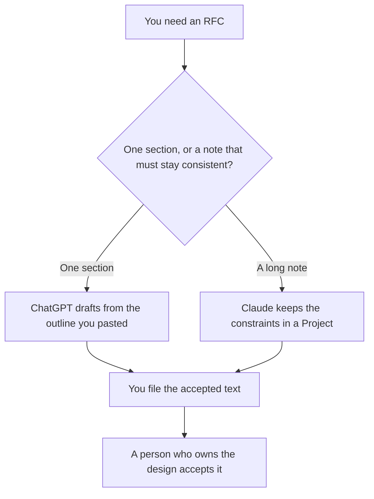

**Use Claude when the RFC is long enough to live in a Project beside the constraints you already accepted. Use ChatGPT when you are drafting one section from an outline you paste.** The model may order the sections and phrase a tradeoff you already wrote. It may not invent a requirement, a latency number, or a team that will do the work. The shorter product spec is [how to draft a product spec with AI](/blog/how-to-draft-a-product-spec-with-ai-2026/). The story that should not pretend to be an RFC is [ChatGPT vs Claude for user stories](/blog/chatgpt-vs-claude-for-user-stories-2026/).

Claude's prices are from claude.com/pricing on October 24, 2026. ChatGPT, Notion, and Cursor prices are from directory pages checked October 16, 2026. chatgpt.com/pricing returned HTTP 403 on October 24. Published October 24, 2026. We did not score RFC quality.

## Which seat matches the note

| The RFC in front of you | Start here | First paid step | The limit |
|---|---|---|---|
| Several sections that must use the same constraints | [Claude](/tools/claude/) | Pro is $17 a month billed annually, $200 up front, or $20 monthly | The Project holds your text. It does not approve the design |
| One section, from an outline you paste | [ChatGPT](/tools/chatgpt/) | Plus is $20 a month | No requirement that was not in the outline |
| The page engineering will comment on | [Notion AI](/tools/notion-ai/) | Business is $20 a seat a month | Plus at $10 is not the full AI tier |
| A prompt or a code sample inside the RFC | [Cursor](/tools/cursor/) | Plus is $8 a month, or $80 a year | You review the diff. The RFC does not merge it |

Claude Free can read a short paste. Pro is the seat with Projects, on the October 24 page and on the directory card. Max is $100 or $200 a month if you already live in Claude all day. An RFC does not require Max. The review is [Claude review](/blog/claude-review-2026/).

ChatGPT Go is $8 a month and may include ads, on the October 16 card. Plus is the seat for a saved outline. The review is [ChatGPT review](/blog/chatgpt-review-2026/).

## What the RFC is allowed to claim

The problem you wrote, the options you listed, the constraint you measured, and the decision if a person already made it. If the decision is open, the draft says Decision open. A model that picks option B because it is "simpler" has written a decision you did not make.

**Claude Pro** is the long-note path. Put the constraints at the top: the deadline, the system you may not break, the number you measured. Ask for a section that only uses those lines. When a constraint changes, change it once, then read the sections that cited it.

**ChatGPT Plus** is the one-section path. Paste the outline and the facts for that section. A second version that adds a rollout plan you did not ask for is the version you delete. The flag plan, if you need one, is [how to create a feature flag rollout plan with AI](/blog/how-to-create-a-feature-flag-rollout-plan-with-ai-2026/).

**Notion Business** is where the accepted RFC lives if that is the wiki. The chat is not the system of record.

**Cursor Plus** is how you check a code sample the RFC quotes. Paste the sample from the repo. Do not let a chat invent an API.

A prompt that holds the line:

"Draft this RFC section from the outline and the constraints I pasted. If a decision is not in the paste, write Decision open. Do not add a metric, an owner, or a date."

## What not to delegate

Do not ask which design is correct. Do not publish the RFC from the chat. Do not paste production credentials or a customer payload into the prompt so the example "looks real." The change between prompt versions, if the RFC includes one, is [what an AI prompt diff is](/blog/what-is-ai-prompt-diff-2026/).

## FAQ

### Which one writes a better RFC?

We did not measure that. Claude fits a long note with shared constraints in a Project. ChatGPT fits one section from an outline. The RFC is better when every requirement traces to a line a person already accepted.

### Do I need both?

You need the seat that matches the length of the job. Running both and merging the prose is how a constraint survives in one section and disappears in another. File one accepted version.

### Where does the spec end and the RFC begin?

The product spec says what the user can do. The RFC says how the system will do it, including the option you did not pick. If you only have the user-facing behavior, start with the spec article.

### Can the model name the approver?

Only if you paste the name. An empty approver line stays empty. A design with no owner is a draft, even if the prose is finished.

## Last verified

October 24, 2026 for Claude. October 16, 2026 for ChatGPT, Notion, and Cursor. Published October 24, 2026.

**Sources:** [Claude pricing](https://claude.com/pricing), [ChatGPT pricing](https://chatgpt.com/pricing/), [Notion pricing](https://www.notion.com/pricing), [Cursor pricing](https://cursor.com/help/account-and-billing/pricing).

*Published by Andrew for [AI Tools Optimizer](https://aitoolsoptimizer.com).*

[Claude](/tools/claude/) is in the [chatbots and assistants directory](/tools/category/chatbots-assistants/). Directory pages may use affiliate links. A purchase through them may earn us a commission at no extra cost to you.
