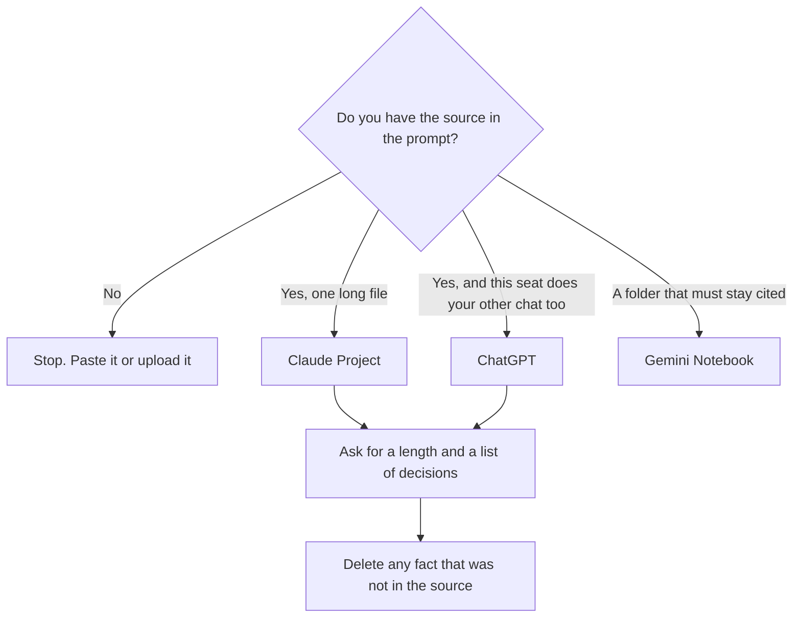

**A summary is only as good as the source you pasted and the length you demanded.** Claude fits when that source is a long file you will revise in a Project. ChatGPT fits when the summary shares a seat with images, custom GPTs, or other daily chat. Neither one may invent a decision that was not in the source. If you did not bring the text, you are not summarizing. You are asking for a guess.

The writing choice beside this is [ChatGPT vs Claude for writing](/blog/chatgpt-vs-claude-for-writing-2026/). The long-file choice, including Gemini, is [Claude vs Gemini for long documents](/blog/claude-vs-gemini-for-long-documents-2026/). The meeting version is [how to summarize meetings with AI](/blog/how-to-summarize-meetings-with-ai-2026/).

Prices are US list prices excluding tax from directory pages checked October 16, 2026. Published October 24, 2026. We did not score summary accuracy.

## What you are summarizing

| The source | Start here | Why this shape |
|---|---|---|
| One long file, a contract, or a transcript you will keep revising | [Claude](/tools/claude/) | Files, Projects, and Artifacts are on the product, including Free, with usage limits |
| A short thread, plus the rest of your chat workload | [ChatGPT](/tools/chatgpt/) | Plus at $20 also covers projects, images, and custom GPTs |
| A folder that must be cited, not paraphrased from memory | [Gemini Notebook](/tools/gemini-notebook/) | The notebook stays on the files you uploaded. Free with a Google account |
| The summary has to live on the team page | [Notion AI](/tools/notion-ai/) Business at $20 a seat | A chat is not the archive |
| A meeting you were in | [Granola](/tools/granola/) or [Fireflies](/tools/fireflies-ai/) | Notes from the meeting, then a summary. Do not summarize from memory of the meeting |

## The seats, without a quality crown

**Claude Free** includes file upload and up to five Projects, with usage limits. That is enough to learn whether you like the way it compresses a document. **Pro is $20 a month, or $17 billed annually.** Max from $100 is 5× or 20× Pro usage. Buy Max when a summary-heavy day hits the cap, not because the PDF is long. A long file on a quiet week can fit on Pro. The capacity split is [Claude Pro vs Max](/blog/claude-pro-vs-max-2026/). The ceiling this directory has recorded for Claude is context windows of up to 1 million tokens, depending on the model. That is not a promise your PDF fits. The practical limit is [what a context window is](/blog/what-is-a-context-window-2026/).

**ChatGPT Free** exists. **Plus is $20. Go is $8.** Pro from $100 is the capacity step after Plus runs out. Use a Project for a recurring summary, such as a weekly customer thread. Do not use a custom GPT as a hidden source of facts. The split is [ChatGPT Projects vs custom GPTs](/blog/chatgpt-projects-vs-custom-gpts-2026/). The ladder is [ChatGPT Go vs Plus vs Pro](/blog/chatgpt-go-vs-plus-vs-pro-2026/).

**Gemini Notebook** is the third option when the rule is "every sentence comes from these files." Google AI Plus at $4.99 adds notebook room. That workflow is [Gemini Notebook study workflows](/blog/gemini-notebook-study-workflows/). It is a better summary tool than either chatbot when you do not want the model to leave the packet.

## The prompt that keeps a summary honest

"Summarize only the source below. Use headings: decisions, open questions, owners, dates. If a date or an owner is not in the source, write 'not in source.' Do not add background. Maximum 200 words."

Then read it against the source, not against your memory of the source. A smooth paragraph with a new number in it is [a hallucination](/blog/what-is-ai-hallucination-2026/). The pass is [how to fact-check AI writing](/blog/how-to-fact-check-ai-writing-2026/).

A meeting summary has a further rule. One notetaker, with consent. Granola Business is $14 per user a month and keeps history past Basic's 30 days. Fireflies Pro is $10 per user billed annually, or $18 monthly. Paste the decision lines into the summary. A side comment will become a decision if you ask for "the key takeaways" with no cap. The field guide is [Fireflies alternatives](/blog/fireflies-alternatives-2026/). The agenda those notes should have followed is [how to create meeting agendas with AI](/blog/how-to-create-meeting-agendas-with-ai-2026/).

If the source is bigger than the window, do not paste a random middle. Retrieve the passages that match the question. That method is [what RAG is](/blog/what-is-rag-explained-2026/).

## FAQ

### Which model writes better summaries?

This page does not know, for your documents. Run the same source through Claude Free and ChatGPT Free. Keep the one you had to correct less. A leaderboard from someone else's corpus will not survive your transcript.

### How long should a summary be?

Short enough that a person who missed the meeting will read it. State the length in the prompt. "Comprehensive" produces a second document. A decision list plus owners is usually the summary. The rest is minutes.

### Can I summarize a meeting I did not record?

You can summarize notes you took. You cannot honestly summarize a conversation you did not capture. Write "from my notes," and leave out anything you are unsure you heard.

### Should the summary mention that AI wrote it?

If a customer or a regulator will see it, follow the rule your team already has. The model should not decide that disclosure. A person sends it. That step is [what human-in-the-loop AI is](/blog/what-is-human-in-the-loop-ai-2026/).

## Last verified

October 16, 2026 for Claude, ChatGPT, Notion, Granola, Fireflies, and Gemini Notebook prices named above. The 1 million token Claude ceiling is the figure recorded on the long-document comparison from the October 16 directory check. Published October 24, 2026.

**Sources:** [Claude pricing](https://claude.com/pricing), [ChatGPT pricing](https://chatgpt.com/pricing), [Notion pricing](https://www.notion.com/pricing).

*Published by Andrew for [AI Tools Optimizer](https://aitoolsoptimizer.com).*

[Claude](/tools/claude/) is in the [chatbots and assistants directory](/tools/category/chatbots-assistants/). Directory pages may use affiliate links. A purchase through them may earn us a commission at no extra cost to you.
