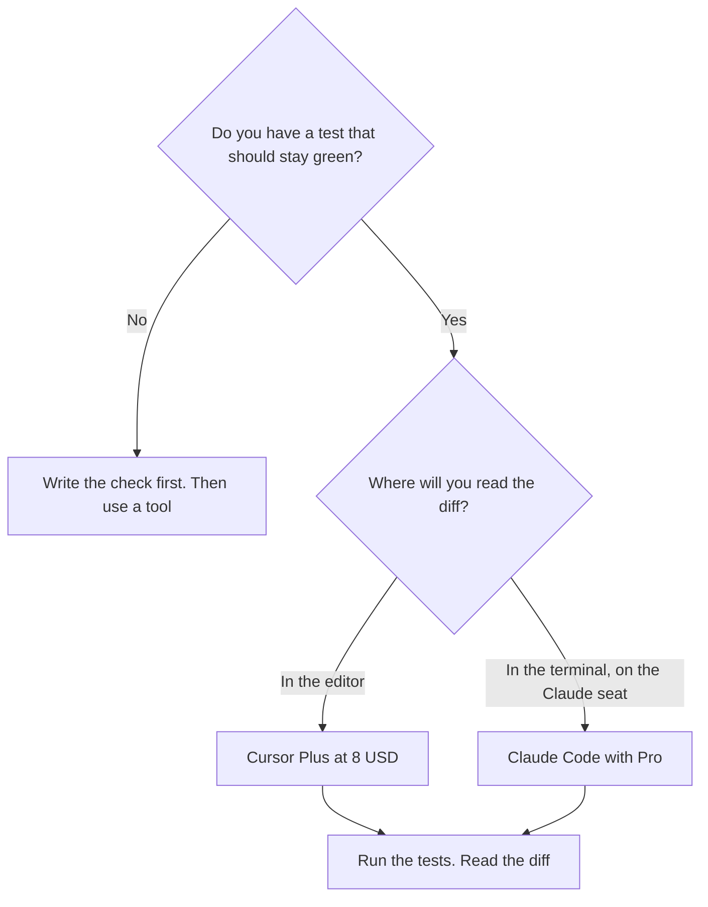

**Use Cursor when the refactor should happen in the editor, on a repository you already have open, and you want to read the diff in that tree. Use Claude Code when you want a terminal agent on the Claude seat and you will still read the diff before you merge.** A refactor is a behavior-preserving change across files, proved by tests you already trust. It is not a vibe that the code looks cleaner. Neither product is a reason to skip the tests.

The three-way with Codex is [Cursor vs Claude Code vs Codex](/blog/cursor-vs-claude-code-vs-codex-2026/). The seat question against ChatGPT is [ChatGPT vs Claude for coding](/blog/chatgpt-vs-claude-for-coding-2026/). Cursor's bill is [Cursor pricing explained](/blog/cursor-pricing-explained-2026/).

Prices are US list prices excluding tax from directory pages checked October 16, 2026. Published October 24, 2026. We did not score refactors.

## What a refactor needs, before the logo

| You already have | Start here | First paid step | Stop if |
|---|---|---|---|
| The repo open in an editor, and a test command | [Cursor](/tools/cursor/) | Plus is $8 a month, or $80 a year, on The X Subscription | There is no test that would catch the break |
| A Claude habit, and you want the agent in the terminal | [Claude Code](/tools/claude-code/), on [Claude](/tools/claude/) Pro | Pro is $20 a month, or $17 billed annually. Claude Code is not on Free | You will not read the patch |
| Completions inside the IDE you already use | [GitHub Copilot](/tools/github-copilot/) | Pro is $10. Free is 2,000 completions a month | The change is too wide for tab-complete and you are pretending it is not |
| The coding agent should live in ChatGPT | [ChatGPT](/tools/chatgpt/) Plus, with Codex | Plus is $20 | You wanted an editor, not another chat |
| A prototype that is not in a repo yet | Not a refactor | Build it somewhere else, then import it | You are renaming files in a demo and calling it a refactor |

## The two bills

**Cursor** on The X Subscription is Free, Plus $8, Premium $30, Super $100, and Ultra $200 a month, or $80, $300, $1,000, and $2,000 a year. Free includes Agent, Chat, and Tab with limited usage. Plus is the step when the limit is the issue and you are in the editor daily. Premium is recorded as 4× Plus usage. Ultra is headroom, not a quality tier. Teams seats are $30, $100, or $200. Legacy Pro at $20 still exists for people who already have it. The review is [Cursor review](/blog/cursor-review-2026/). The shelf is [best AI coding assistants](/blog/best-ai-coding-assistants-2026/).

For a refactor, Cursor's advantage is that the files are already in the window. You can refuse a hunk. An agent that "cleans up" a module will also rename a public function and update half the callers. The tests are the backstop. Your eyes are the other one. A copilot suggests. An agent edits. The definition is [what an AI copilot is](/blog/what-is-an-ai-copilot-2026/).

**Claude Code** is included with Claude Pro and Max. Pro is $17 a month billed annually, or $20 monthly. Max is $100 or $200 a month, with the same amounts in API credits, for people who already hit Pro's cap. There is no free Claude Code. It runs in the terminal, IDEs, the desktop app, the web, and Slack. Auto mode is the default on Pro, Max, and Team, on the directory card. The review is [Claude Code review](/blog/claude-code-review-2026/). The beginner path is [Claude Code for beginners](/blog/claude-code-for-beginners-2026/). The seat ladder is [Claude Pro vs Max](/blog/claude-pro-vs-max-2026/).

Claude Code is the better fit when you already want Claude for the written explanation of the refactor, and the patch can be reviewed as a diff in git. It is a worse fit when you wanted to click through hunks in an editor you will live in after the branch merges. You can use the IDE surface. You do not have to pretend the $20 seat is an $8 editor.

[GitHub Copilot](/tools/github-copilot/) Pro at $10 stays in the editor you have, with $15 in monthly credits. Business at $19 adds admin controls and IP indemnity. Use it when the refactor is a series of small edits and a suggestion is enough. Use Cursor or Claude Code when you are asking for a multi-file change. The comparison is [Cursor vs GitHub Copilot](/blog/cursor-vs-github-copilot-2026/).

## A refactor prompt that does not invite a rewrite

Name the behavior that must not change. Name the tests to run. Name the files in scope, and the files out of scope. Ask for a diff, not a new architecture. Paste one example of the style you want kept. That example is [what few-shot prompting is](/blog/what-is-few-shot-prompting-2026/).

Then run the tests. If they fail, the refactor is not done, even if the diff looks quieter. If they pass and you do not understand a hunk, do not merge it. The person who merges is [what human-in-the-loop AI is](/blog/what-is-human-in-the-loop-ai-2026/).

QA that lives downstream of this diff is [best AI tools for QA engineers](/blog/best-ai-tools-for-qa-engineers-2026/). The team that owns the pipeline around the repo is [best AI tools for DevOps teams](/blog/best-ai-tools-for-devops-teams-2026/).

## FAQ

### Is Claude Code included with Cursor?

No. Claude Code comes with a paid Claude plan. Cursor Plus is a separate $8 subscription on The X Subscription. You can pay for both. Do it when you actually use both, not to settle an argument.

### Which one is safer for a large refactor?

The one whose diff you will read, in the place you will read it, with tests that fail when behavior changes. This page did not measure which model breaks less. A large refactor without tests is unsafe on either logo.

### Should I use Max or Cursor Ultra?

Only when the cheaper seat runs out on work you are still reviewing. Max from $100 and Ultra at $200 are capacity. They are not a refactor quality tier.

### Can I refactor in ChatGPT instead?

Plus includes Codex. That is a third home for the agent. If the review happens in Cursor anyway, start there. The Gemini and ChatGPT seat question is [ChatGPT vs Gemini for coding](/blog/chatgpt-vs-gemini-for-coding-2026/).

## Last verified

October 16, 2026 for Claude, Claude Code, Cursor, GitHub Copilot, and ChatGPT prices named above. Published October 24, 2026.

**Sources:** [Claude pricing](https://claude.com/pricing), [Cursor pricing](https://cursor.com/help/account-and-billing/pricing), [GitHub Copilot](https://github.com/features/copilot).

*Published by Andrew for [AI Tools Optimizer](https://aitoolsoptimizer.com).*

[Cursor](/tools/cursor/) is in the [coding directory](/tools/category/coding/). Directory pages may use affiliate links. A purchase through them may earn us a commission at no extra cost to you.
