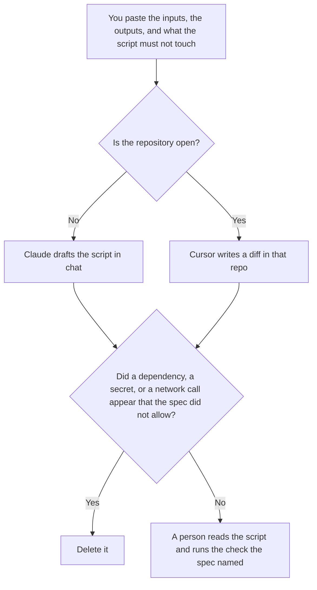

**Use Claude when you want a script drafted in chat from a spec you pasted, and a person will copy it into a repository after reading it. Use Cursor when the script should be written as a diff in the repository you already have open.** A script here is a new file that does the job the spec describes: inputs, outputs, and what it must not touch. It is not a refactor of code that already behaves correctly. The editor-versus-terminal choice for that kind of change is [Claude vs Cursor for refactors](/blog/claude-vs-cursor-for-refactors-2026/). A small fix with a failing test is [Cursor vs Claude Code for bugfixes](/blog/cursor-vs-claude-code-for-bugfixes-2026/).

The three-way with Codex is [Cursor vs Claude Code vs Codex](/blog/cursor-vs-claude-code-vs-codex-2026/). Cursor's bill is [Cursor pricing explained](/blog/cursor-pricing-explained-2026/).

Claude's prices are the October 24, 2026 read of claude.com/pricing recorded in [Claude pricing explained](/blog/claude-pricing-explained-2026/). Cursor's prices are the October 16 directory card, restated in the Cursor pricing article. GitHub Copilot's comparison price is the October 16 figure recorded in [GitHub Copilot vs Cursor pricing](/blog/github-copilot-vs-cursor-pricing-2026/). Published October 24, 2026. We did not score scripts. We did not run the drafts.

## What you have open

| The job | Start here | First paid step | The limit |
|---|---|---|---|
| A spec in a paste, no repo open yet | [Claude](/tools/claude/) | Pro is $17 a month billed annually, $200 up front, or $20 monthly | The script matches the spec. A person copies it |
| A repo is open and the script must be a diff | [Cursor](/tools/cursor/) | Plus is $8 a month, or $80 a year | You read the diff. The model does not merge it |
| The script is a one-file draft you will throw away | [ChatGPT](/tools/chatgpt/) | Plus is $20 a month | Same spec rule. No extra files |
| You already pay for completions in another editor | [GitHub Copilot](/tools/github-copilot/) | The $10 comparison is in the pricing article | This page does not move you off that seat to write one script |

A script that reads a credential from the environment because it was "easier" has widened the spec. If the spec does not name a network call, the draft does not add one. If the output path is missing, the draft says Output path not set. It does not pick a directory.

Claude Free can draft a short snippet. Pro is the seat you keep the spec in, so a later edit does not add a flag. Team standard seats are $20 a seat a month billed annually, or $25 monthly, when the spec is a company record, as recorded in [Claude Team pricing explained](/blog/claude-team-pricing-explained-2026/). The review is [Claude review](/blog/claude-review-2026/).

Cursor Plus is the new-customer seat at $8, or $80 a year. Premium is $30 or $300. Teams seats are $30, $100, or $200 a month, matching the usage tier, in the pricing article. Legacy Pro at $20 is a plan you might already be on. It is not the new-customer price. The review is [Cursor review](/blog/cursor-review-2026/).

## What the script is allowed to do

The inputs you named, the outputs you named, and the libraries you named. A retry loop the spec did not ask for stays out. A log line that prints a secret stays out. The person who copies the chat draft into the repo is doing a review, not a favor. The person who accepts the Cursor diff is doing the same review in the tree.

**Claude Pro** is the spec-in-chat path. Keep the spec in the Project. A version that adds a third-party API is the version you delete.

**Cursor Plus** is the diff path. The file lands where the repo expects it. You read the diff before you commit. The side-project habit, if this script is not for work, is [how to use Cursor for a side project](/blog/how-to-use-cursor-for-a-side-project-2026/).

**ChatGPT Plus** is the throwaway draft when you do not need a Project. The same spec rules apply. The ladder is [ChatGPT pricing explained](/blog/chatgpt-pricing-explained-2026/).

A prompt that holds the line:

"Draft the script from the inputs, the outputs, and the libraries I pasted. If the output path is missing, write Output path not set. Do not add a network call. Do not add a dependency. Do not read a secret."

## What not to delegate

Do not ask the model to "make it production ready" without a spec for production. Do not commit a diff you did not read. Do not paste a live credential so the script can be tested in chat. The author owns the merge. A script that runs once on sample data is not a finished job unless the spec said that was the job.

## FAQ

### How is this different from Claude vs Cursor for refactors?

That page is a behavior-preserving change across files that already exist, proved by tests you trust. This page is a new script from a spec. Cursor is the editor on both pages when the repo is open. Claude on this page is the chat draft. The refactor page's Claude seat is the terminal agent. Do not use a refactor prompt to invent a new script, and do not call a new script a refactor because the diff is small.

### How is this different from a bugfix?

A bugfix starts from a failure you can point at. A script starts from a job that does not have a file yet. The bugfix page compares Cursor with Claude Code. This page compares Claude chat with Cursor. If a test is already failing, use the bugfix page.

### Do I need Cursor Teams to add a script?

Plus is the new-customer seat for a person writing a diff, at $8 or $80 a year, on the pricing article. Teams is the company seat at $30, $100, or $200. One script does not require Teams. Shared admin is a reason to read the Teams article, which is [Cursor Business pricing explained](/blog/cursor-business-pricing-explained-2026/). This page does not restate those company tiers as a script feature.

### Who may merge it?

The person who owns the repository path. A chat transcript is not a merge. A diff the model wrote is not a merge. The spec's "must not touch" list is still in force after the file exists.

## Last verified

October 24, 2026 for Claude, via the pricing article. October 16, 2026 for Cursor, with the ladder restated in the Cursor pricing article. ChatGPT's Plus price is the October 24 plan page. Published October 24, 2026.

**Sources:** [Claude pricing](https://claude.com/pricing), [Cursor pricing](https://cursor.com/help/account-and-billing/pricing), [ChatGPT and Codex pricing](https://learn.chatgpt.com/docs/pricing).

*Published by Andrew for [AI Tools Optimizer](https://aitoolsoptimizer.com).*

[Cursor](/tools/cursor/) is in the [coding directory](/tools/category/coding/). Directory pages may use affiliate links. A purchase through them may earn us a commission at no extra cost to you.
