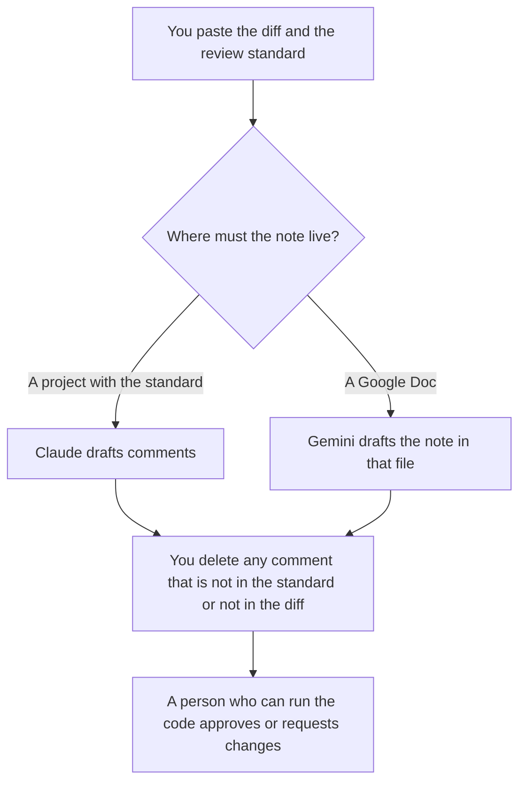

**Use Claude when the review comment has to follow a written standard you keep in a Project, and you paste the diff. Use Gemini when the review note has to land in a Google Doc the team already uses.** Neither tool approves the change. A person who can run the code still does.

The in-editor pair, which is a different job, is [Cursor vs GitHub Copilot for refactors](/blog/cursor-vs-github-copilot-for-refactors-2026/). The shelf of coding assistants is [best AI coding assistants](/blog/best-ai-coding-assistants-2026/). Claude's coding product, which is not this paste-a-diff note, is [Claude Code review](/blog/claude-code-review-2026/).

Prices are US list prices excluding tax from directory pages checked October 16, 2026. Published October 24, 2026. We did not score review comments, and we did not measure how many bugs either model finds.

## Which seat matches the note

| The review you actually have | Start here | What you still do |
|---|---|---|
| A short diff you can paste once | [Claude](/tools/claude/) Free or [Gemini](/tools/gemini/) Free | You keep, edit, or delete each comment |
| The same review standard every week | Claude Pro at $20 a month, or $17 billed annually | The Project holds the standard. Comments that are not in the standard come out |
| The note must live in a Google Doc | Gemini, free, or Google AI Pro at $19.99 a month | Pro is the directory's row for Gemini in Docs |
| The comment should sit on the lines in the editor | [Cursor](/tools/cursor/) Plus at $8 a month, or $80 a year | This pair is the wrong tool for an inline edit. Use the editor |
| The comment should sit in GitHub's review box from Copilot | [GitHub Copilot](/tools/github-copilot/) Pro at $10 a user a month | Again, a different product. The invoice is its own page |

Claude Max starts at $100. A review note does not need it. Google AI Plus is $4.99 a month. Buy Plus when you need that card's video and storage, not because a diff requires it. Pro at $19.99 is the row the directory ties to Gemini in Gmail and Docs. Chat is not a substitute for running the tests.

## What the comment may say

A comment may point at a line in the diff and a rule in the standard you pasted: a missing test you named, a behavior the standard forbids, or a question. It may not claim the change is safe. It may not invent a ticket number, a performance percent, or a line that is not in the paste. If the diff is missing, the note says Diff missing.

**Claude Pro** is the paid path when the standard is long and should stay next to last month's comments. The review is [Claude review](/blog/claude-review-2026/).

**Gemini** is the paid path when the note is a Doc. Free Gemini can draft one note. The review is [Gemini review](/blog/gemini-review-2026/). The ladder is [Gemini pricing explained](/blog/gemini-pricing-explained-2026/).

**Cursor and Copilot** are the neighbors when the review happens where the code is. Plus is $8. Copilot Pro is $10. The Copilot invoice is [GitHub Copilot pricing explained](/blog/github-copilot-pricing-explained-2026/). Do not add those seats to a Claude bill and call the sum a better review.

A prompt that holds the line:

"Draft review comments from the diff and the standard I pasted. Quote the line. Name the rule. Do not say the change is approved. Do not invent a line that is not in the diff. If the diff is missing, write Diff missing and stop."

## What not to delegate

Do not paste a private repo into a personal account your company forbids. Do not ask which comments to "skip so the author feels good." Do not treat a clean comment list as a passing test. The person who runs the code is [what human-in-the-loop AI is](/blog/what-is-human-in-the-loop-ai-2026/).

## FAQ

### Can Claude or Gemini replace the reviewer?

They can draft comments on a diff you provide. They do not run the program unless you are in a tool that does, and even then you read the result. Approval stays with a person who can be wrong in public and fix it.

### What if the standard and the diff disagree?

Say so. A comment that rewrites the standard to match the diff has left the job. The standard changes in its own review, not inside a comment draft.

### Is Gemini in a Doc as good as a review on the pull request?

It is a note in a Doc. It is not attached to the line in the pull request unless a person puts it there. If the team reviews in GitHub, the Doc is a draft you copy. Do not leave the decision only in the Doc.

### Do I need Pro on both?

No. One seat, in the place the note lives. Buy the second when a second place is real. A weekly Doc does not require Claude Max, and a Project does not require Google AI Ultra.

## Last verified

October 16, 2026 for Claude, Gemini, Cursor, and GitHub Copilot. Published October 24, 2026.

**Sources:** [Claude pricing](https://claude.com/pricing), [Google AI pricing](https://gemini.google/subscriptions/), [Cursor pricing](https://cursor.com/help/account-and-billing/pricing), [GitHub Copilot plans](https://github.com/features/copilot).

*Published by Andrew for [AI Tools Optimizer](https://aitoolsoptimizer.com).*

[Claude](/tools/claude/) is in the [chatbots and assistants directory](/tools/category/chatbots-assistants/). Directory pages may use affiliate links. A purchase through them may earn us a commission at no extra cost to you.
