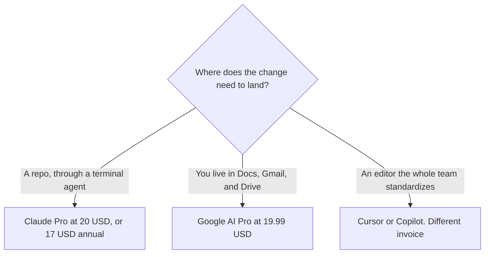

**Choose Claude Pro, $20 a month or $17 billed annually, when the coding work should include Claude Code in the terminal. Choose Google AI Pro at $19.99 a month when you want Gemini's higher usage and the assistant inside Google's apps, and you will still review every diff.** The directory does not describe Gemini as a terminal coding agent on the same line as Claude Code. This page will not invent that feature or a benchmark winner.

The other pair, ChatGPT against Claude, is [ChatGPT vs Claude for coding](/blog/chatgpt-vs-claude-for-coding-2026/). Claude Code's own page is [Claude Code review](/blog/claude-code-review-2026/). Gemini's seat is [Gemini review](/blog/gemini-review-2026/). An editor seat is a third decision: [Cursor vs GitHub Copilot](/blog/cursor-vs-github-copilot-2026/).

Prices are US list prices excluding tax from directory pages checked October 16, 2026. Published October 24, 2026. We did not score code.

## The seats a developer can actually buy

| | [Claude](/tools/claude/) | [Gemini](/tools/gemini/) |
|---|---|---|
| Free | Chat, files, code, and Artifacts, with the free limits | Free with a Google account |
| First paid step people mean | Pro: $20 a month, or $17 billed annually ($200 up front). Includes Claude Code | Google AI Plus: $4.99 a month, 2× usage versus Free, 200 Flow credits, 400 GB |
| The coding step on the card | Pro for short sprints. Max at $100 (5×) or $200 (20×) for heavier use, plus API credits of $100 or $200 | Google AI Pro: $19.99 a month, 4× usage versus Free, Gemini in Gmail and Docs, 1,000 Flow credits, 5 TB |
| A higher personal tier | Max, as above | Ultra at $99.99 (5× Pro limits) or $199.99 (20×) |
| Team admin | Team is per seat for 2 to 150 people. The directory card has no public seat dollar, so this page does not invent one | The card prices consumer Google AI plans. It does not list a separate company IDE price here |
| Where the work happens | Claude.ai, and Claude Code in the terminal, IDE, Slack, or web on paid plans | The Gemini app and Google's apps on the plans that include them |

Claude Pro annual is $200 a year, against $240 if you pay $20 each month. Google AI Pro is $19.99 × 12 = $239.88 a year at the monthly rate the card lists. The dollars are close. The products are not. Flow credits and 5 TB of storage are real lines on the Gemini card, and they are not a pull request.

## What to pay for, and what to review

**A small service and a person who will read the diff.** Claude Pro. Anthropic's card describes Pro as suited to short coding sprints in small codebases, and Max for larger ones. That is their guidance, not a measurement we ran. Start on Pro. Move to Max when you hit the limit, not because a launch blog said so.

**Explanations next to a design doc in Google Docs.** Gemini on Google AI Pro, because the card puts Gemini in Docs on that plan. Plus at $4.99 is the cheaper step when 2× usage is enough and you do not need that bundle. Free is a fair test.

**A team that wants one IDE.** [Cursor](/tools/cursor/) team seats start at $30 a month for new customers. [GitHub Copilot](/tools/github-copilot/) Business is $19 a user a month. Claude and Gemini can still explain a function. They do not replace the admin seat. The team page for Cursor is [Cursor vs GitHub Copilot for teams](/blog/cursor-vs-github-copilot-for-teams-2026/).

**A refactor with tests.** The Claude-and-editor version of that job is [Claude vs Cursor for refactors](/blog/claude-vs-cursor-for-refactors-2026/). Paste the failing test. Reject any change that does not keep the test you wrote.

Generated code that calls a library you do not have is still [a hallucination](/blog/what-is-ai-hallucination-2026/). The person who merges is [what human-in-the-loop AI is](/blog/what-is-human-in-the-loop-ai-2026/).

## FAQ

### Is Google AI Pro a Claude Code equivalent?

The directory does not say that. It says Pro includes higher Gemini usage, Gemini in Gmail and Docs, Flow credits, and storage. Claude Code is listed as included with Claude Pro and Max. Buy the product whose surface you will open.

### Can I use both?

Yes. Many people draft in Gemini next to a doc and send a patch through Claude Code. You will pay both seats. $17 a month annual for Claude plus $19.99 for Google AI Pro is $36.99 in a typical month, before tax, using those recorded rates.

### Which model is better at algorithms?

We did not run a benchmark. Use the free tiers on a task from your repo, read the diff, and keep the seat that fits the surface. A leaderboard is not your test suite.

### Does Claude Team have a price I can budget?

Not from the directory card we used. Team covers 2 to 150 people with central billing. Ask checkout for the seat price. Do not copy a number from a secondary blog into a budget.

## Last verified

October 16, 2026 for Claude, Gemini, Cursor, and GitHub Copilot. Published October 24, 2026.

**Sources:** [Claude pricing](https://claude.com/pricing), [Google AI subscriptions](https://gemini.google/subscriptions/), [GitHub Copilot](https://github.com/features/copilot).

*Published by Andrew for [AI Tools Optimizer](https://aitoolsoptimizer.com).*

[Claude Code](/tools/claude-code/) is in the [coding directory](/tools/category/coding/). Directory pages may use affiliate links. A purchase through them may earn us a commission at no extra cost to you.
