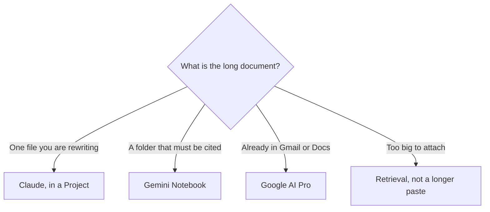

**Use Claude when one long file, or a Project of files, is the document you are writing and revising. Use Gemini Notebook when the rule is that every sentence has to come from sources you uploaded. Use Google AI Pro when the long document is already a Gmail thread or a Google Doc.** Those are three surfaces. A bigger chat window is not a strategy for a folder.

The ceiling this directory has recorded for Claude is context windows of up to 1 million tokens, depending on the model, checked October 16, 2026. That is not a promise that your PDF fits, and it is not a figure this site has recorded for Gemini. The practical limit is [what a context window is](/blog/what-is-a-context-window-2026/). Retrieval over a corpus that does not fit is [what RAG is](/blog/what-is-rag-explained-2026/).

Prices are US list prices excluding tax from directory pages checked October 16, 2026. Published October 24, 2026. We did not score summary accuracy.

## Which long document you actually have

| The material | Start here | Why |
|---|---|---|
| A contract, a paper, or a transcript you will revise in chat | [Claude](/tools/claude/) | Files, Projects, and Artifacts are on the product, including Free, with usage limits |
| A stack of PDFs, Docs, and Slides that must be cited | [Gemini Notebook](/tools/gemini-notebook/) | The notebook stays on those sources |
| The thread is in Gmail, or the draft is a Google Doc | [Gemini](/tools/gemini/) on Google AI Pro | Pro at $19.99 lists Gemini in Gmail and Docs |
| The team wiki is the document | [Notion AI](/tools/notion-ai/) | Business at $20/seat is the system of record |
| You also need images, custom GPTs, or Codex | [ChatGPT](/tools/chatgpt/) Plus at $20 | A different assistant. The three-way is linked below |

## What you pay to stay in the file

**Claude Free** includes file upload, Artifacts, and up to five Projects, with usage limits. That is enough to learn whether you like the revision style. **Pro is $20 a month, or $17 billed annually.** Pro is more usage, more models, and Claude Code. **Max at $100 or $200** is 5× or 20× Pro usage. Buy Max when a long-document day actually hits the cap, not because the PDF is long. A long file on a quiet week can fit on Pro. A short file pasted fifty times can blow the cap. The capacity split is [Claude Pro vs Max](/blog/claude-pro-vs-max-2026/).

Put the file in a Project with instructions: the questions you always ask, and a line that says to quote the page when a claim depends on it. The container comparison is [Claude Projects vs ChatGPT Projects](/blog/claude-projects-vs-chatgpt-projects-2026/).

**Gemini Notebook is free** with a Google account. Google AI Plus at $4.99 adds notebook room. Google AI Pro at $19.99 is the larger limit, about 5× on the directory card, and it is also the plan that lists Gemini inside Gmail and Docs. Ultra at $99.99 or $199.99 is headroom. The study workflow is [how to study with Gemini Notebook](/blog/gemini-notebook-study-workflows/). Notebook accepts Docs and Slides, which is the practical way a Workspace folder becomes a cited notebook without a second paste.

**Do not pay for both Pro plans on day one.** Run the same packet through Claude Free and through a free notebook. Keep the one you had to correct less. The assistant-level choice, including ChatGPT, is [ChatGPT vs Gemini vs Claude](/blog/chatgpt-vs-gemini-vs-claude-2026/).

## When the file is a figure, a table, or a scan

A text layer and a photograph of a page are different problems. If the number exists only in a chart, ask for that number and the page. If the answer misses it, you uploaded words, not the figure. That case is [what multimodal RAG is](/blog/what-is-multimodal-rag-2026/).

A spreadsheet total is the same test. The tools aimed at the grid are [best AI for Excel and Google Sheets](/blog/best-ai-for-excel-and-google-sheets-2026/). Claude can outline a CSV you trust. It should not be the system of record for the model.

For a public web page, neither Claude nor a private notebook is the citation product. [Perplexity](/tools/perplexity/) Pro at $17 a month billed annually ships links. Mixing a private contract into a web search is the mistake. Keep the contract in the Project or the notebook.

## A way to read without boiling the PDF

1. Write the decision you need in one sentence. "List the termination dates" beats "summarize this."
2. Ask for a table with a location column: page, section, or slide.
3. Open two locations. If either is wrong, stop and fix the source, not the prompt.
4. Delete any sentence that has no location. That sentence is the model writing from training. The failure mode is [what an AI hallucination is](/blog/what-is-ai-hallucination-2026/).
5. Save the table in the Project or the notebook. A chat transcript is a poor archive. The fact-check habit is [how to fact-check AI writing](/blog/how-to-fact-check-ai-writing-2026/).

Claude's 1 million token ceiling, where the model you are on actually has it, still includes your prompt and the reply. A million tokens of contract is not a million tokens of answer. Ask for the table.

## FAQ

### Is Claude's context window larger than Gemini's?

This directory has recorded "up to 1 million tokens, depending on the model" for Claude. It has not recorded a matching Gemini chat figure. Do not treat the absence as a smaller window. Test the file. If it does not fit, use Notebook or retrieval.

### Which Gemini plan reads a long Google Doc in place?

Google AI Pro at $19.99, on the line this site recorded for Gmail and Docs. Notebook, including the free notebook, is the surface for a folder of sources rather than for editing the Doc.

### Can I paste a book into Claude Free?

You can try. Usage limits, not the marketing ceiling, are what stop a free account. If the book is the work, Pro is the usage step. If you will not reread the citations, neither plan is the right spend.

### What about ChatGPT for the same PDF?

Plus at $20 adds projects and a recorded reasoning window of 256K, which the file shares with instructions. Use it when ChatGPT is already the seat. This comparison is Claude versus Gemini because those two are the file and the notebook. The paste-into-chat pattern is the same discipline either way.

## Last verified

October 16, 2026 for Claude, Gemini, Notebook, Notion, and Perplexity prices, and for Claude's recorded context ceiling. October 24, 2026 for the ChatGPT Plus reasoning-window figure cited from the plan comparison. Published October 24, 2026.

**Sources:** [Claude pricing](https://claude.com/pricing), [Google AI subscriptions](https://gemini.google/subscriptions/), [Gemini Notebook](https://workspace.google.com/products/gemini-notebook/).

*Published by Andrew for [AI Tools Optimizer](https://aitoolsoptimizer.com).*

[Gemini Notebook](/tools/gemini-notebook/) is in the [research directory](/tools/category/research-search/). Directory pages may use affiliate links. A purchase through them may earn us a commission at no extra cost to you.
