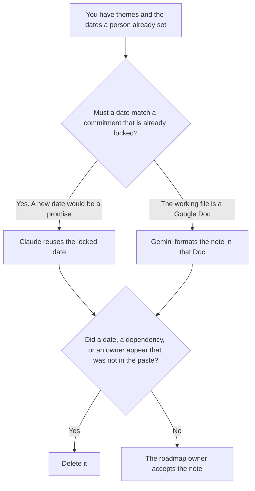

**Use Claude when the roadmap note must reuse dates and commitments a person already locked, and a new date would be a promise. Use Gemini when that note already lives in a Google Doc the team edits.** The model may order the themes. It may not invent a ship date, a dependency, or an owner.

What already happened, which is not this forward note, is [Gemini vs Claude for status reports](/blog/gemini-vs-claude-for-status-reports-2026/). A project update that reports the week is [Gemini vs ChatGPT for project updates](/blog/gemini-vs-chatgpt-for-project-updates-2026/). The page a platform PM uses for a deprecation is [best AI tools for platform PMs](/blog/best-ai-tools-for-platform-pms-2026/).

Claude's prices are the October 24, 2026 read of claude.com/pricing recorded in [Claude pricing explained](/blog/claude-pricing-explained-2026/). Gemini's prices are the October 16 directory figures recorded in [Gemini pricing explained](/blog/gemini-pricing-explained-2026/): Plus is $4.99 a month, Pro is $19.99. Notion is the October 16 directory card. ChatGPT's Plus price is the October 24 plan-page figure recorded in [ChatGPT pricing explained](/blog/chatgpt-pricing-explained-2026/). Published October 24, 2026. We did not score roadmaps.

## Which note you are writing

| The note | Start here | First paid step | The limit |
|---|---|---|---|
| Dates and commitments that must match what you locked | [Claude](/tools/claude/) | Pro is $17 a month billed annually, or $20 monthly | A new date is a new promise |
| The note already lives in a Google Doc | [Gemini](/tools/gemini/) | Google AI Plus is $4.99 a month. Pro is $19.99 | The Doc's dates stay. A blank date stays blank |
| The page leadership will open | [Notion AI](/tools/notion-ai/) | Business is $20 a seat a month | Plus at $10 is not the full AI tier |
| One theme, from a paste, with no locked set yet | [ChatGPT](/tools/chatgpt/) | Plus is $20 a month | No date that was not in the paste |

Claude Pro is the right seat when the roadmap already has a date for a theme and this note is only allowed to point at it. A cleaner quarter is a different promise. If the locked date is missing from the paste, the line says Date not set. Gemini Plus is the right first paid step when the file is already a Google Doc. Pro at $19.99 is the higher individual row on the October 16 card, including Gemini in Docs. The Doc does not gain a date because the plan is Pro.

The status-report page is what happened. A roadmap note is what you are willing to say will happen, and only where a person already set the date. Do not paste last week's status into the roadmap and call it a commitment.

## What the note is allowed to say

The themes, the dates, the owners, and the dependencies you pasted. A "likely" month the model adds stays out. A team the model assigns stays out. If a theme has no date, the theme says Date not set.

**Claude Pro** holds the locked dates in a Project so the next note cannot drift. The review is [Claude review](/blog/claude-review-2026/).

**Gemini Plus** is the Doc you already have. The ladder is [Gemini pricing explained](/blog/gemini-pricing-explained-2026/).

**Notion Business** is where the accepted note lives when Google is not the system of record. The invoice is [Notion AI pricing explained](/blog/notion-ai-pricing-explained-2026/).

**ChatGPT Plus** is one theme from a paste, before a locked set exists. The bill is [ChatGPT pricing explained](/blog/chatgpt-pricing-explained-2026/).

A prompt that holds the line:

"Draft the roadmap note from the themes, dates, owners, and dependencies I pasted. If a date is missing, write Date not set. Do not add a quarter. Do not add an owner."

## What not to delegate

Do not ask which quarter a feature "should" ship. Do not turn a status report into a commitment. Do not publish because the themes look complete. The roadmap owner accepts the note.

## FAQ

### How is this different from a status report?

A status report says what happened. A roadmap note says what you are willing to commit, and only the dates a person already set. The status page does not become the roadmap by being pointed at the future.

### How is this different from a project update?

A project update reports a week of work. A roadmap note is the forward list. An update can mention a date only after the roadmap owner has set it. The update does not set it.

### When is the note a Google Doc problem?

When the team already edits the roadmap in Google Docs. Gemini is the seat for that file. Claude is the seat when the risk is a new date, wherever the file lives. You can draft in Claude and paste the accepted lines into the Doc.

### Who may publish the note?

The roadmap owner named on the note. Date not set stays unpublished as a commitment. A formatted roadmap is not a promise.

## Last verified

October 24, 2026 for Claude and for ChatGPT's plan page, via the posts cited above. October 16, 2026 for Gemini and Notion. Published October 24, 2026. We did not score delivery.

**Sources:** [Claude pricing](https://claude.com/pricing), [Google AI subscriptions](https://gemini.google/subscriptions/), [Notion pricing](https://www.notion.com/pricing), [ChatGPT and Codex pricing](https://learn.chatgpt.com/docs/pricing).

*Published by Andrew for [AI Tools Optimizer](https://aitoolsoptimizer.com).*

[Claude](/tools/claude/) is in the [chatbots and assistants directory](/tools/category/chatbots-assistants/). Directory pages may use affiliate links. A purchase through them may earn us a commission at no extra cost to you.
