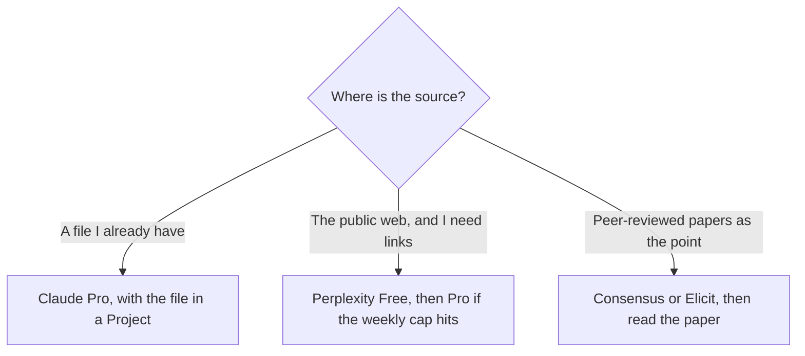

**Use Claude when the sources are files you already have and you want a long read with room to ask follow-ups. Use Perplexity when the job is to search the live web and come back with citations you can click.** Claude will not invent a bibliography of pages it did not see. Perplexity will not replace a PDF sitting in your folder. The ChatGPT version of the web-search choice is [ChatGPT vs Perplexity for research](/blog/chatgpt-vs-perplexity-for-research-2026/). This page is the Claude side of that decision.

The long-file habit against Gemini is [Claude vs Gemini for long documents](/blog/claude-vs-gemini-for-long-documents-2026/). The cost of Perplexity Pro against a $20 drafting seat is [Perplexity Pro vs ChatGPT Plus cost](/blog/perplexity-pro-vs-chatgpt-plus-cost-2026/).

Prices are US list prices excluding tax from directory pages checked October 16, 2026. Perplexity's card does not print a month-to-month Pro dollar. Published October 24, 2026. We did not score citation accuracy.

## Two research jobs

| | [Claude](/tools/claude/) | [Perplexity](/tools/perplexity/) |
|---|---|---|
| Best first job | A packet of files you are allowed to upload | A question the open web can answer, with links |
| Free | Chat, web search, files, code, memory, Artifacts, usage limits, up to 5 Projects | Top models with a weekly cap |
| First paid step | Pro is $20 a month, or $17 billed annually ($200 up front) | Pro is $17 a month billed annually. Monthly costs more. The card does not print that dollar |
| What paid adds | A higher use limit. Claude Code is included. Max is $100 or $200 | Computer, premium data such as PitchBook and Statista, files and apps, model choice |
| Heavy tier | Max at $100 (5× Pro) or $200 (20×), with API credits in that amount | Max is $167 a month billed annually, with 10,000 monthly credits and 35,000 bonus credits |
| What you still do | Open the page the answer cites inside your file | Open the link. A citation is not a reading |

One year of Claude Pro on the annual card is $200, which is $17 a month. Twelve months of month-to-month Pro is 12 × $20 = $240. The $40 gap is the billing toggle. Perplexity Pro at $17 billed annually is also $204 a year if the annual rate holds for twelve months (12 × $17). The stickers match. The jobs do not. Enterprise Perplexity, if you need it, is $40 a user a month for Enterprise Pro ($400 a year) on the directory card. A solo researcher does not start there.

## How to use each one without a fake source

**Claude.** Put the readings in a Project so the next question cannot drift away from the packet. Ask for quotes and page or heading markers you can find. If the file does not say it, the draft should say the file does not say it. Context can be up to 1 million tokens depending on the model, on the directory card. A long window is not a reason to skip the quote. The container is [Claude Projects vs ChatGPT Projects](/blog/claude-projects-vs-chatgpt-projects-2026/). The review is [Claude review](/blog/claude-review-2026/).

**Perplexity.** Start on Free. Move to Pro when the weekly cap is the thing that stops the work, or when you need the premium data sources the card names. Max at $167 a month billed annually is a heavy Computer tier. A literature scan does not need it by default. The review is [Perplexity review](/blog/perplexity-review-2026/). The click-through habit is [how to use Perplexity for market research](/blog/how-to-use-perplexity-for-market-research-2026/).

**When the source has to be a paper.** [Consensus](/tools/consensus/) and [Elicit](/tools/elicit/) are built around the literature, not the open web. Use them when "a blog said so" is the wrong bar. Then read the paper. The product notes are the [Consensus review](/blog/consensus-review-2026/) and the [Elicit review](/blog/elicit-review-2026/).

**A drafting seat you already pay for.** [ChatGPT](/tools/chatgpt/) Plus is $20. It can outline from notes you paste. It is the wrong default when the requirement is a link you did not have five minutes ago. That comparison is the ChatGPT page linked above.

A number that was not in the source is [a hallucination](/blog/what-is-ai-hallucination-2026/). The pass is [how to fact-check AI writing](/blog/how-to-fact-check-ai-writing-2026/). Whether the fetched pages were the right pages is [what retrieval evaluation is](/blog/what-is-retrieval-evaluation-2026/).

## FAQ

### Can I use both?

Yes. Perplexity to find public sources you will actually open. Claude to read the PDFs you downloaded and are allowed to use. Pasting Perplexity's answer into Claude and asking for "more authority" does not create a source.

### Is Pro on either tool required for a short brief?

No. Free on both will show you the shape of the work. Pay when the cap, the file size, or the premium data is the blocker. A partner brief that needs this split is [how to write a partner brief with AI](/blog/how-to-write-a-partner-brief-with-ai-2026/).

### Which one is better for academic papers?

The one that is pointed at papers, which on this site is Consensus or Elicit, plus the PDF. Claude is the reader once you have the PDF. Perplexity is the way you find a public page. Your citation style still comes from you.

### Does Claude's web search make Perplexity unnecessary?

Claude's free plan includes web search, on the directory card. Use it for a quick look. Use Perplexity when the product you want is a cited research pass with the caps and data sources on Perplexity's card. Read both outputs against the links.

## Last verified

October 16, 2026 for Claude, Perplexity, and ChatGPT prices named above. Perplexity's month-to-month Pro dollar was not on the card. Published October 24, 2026.

**Sources:** [Claude pricing](https://claude.com/pricing), [Perplexity pricing](https://www.perplexity.ai/hub/pricing), [ChatGPT pricing](https://chatgpt.com/pricing).

*Published by Andrew for [AI Tools Optimizer](https://aitoolsoptimizer.com).*

[Perplexity](/tools/perplexity/) is in the [research and search directory](/tools/category/research-search/). Directory pages may use affiliate links. A purchase through them may earn us a commission at no extra cost to you.
