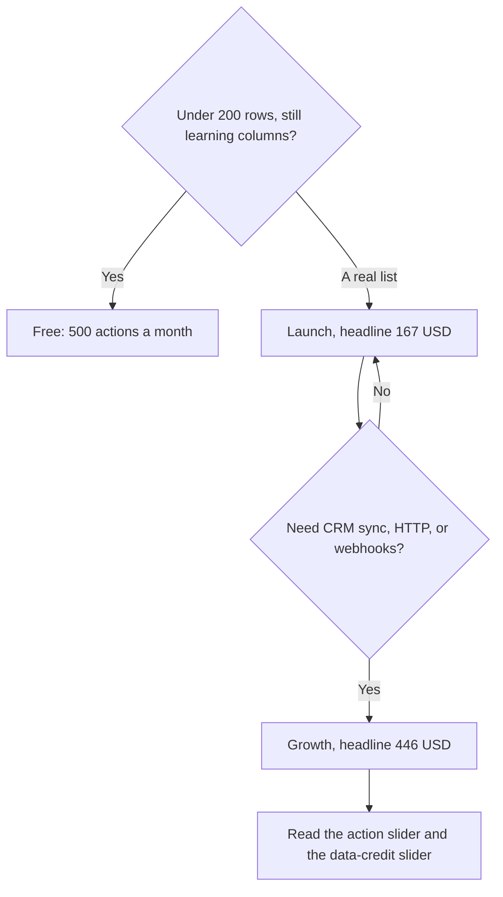

**Clay's annual toggle, read October 24, 2026, shows Launch at $167 a month and Growth at $446 a month.** Those are the headline floors. The same cards carry sliders for actions and for data credits, and the action slider's first row prints lower numbers: about $54 a month on the annual view and about $60 a month on the monthly view for Launch's starting action pack. A quote is both sliders. Annual billing is labeled as saving 10%.

Figures are US dollars from [Clay's pricing page](https://www.clay.com/pricing), fetched October 24, 2026. The page also offers a 14-day trial. The product story is [Clay review](/blog/clay-review-2026/). We did not run a waterfall or score email accuracy.

## Two meters

Actions pay for workflow steps. Data credits pay for provider lookups. Unlimited seats are on the free plan. You pay for rows and lookups, not for every person who can open the table.

| Plan | Headline on the annual toggle | What the card says you start with |
|---|---|---|
| Free | $0 | 500 actions a month (6,000 a year) and 100 data credits a month (1,200 a year). Unlimited seats and tables. Up to 200 rows a table |
| Launch | $167 a month | Starts at 15,000 actions a month, or 180,000 a year. Phone enrichment, Audiences search, job-change signals, Clay email or a sequencing integration |
| Growth | $446 a month | Starts at 40,000 actions a month, or 480,000 a year. CRM auto-sync, warehouse sync, HTTP API, webhooks, web intent |
| Enterprise | Custom | SSO, SCIM, credit budgets, user groups, a dedicated strategist |

Free includes multi-provider waterfalls, Claygent, and bring-your-own API key. Five hundred actions will teach the sheet. They will not enrich a conference list of 800 accounts. The 200-row cap ends that job before the interesting column runs.

## The sliders under the headline

Launch's action rows, as printed on the October 24 fetch:

| Billing view | Starting pack | Next packs the page printed |
|---|---|---|
| Annual actions | 180,000 a year at $54 a month | 480,000 at $135; 720,000 at $180; 1.2 million at $261; 2.4 million at $486 |
| Monthly actions | 15,000 a month at $60 | 40,000 at $150; 60,000 at $200; 100,000 at $290; 200,000 at $540 |

Launch's data-credit rows start at 30,000 a year for $113 a month, or 2,500 a month for $125. The same block also prints "3K data credits/mo" beside that monthly line. If those two labels disagree on your screen, use the selector you are about to buy. Later annual data rows on that fetch were 72,000 a year at $261 a month, 120,000 at $414, 240,000 at $792, and 600,000 at $1,913.

Growth's action rows start at 480,000 a year for $185 a month, or 40,000 a month for $205. The headline above those rows is still $446. Growth data credits on that fetch start at 72,000 a year for $261 a month, or 6,000 a month for $290.

Do not email $54 to finance as "the Launch price." Do not ignore $54 if the checkout is sitting on that action row and a separate data-credit row. Screenshot both. The $167 and $446 headlines are what the cards lead with when the annual toggle is on. Monthly billing is the higher set of figures. The page says annual saves 10%. Open the toggle you intend to buy rather than doing the discount in a spreadsheet.

Bring-your-own-key columns move a provider's price to that vendor's invoice. Clay's subscription does not erase it. A waterfall that tries a second provider after a miss can charge two lookups for one cell.

## Clay next to a database and a sender

[Apollo.io](/tools/apollo-io/) Basic is $49 per seat per month billed annually, with a free plan of 900 credits per seat per year, on the directory card checked October 16, 2026. That is a seat plus a database. Clay is a table. [Instantly](/tools/instantly/) prices sending. Growth at $47 a month is one of two different $47 plans, which [Instantly pricing explained](/blog/instantly-pricing-explained-2026/) separates. [HubSpot](/tools/hubspot/) is the CRM. The directory lists a free CRM and a limited-time Starter from $7 per seat per month, checked October 16, 2026. Confirm the offer. It is time-limited on the card.

A common stack is Clay for the row, Apollo when a waterfall misses a phone, Instantly for the send, and HubSpot for the opportunity. The rep-facing version is [best AI tools for sales teams](/blog/best-ai-tools-for-sales-teams-2026/). The operator version is [best AI tools for RevOps](/blog/best-ai-tools-for-revops-2026/).

Annual Launch at the $167 headline is $2,004 a year before extra data credits. Annual Growth at $446 is $5,352 before the data-credit slider. Those are illustrations of the headlines, not an invoice.

## FAQ

### How much does Clay cost?

On October 24, 2026, with the annual toggle on, the Launch card showed $167 a month and the Growth card showed $446 a month. Free is $0. Enterprise is custom. Sliders under those headlines change the price.

### Is Clay free?

Yes, for 500 actions and 100 data credits a month, unlimited seats, and up to 200 rows a table. Claygent and waterfalls are on that plan.

### Why do I see $54 and $167 on the same card?

$167 is the Launch headline. $54 is the first annual action-volume row the page printed for 180,000 actions a year. Data credits are another row. Add the rows you select.

### Does Clay include a dialer?

The Launch card includes sending email through Clay or an integration. A full outreach seat is a different product. Price Apollo or Instantly for that job.

## Last verified

October 24, 2026, from clay.com/pricing. Apollo, Instantly, and HubSpot comparison prices are from directory pages checked October 16, 2026. Published October 24, 2026.

**Sources:** [Clay pricing](https://www.clay.com/pricing).

*Published by Andrew for [AI Tools Optimizer](https://aitoolsoptimizer.com).*

[Clay](/tools/clay/) is in the [sales directory](/tools/category/sales/). Directory pages may use affiliate links. A purchase through them may earn us a commission at no extra cost to you.
