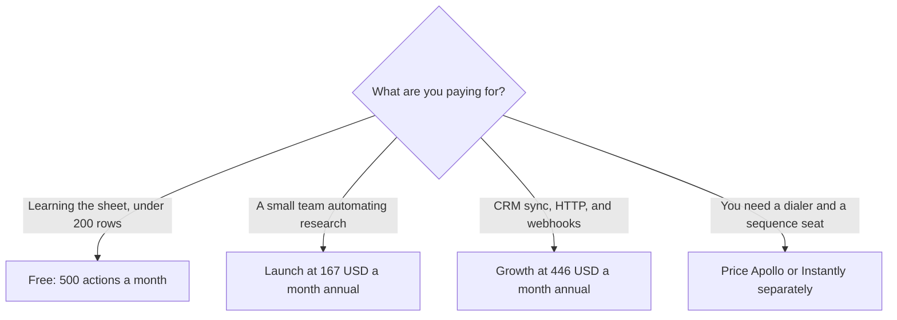

**[Clay](/tools/clay/) is a spreadsheet for go-to-market data.** You add rows of people or companies, then run columns that call data providers, an AI research step Clay calls Claygent, and your own API keys. The bill is not a seat. On October 24, 2026 the pricing page's annual toggle, labeled save 10%, showed Launch at **$167 a month** and Growth at **$446 a month**. Those are floors. The same cards carry volume sliders.

This is a pricing review. We did not run a waterfall, score data accuracy, or measure how often an email comes back valid. Clay's own page is the source for the numbers below.

## Two meters, not one subscription

Clay splits usage into **actions** and **data credits**. Actions cover workflow steps. Data credits cover provider lookups. A plan that looks affordable on actions can still jump when a column buys emails, phone numbers, or firmographics. Unlimited seats are listed on the free plan, which is the point of the product: you pay for rows processed, not for every rep who can open the table.

The free plan, read the same day, includes:

| Free allowance | Amount printed |
|---|---|
| Actions | 500 a month, and 6,000 a year |
| Data credits | 100 a month, and 1,200 a year |
| Seats and tables | Unlimited |
| Rows | Up to 200 per table |
| Research | Claygent, waterfalls across providers, bring your own API key |

Five hundred actions is enough to learn the sheet. It is not enough for a weekly outbound list. Two hundred rows per table is the other free cap. If the job is "enrich this conference list of 800 accounts," free ends before the interesting column runs.

## What the paid cards actually print

| Plan | Price on the annual toggle | Volume the card starts at |
|---|---|---|
| Free | $0 | 500 actions and 100 data credits a month |
| Launch | $167/month | 15,000 actions a month, or 180,000 actions a year |
| Growth | $446/month | 40,000 actions a month, or 480,000 actions a year |
| Enterprise | Custom | Not printed as a self-serve seat |

The invoice is [Clay pricing explained](/blog/clay-pricing-explained-2026/).

The annual control says it saves 10%. Monthly billing is the higher figure on that same page. Do not subtract 10% yourself and email it to finance as if Clay had printed the monthly number. Open the toggle you intend to buy.

The Launch card also prints action-volume lines that start near **$54 a month** for 180,000 actions a year on the annual view, and near **$60 a month** for 15,000 actions a month on the other view. Those lines are the volume control, not a second Launch plan that undercuts $167. Growth's headline is $446, and its card has the same kind of expandable lines. A quote is the slider position plus the data-credit position. Screenshot both before you compare Clay with a per-seat database.

## What the product is for

Clay fits a list you already know how to define. A founder might start with companies that match a narrow ICP, then add columns for a tech install, a recent hire, and a line Claygent writes from the company site. A RevOps person might keep the CRM as the system of record and use Clay as the place where messy enrichment happens before a clean row is pushed back. Growth is the tier whose materials mention CRM auto-sync, HTTP, and webhooks. Launch is the tier for building that workflow before those connections are the reason you pay.

The marketplace is the other cost people forget. Clay sells access to many providers from one sheet, and each provider still has a price in credits. Waterfalls try the next provider when the first one misses. That raises match rate and it also raises the chance you pay twice for one cell. Bring-your-own-key columns move the provider bill to that vendor's invoice. The Clay subscription does not make that invoice disappear.

[Apollo.io](/tools/apollo-io/) is the directory's other large contact database, priced per seat with its own credits. [Instantly](/tools/instantly/) prices sending volume rather than research columns. The [Instantly review](/blog/instantly-review-2026/) separates outreach plans from credit bundles so you do not quote "$47" for the wrong tab. Clay does not replace either tool by existing. A common expensive stack is Clay for the row, Apollo for a phone number the waterfall missed, and Instantly for the send. Add [HubSpot](/tools/hubspot/) if that is where the opportunity has to land. Connecting them is the same class of work as [Zapier vs Make vs n8n](/blog/zapier-vs-make-vs-n8n/).

## A month, as arithmetic

These are illustrations from the printed floors, not a Clay invoice.

A solo operator on annual Launch at $167 is about **$2,004 a year** before extra data credits. If the slider moves to a larger action pack, that $167 is no longer the invoice. A team that needs Growth's integrations starts at $446 a month, about **$5,352 a year** on the annual headline, again before the data-credit slider.

Compare that with a per-seat tool only after you know the seat count. Five seats somewhere else can pass $167 quickly and still not include a waterfall. One heavy data-credit month inside Clay can pass five cheap seats and still not include a sequencer. Write both numbers down. The [subscription worth paying for](/blog/which-ai-subscription-is-worth-paying-for/) is the one whose meter matches the work. Clay's meter is rows and lookups. It is a poor buy if the work is a single mailbox and a script you already trust.

## Who should pay

**Stay on free** while you are still deciding which columns matter and the table stays under 200 rows. **Buy Launch** when 500 actions block a real list and you will use at least the starting 15,000 actions. **Buy Growth** when the requirement is CRM sync, HTTP, or webhooks, not when the word "growth" sounds like a sales target. **Skip Clay** when you need a sequenced send or a dialer and you do not need a research sheet. Pay for the tool that does that job. **Skip the annual toggle** if you are still changing providers every week. A 10% discount is real, and it is also a year of a workflow you might throw away.

Agencies should price Clay per client table, not per employee. Unlimited seats make it tempting to invite every account manager. The invoice will not care how many of them log in. It will care how many rows they enrich on a Monday.

## FAQ

### How much does Clay cost?

On October 24, 2026, with the annual toggle on, Launch was $167 a month and Growth was $446 a month. Free is $0 with 500 actions and 100 data credits a month. Enterprise is custom. The page says annual billing saves 10%.

### Does Clay charge per seat?

The free plan prints unlimited seats and unlimited tables. Paid cards we read are priced from action volume, not from a seat count. Data credits are a second meter.

### What is the difference between an action and a data credit?

Actions are workflow steps. Data credits pay for provider data. A column that calls a data vendor spends credits even when the action budget still looks healthy.

### Is the $54 line a cheaper Launch plan?

No. The Launch headline we read was $167 a month on annual billing. Lower dollar lines on the same card are volume steps for actions. Use the slider total.

### Can Clay send the cold email?

Clay can sit next to a sending tool. It is not the sequencer reviewed in the Instantly piece, and it is not a substitute for a lawful basis to email someone. Your list and your region's rules still apply. A practical sales workflow that stays inside consent, rather than a scraped blast, is the one in [best AI tools for real estate agents](/blog/best-ai-tools-for-real-estate-agents-2026/).

## Last verified

October 24, 2026, from Clay's pricing page, annual toggle visible. Slider prices move. Recheck the toggle and both meters before you send a client a single number.

**Sources:** [Clay pricing](https://www.clay.com/pricing), [Clay](https://www.clay.com).

[Clay](/tools/clay/) is in the [sales directory](/tools/category/sales/). Directory pages may use affiliate links. A purchase through them may earn us a commission at no extra cost to you.
