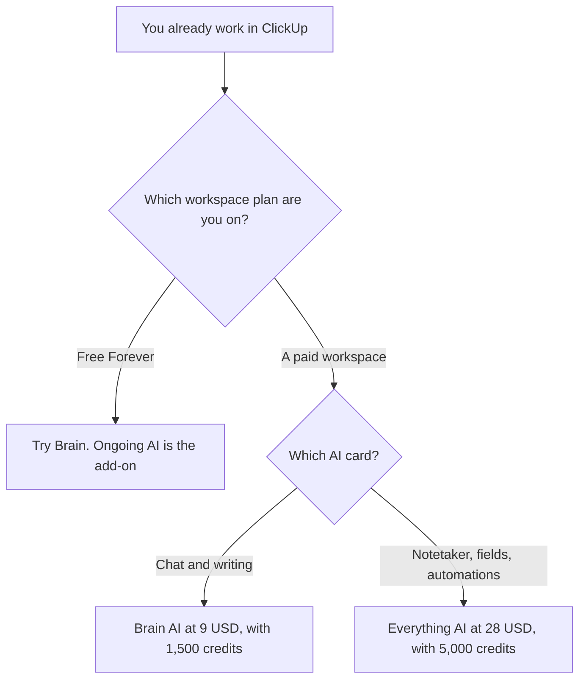

**ClickUp Brain AI is $9 per user per month and includes 1,500 AI Super Credits per user per month. Everything AI is $28 per user per month and includes 5,000 AI Super Credits.** Those two cards were on clickup.com/brain/pricing on October 24, 2026. Brain is an add-on. You also pay for a ClickUp workspace plan. Extra credits on that page were $10 per 10,000, which is $0.001 a credit.

The product page is [ClickUp Brain review](/blog/clickup-brain-review-2026/). The other wiki AI bill is [Notion AI pricing explained](/blog/notion-ai-pricing-explained-2026/). The head-to-head is [Notion AI vs ClickUp Brain](/blog/notion-ai-vs-clickup-brain-2026/).

The directory page checked October 16, 2026 recorded Brain AI from $9 with 1,500 credits and Everything AI at $28, and described Everything as adding Notetaker, AI Fields, Automations, and Super Agents. It did not record the 5,000-credit line. That count is from the October 24 capture. Published October 24, 2026. We did not score answers.

## The AI cards, then the workspace under them

| Item | Price on the October 24 page | What the card listed |
|---|---|---|
| ClickUp Free Forever | $0 | Core ClickUp, with limits. The AI block says you can try AI and that advanced features are a trial |
| Unlimited | $7 per user a month billed yearly, or $10 monthly | The workspace plan under Brain. Unlimited storage on this card |
| Business | $12 per user a month billed yearly, or $19 monthly | Dashboards, more automations, Google SSO on the workspace card |
| Enterprise | Contact sales | The governance card. No public dollar |
| Brain AI | $9 per user a month | Unlimited Brain Assistant, @Brain Agent, AI chat with Claude, ChatGPT, and Gemini, unlimited AI writing, plus 1,500 AI Super Credits |
| Everything AI | $28 per user a month | Unlimited Notetaker, AI Fields, AI Automations, and related items on the card, plus 5,000 AI Super Credits. Image generation is marked with an asterisk the capture did not explain |
| More credits | $10 per 10,000 | $0.001 a credit. Shared across the workspace. Usage varies by complexity, in the page's words |

A line above the AI cards said you can save up to 20% with yearly billing. The capture did not print a second dollar for Brain AI or Everything AI. This page does not compute a discounted AI price the card did not show. The workspace plans did print both yearly and monthly figures. Use those pairs for Unlimited and Business. Use $9 and $28 for the AI cards until checkout shows another number.

The October 24 FAQ says upgrading ClickUp upgrades the whole workspace. Guests on Free Forever are not a paid seat. The same FAQ says a paid Unlimited workspace starts with 5 guest seats for one paid user and 2 more for each additional paid user, and Business starts with 10 and then 5 per additional paid user. Those guest counts are workspace rules, not AI credits.

## What the credits are for

The page says every AI plan includes a monthly credit allowance shared across the workspace. Credits fuel Super Agents, AI Fields, Automations, Image Generation, and more. Regular Brain Assistant use is listed as unlimited on the Brain AI card, separate from the 1,500 credits. If you build many automations, price the credit pack before you price another chat seat.

Everything AI's card lists 3 times more Super Agent usage and the 5,000 credits. The asterisk on unlimited image generation was not defined in the text we kept. Do not assume images are free of credits because the word unlimited is nearby.

**Notion AI** Business is $20 a seat a month if the team lives in Notion and not in ClickUp. Brain's value, on the directory verdict, depends on tasks and docs that are already in ClickUp. The invoice is the Notion article. **ChatGPT** Plus at $20 a month and **Claude** Pro at $20 a month, or $17 billed annually, are general chats. They do not see a ClickUp list unless you paste it or connect a tool you have reviewed. The reviews are [ChatGPT review](/blog/chatgpt-review-2026/) and [Claude review](/blog/claude-review-2026/).

## What not to assume

Do not quote Brain at $9 and forget the workspace plan under it. A Business seat billed monthly is $19 before the $9. Do not quote a 20% discount on the AI card until checkout shows it. Do not treat the asterisk on image generation as permission. Do not mix this page's Unlimited plan with a later block on the same URL that used the name Core without a dollar in the text we kept. Price the card that shows the dollar.

## FAQ

### How much does ClickUp Brain cost?

On October 24, 2026, Brain AI was $9 per user per month with 1,500 AI Super Credits. Everything AI was $28 per user per month with 5,000 credits. Both sit on top of a ClickUp plan.

### Is there a free Brain?

Free Forever can try AI, on that page. Ongoing Brain AI is the $9 add-on. The directory's October 16 note said the same thing in different words: you can try Brain before you buy it.

### What is an AI Super Credit worth?

The page priced additional credits at $10 per 10,000, or $0.001 each. Included credits are the 1,500 or 5,000 on the card you buy. Usage per action varies. The page says so.

### Do I need ClickUp if I only want a chatbot?

No. Brain is the AI inside a ClickUp workspace. If the work lives in Notion, read the Notion pricing article. If the work is a general chat, Plus or Pro is the smaller bill.

## Last verified

October 24, 2026, from clickup.com/brain/pricing. The October 16 directory recorded the $9 and $28 cards and the 1,500-credit line, and did not record the 5,000-credit line. Published October 24, 2026.

**Sources:** [ClickUp Brain pricing](https://clickup.com/brain/pricing), [ClickUp Brain](https://clickup.com/brain).

*Published by Andrew for [AI Tools Optimizer](https://aitoolsoptimizer.com).*

[ClickUp Brain](/tools/clickup-brain/) is in the [productivity and notes directory](/tools/category/productivity-notes/). Directory pages may use affiliate links. A purchase through them may earn us a commission at no extra cost to you.
