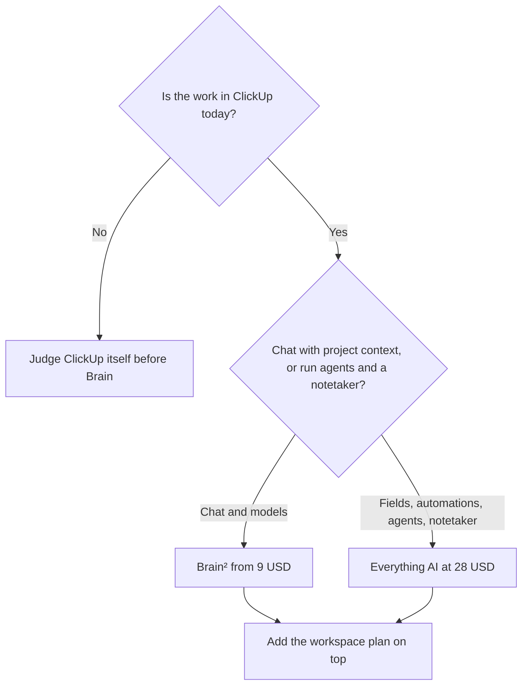

**[ClickUp Brain](/tools/clickup-brain/) answers questions from the tasks, docs, and chat already in ClickUp.** Brain² AI is listed from $9 per user per month, with unlimited Brain² conversations, a choice of premium models, and 1,500 AI Super Credits. Everything AI is listed at $28 per user per month and adds Notetaker, AI Fields, Automations, and Super Agents. The ClickUp workspace is a separate bill: Free Forever, Unlimited at $7 per user per month billed yearly ($10 monthly), or Business at $12 yearly ($19 monthly).

Prices are US dollars from ClickUp's Brain and pricing pages, recorded October 16, 2026. Do not add the $9 and the $28 together unless your checkout shows both as line items. The pages describe them as two AI tiers. Confirm the stack in billing, because a mis-added invoice is a $37 misunderstanding. Tax and currency can differ. We did not benchmark model quality inside ClickUp against the same models in their own apps.

If the wiki is Notion, use the [Notion AI review](/blog/notion-ai-review-2026/). A general "what should I pay for" pass is [which AI subscription is worth paying for](/blog/which-ai-subscription-is-worth-paying-for/).

## The workspace, then the AI

| Line | Price | Role |
|---|---|---|
| Free Forever | $0 | ClickUp itself. You can try Brain² before you buy |
| Unlimited | $7/user/month yearly, $10 monthly | Storage, integrations, Gantt |
| Business | $12/user/month yearly, $19 monthly | Dashboards, automations, timelines |
| Brain² AI | From $9/user/month | Unlimited Brain² chat, premium models, 1,500 AI Super Credits |
| Everything AI | $28/user/month | Notetaker, AI Fields, Automations, Super Agents |

The invoice is [ClickUp Brain pricing explained](/blog/clickup-brain-pricing-explained-2026/).

A person on Business yearly plus Brain² is $12 + $9 = $21 per user per month, if Brain² sits on top of the workspace the way the pages describe. A person who needs the notetaker should price Everything AI at $28 plus the workspace, not Brain² plus Everything, until checkout says otherwise. On Business yearly that reading is $12 + $28 = $40 per user per month.

Conversations in Brain² do not spend Super Credits. Super Credits pay for the heavier actions: Super Agents, AI automations, and AI fields. A team that only asks "what is blocked?" can stay inside the conversation allowance. A team that fills fields on every new task will meet the 1,500-credit meter.

## What the context is worth

Brain routes across models from OpenAI, Anthropic, and Google, and you can pick one. Each model, in ClickUp's description, sees the workspace context you already have permission to see. Admins do not get your private Brain conversations. ClickUp says your data is not used to train third-party models, and it cites SOC 2, ISO 27001, GDPR, and HIPAA among its compliance claims. Those are vendor claims to verify against your security review, not a certification this article re-audits.

The useful question is specific: "What shipped on the Website Redesign list this week, what is blocked, and who owns the blocker?" A vague question returns a vague memo. The model did not attend the meeting. The tasks did, if someone updated them.

Everything AI's Notetaker writes meetings into tasks and docs. If you only need a transcript and you do not live in ClickUp, [Otter](/tools/otter-ai/) publishes a cheaper seat. Pro there is $8.33 per user per month annually. The [Otter review](/blog/otter-ai-review-2026/) has the minute caps. [Motion](/tools/motion/) and [Reclaim](/tools/reclaim-ai/) are the tools to open when the pain is the calendar, not the task list.

ClickUp is a large product. Brain does not remove that learning curve. If the team will not keep tasks current, Brain will summarize a stale workspace with confidence.

## Fit score

| Need | Try it on Free | Brain² from $9 | Everything AI $28 |
|---|---|---|---|
| Ask about tasks you can already see | Yes, as a trial | Ongoing | Ongoing |
| Switch among premium models | Trial | Yes | Yes |
| Unlimited Brain² conversations | Trial | Yes, credits not spent on chat | Included in the higher tier's scope |
| AI fields, automations, Super Agents | No | Super Credits, if your tier includes the feature | The listed home for these |
| Meeting notetaker into tasks | No | No | Yes |
| Worth it with an empty workspace | No | No | No |

Fit follows ClickUp's published split. We did not rate answer accuracy.

## FAQ

### How much does ClickUp Brain cost?

Brain² AI starts at $9 per user per month. Everything AI is $28 per user per month. The ClickUp plan is additional. Confirm both lines at checkout.

### Is it free?

You can try Brain² from the Free Forever plan. Ongoing use is a paid add-on.

### What is an AI Super Credit?

A meter for advanced actions such as Super Agents, AI automations, and AI fields. Brain² includes 1,500 a month. Ordinary Brain² chat does not spend them.

### Can I pick the model?

Yes. ClickUp lists Claude, GPT, and Gemini among the choices, with workspace context on each.

## Last verified

October 16, 2026.

**Sources:** [ClickUp Brain](https://clickup.com/brain), [ClickUp Brain pricing](https://clickup.com/brain/pricing).

[ClickUp Brain](/tools/clickup-brain/) is in the [productivity directory](/tools/category/productivity-notes/). Directory pages may use affiliate links. A purchase through them can earn us a commission at no extra cost to you.
