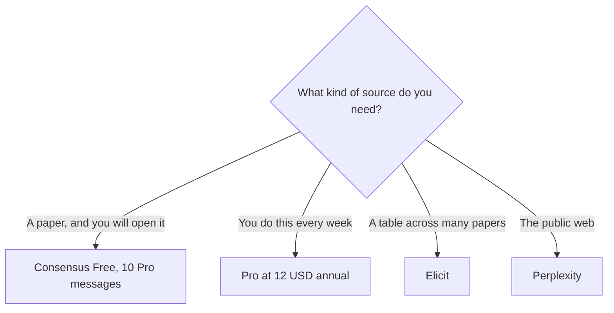

**[Consensus](/tools/consensus/) searches peer-reviewed papers and answers with citations, instead of searching the open web.** Pro is $20 a month, or $144 a year, which is $12 a month. Deep is $65 a month, or $540 a year, which is $45 a month. Free is enough to see whether the papers it returns are the ones you would have found yourself.

Those prices and limits are from Consensus's help-center article "Subscription Plans," updated September 12, 2026, and re-read on October 24, 2026. The pricing page itself is the checkout. We did not score how often the synthesis matches the papers. A citation is a link. Open it.

The web-search desk, which is a different job, is [Perplexity review](/blog/perplexity-review-2026/). The extraction-table tool is [Elicit](/tools/elicit/), reviewed in the [Elicit review](/blog/elicit-review-2026/).

## The plans

| Plan | Monthly | Annual | What the help center lists |
|---|---|---|---|
| Free | $0 | $0 | Unlimited paper searches, 10 Pro messages, 3 Deep reviews, 10 Study Snapshots, 30 API and MCP calls |
| Pro | $20 | $144 ($12/month) | Unlimited Pro messages, 15 Deep reviews, unlimited Study Snapshots, 500 API and MCP calls |
| Deep | $65 | $540 ($45/month) | Everything in Pro, with 200 Deep reviews and 2,000 API and MCP calls |
| Teams | Custom | Custom | Pro features, 50 Deep reviews per user a month, centralized billing, 500 API calls per member. Up to 200 seats, with discounts |
| Enterprise | Custom | Custom | Over 200 users. Email sales. The help center lists 500 API calls per user |

The invoice is [Consensus pricing explained](/blog/consensus-pricing-explained-2026/).

Credits reset on a date you can see under profile, Settings, Subscription. "Unlimited Pro messages" is the help center's phrase for Pro and Deep. Deep reviews stay counted. Do not describe Pro as unlimited literature reviews.

## How to use the allowance

Ask a question a paper could answer. Read the synthesis as a map, then open the studies attached to any claim you might repeat. Free gives you 10 of the heavier Pro messages and 3 Deep reviews a month. That is a real research afternoon, not a teaser, if you spend them on the question you will cite.

Pro is the plan when 10 messages is the thing that stops a weekly habit. At the annual price, $144 is $12 a month, against $20 month to month. The gap is $96 a year. Deep is for someone running many multi-step reviews. Two hundred Deep reviews a month is a lab's volume, not a student's. A dissertation that needs fifteen Deep reviews in a term can stay on Pro.

Teams is not "Pro, but cheaper per person" until you have the quote. The help center says Teams includes Pro features and 50 Deep reviews per user, which is more Deep reviews than individual Pro (15) and far fewer than individual Deep (200). Price Teams against the Deep-review count you need, not against the word Teams.

Consensus is the wrong tool for a draft in your voice. Take the papers to [Claude](/tools/claude/) or [ChatGPT](/tools/chatgpt/) after you have opened them. It is also the wrong tool for "what does the web say this week." That is Perplexity. Students comparing a whole stack should read [best AI tools for students](/blog/best-ai-tools-for-students-2026/).

## Who should pay

**Stay on Free** until you have used the 10 Pro messages on real questions. **Pay for Pro annual** if that cap is the blocker and you will keep the habit. **Pay for Deep** if the Deep-review count, not the name, is the limit. **Skip Consensus** if you need a screening table or figure extraction. That workflow is Elicit's.

## FAQ

### Is Consensus free?

Yes. Free includes unlimited paper searches, 10 Pro messages a month, and 3 Deep reviews a month.

### How much is Consensus Pro?

$20 a month, or $144 a year ($12 a month), on the help-center article updated September 12, 2026.

### Does Pro include unlimited Deep reviews?

No. Pro includes 15 Deep reviews a month. Deep includes 200. Pro messages are the unlimited row.

## Last verified

October 24, 2026, against Consensus's subscription-plans article (dated September 12, 2026). University and team quotes are custom. Recheck the pricing page at checkout.

**Sources:** [Consensus subscription plans](https://help.consensus.app/en/articles/10087865-subscription-plans), [Consensus pricing](https://consensus.app/pricing/).

[Consensus](/tools/consensus/) is in the [research directory](/tools/category/research-search/). Directory pages may use affiliate links. A purchase through them may earn us a commission at no extra cost to you.
