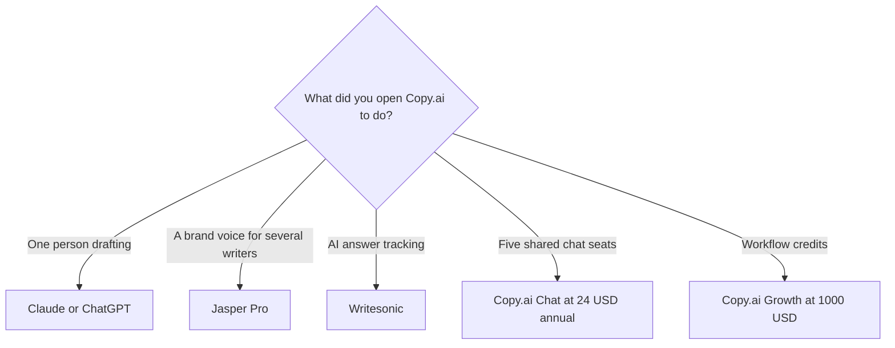

**Leave Copy.ai when you wanted a writing assistant, a stored brand voice, or a search-visibility tracker.** Stay on the Chat plan when five people need a shared multi-model chat and you will not cross into workflow credits. The workflow plans start at $1,000 a month. That jump is the reason most alternatives exist.

[Copy.ai](/tools/copy-ai/) Chat is $29 a month, or $24 billed annually ($288 a year), with 5 seats. Growth, Expansion, and Scale are $1,000, $2,000, and $3,000 a month billed annually, with 20,000, 45,000, and 75,000 workflow credits. The product page is [Copy.ai review](/blog/copy-ai-review-2026/). The three-way is [Jasper vs Copy.ai vs Writesonic](/blog/jasper-vs-copy-ai-vs-writesonic-2026/).

Prices are US list prices excluding tax from directory pages checked October 16, 2026. Published October 24, 2026. We did not score marketing copy.

## Pick by the job you thought Chat would do

| The job | Try | First paid step |
|---|---|---|
| A draft one person will edit | [Claude](/tools/claude/) or [ChatGPT](/tools/chatgpt/) | Claude Pro $20/month or $17 annual. ChatGPT Plus $20. Go $8 |
| A voice, a knowledge base, and an audience saved for a marketing team | [Jasper](/tools/jasper/) | Pro $59/seat/month yearly, or $69 monthly |
| Tracking whether AI answers mention you | [Writesonic](/tools/writesonic/) | Starter $79/month, 50 prompts tracked daily |
| Shared chat for up to five people, several model families | Stay on [Copy.ai](/tools/copy-ai/) Chat | $24/month annually, 5 seats |
| Automated GTM workflows at company scale | Stay, on a workflow plan | Growth $1,000/month billed annually |

The marketing stack around these tools is [best AI tools for marketers](/blog/best-ai-tools-for-marketers-2026/). The writing aisle is [best AI writing assistants](/blog/best-ai-writing-assistants/).

## What the alternatives refuse to bundle

**Claude and ChatGPT are the blank page.** They do not include five seats for $24. They also do not present a $1,000 workflow tier next to the chat box. Paste the offer, the audience, and the facts that must stay put. The method is [how to write a blog post with Claude](/blog/how-to-write-a-blog-post-with-claude-2026/). Buy Plus or Pro when the free cap hits during a work week. A solo newsletter does not need Copy.ai Growth.

**Jasper is the brand vault.** Pro at $59 a seat a month on annual billing includes two Brand Voices, five Knowledge assets, and three Audiences. Business is a custom quote for more. An agency with a voice per client will outgrow Pro. A single freelancer will overpay relative to Claude if they only needed a draft. The review is [Jasper AI review](/blog/jasper-ai-review-2026/).

**Writesonic is the measurement product.** On the annual view read October 24, 2026, Starter is $79 a month, Basic is $199, and Growth is $399. Starter tracks 50 prompts. Extra users are $50 per user per month on that page. Buy it when the question is whether answer engines mention you. Buy a chatbot when the question is the draft. The review is [Writesonic review](/blog/writesonic-review-2026/).

**Copy.ai Chat is still the odd cheap multi-seat.** Five seats at $288 a year is $57.60 a seat if you divide the annual total, against ChatGPT Plus at $20 per person per month if each person buys a seat. The division only matters if all five people use it. Workflow credits are a different product: Growth's 20,000 credits and 75 seats are for automated go-to-market work, with guided onboarding on the larger plans. A blog calendar is not that invoice.

## What not to migrate by accident

A paraphrase tool is a third category. [Grammarly](/tools/grammarly/) Pro at $12 a member a month billed annually edits sentences. It is the last pass, and the alternatives for that pass are [Grammarly alternatives](/blog/grammarly-alternatives-2026/). Copy.ai Chat will also rewrite a sentence, and it is a poor fit if the only habit you wanted was an overlay in the browser.

Search optimization of a draft you already wrote is [Surfer SEO](/tools/surfer-seo/) or [Frase](/tools/frase/). Surfer Standard is $99 a month yearly for 360 documents. Frase Starter is $39 a month yearly for 10 articles. The comparison is [Surfer SEO vs Frase](/blog/surfer-seo-vs-frase-2026/). Those tools score a page. They do not replace a brand-voice vault.

## FAQ

### Is Jasper cheaper than Copy.ai?

Jasper Pro is $59 a seat a month on annual billing. Copy.ai Chat is $24 a month annually for five seats, which is less money and a different feature set. Copy.ai Growth at $1,000 a month is the workflow tier, and it is more than Jasper Pro. Compare the row you would actually use.

### What should a solo writer use instead of Copy.ai?

Claude or ChatGPT, then Grammarly's free tier or Pro if the last pass is the habit. Add Jasper only when a saved voice is the requirement. The solo stack, including the rest of the desk, is [best AI tools for freelancers](/blog/best-ai-tools-for-freelancers-2026/).

### Does Copy.ai have a free plan?

The pricing page we checked does not list a permanent free plan. Chat is the entry. A 7-day trial appears on Jasper Pro, which is a different product.

### Are the workflow plans required to use the chat models?

No. Chat includes access to several model families and unlimited words, on the directory page, for the five seats. Workflow credits are consumed when automated workflows run. Stay on Chat until a workflow is the project.

## Last verified

October 16, 2026. Published October 24, 2026.

**Sources:** [Copy.ai prices](https://www.copy.ai/prices), [Jasper pricing](https://www.jasper.ai/pricing), [Writesonic pricing](https://writesonic.com/pricing).

*Published by Andrew for [AI Tools Optimizer](https://aitoolsoptimizer.com).*

[Copy.ai](/tools/copy-ai/), [Jasper](/tools/jasper/), and [Writesonic](/tools/writesonic/) are in the [marketing directory](/tools/category/marketing-seo/). Directory pages may use affiliate links. A purchase through them may earn us a commission at no extra cost to you.
