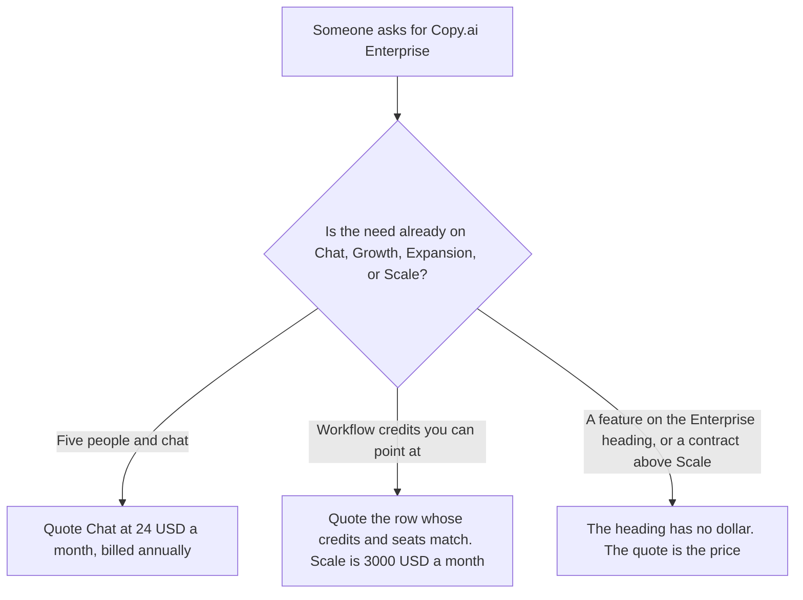

**Copy.ai's prices page, fetched October 24, 2026, has a section titled Enterprise and does not put a dollar on it.** The heading says it is for organizations ready to power go-to-market with AI, and it lists guided jumpstart implementation, API access and bulk workflow runs, 20+ tech integrations, unlimited customizable workflows, a designated account and support team, and enterprise-grade security protocols. The priced plans on that same page are Chat, Growth, Expansion, and Scale. Scale is $3,000 a month, billed $36,000 a year, with 200 seats and 75,000 workflow credits a month. The ladder that walks all four priced rows is [Copy.ai pricing explained](/blog/copy-ai-pricing-explained-2026/). This page is the Enterprise heading.

Jasper's custom contract, which is a different product, is [Jasper Business pricing explained](/blog/jasper-business-pricing-explained-2026/). The product page is [Copy.ai review](/blog/copy-ai-review-2026/).

Prices that do exist are US list prices from that October 24 fetch. They match the October 16 directory card. Published October 24, 2026. We did not score workflows. We did not receive a quote above Scale.

## What the page actually prices

| Name on the October 24 page | Price the page printed | Seats and credits | What you may call Enterprise |
|---|---|---|---|
| Chat | $29 a month, or $24 a month billed annually ($288 a year) | 5 seats. No workflow-credit line | A small shared chat. Not the heading |
| Growth | $1,000 a month, billed $12,000 a year | 75 seats, 20,000 workflow credits a month | A published workflow plan |
| Expansion | $2,000 a month, billed $24,000 a year | 150 seats, 45,000 workflow credits a month | A published workflow plan |
| Scale | $3,000 a month, billed $36,000 a year | 200 seats, 75,000 workflow credits a month | The top published dollar. Not a price for the Enterprise heading |
| Enterprise, the heading | No dollar | The feature list above | Ask Copy.ai if you need a contract the four rows do not name |

The October 16 directory said larger plans include guided implementation, a designated account team, and enterprise-grade security. The October 24 page puts those words under an Enterprise heading and still prices Growth, Expansion, and Scale as named rows. This page does not merge the heading into Scale. If a salesperson calls Scale "Enterprise," ask which row the invoice uses. If the quote is above $3,000 a month, or outside the 200-seat and 75,000-credit line, that quote is the price. This page will not average Chat and Scale into a typical enterprise number.

Chat at $24 times 12 is $288 a year for five seats. The step from that Chat price to Growth at $1,000 a month is the cliff the base article already walks. Enterprise is not a way to smooth the cliff. There is no fifth sticker between them on the page we fetched.

## What a neighboring contract does, and does not, tell you

**A marketing platform whose company tier is custom.** [Jasper](/tools/jasper/) Business is custom on the October 24 pricing page, and Pro is $59 a seat a month billed yearly or $69 monthly, with the card saying it includes one seat. Jasper's custom line is not Copy.ai Scale. The invoice is the Jasper Business article.

**A general seat.** [ChatGPT](/tools/chatgpt/) Plus is $20 a month. It does not include 20,000 Copy.ai workflow credits. The ladder is [ChatGPT pricing explained](/blog/chatgpt-pricing-explained-2026/).

**A Project for the brief the workflow must follow.** [Claude](/tools/claude/) Pro is $17 a month billed annually, $200 up front, or $20 monthly. The brief is not a Copy.ai seat. The review is [Claude review](/blog/claude-review-2026/).

## What not to assume

Do not invent an Enterprise seat price. Do not say the Enterprise heading includes 75,000 credits. That credit line is on Scale. Do not say Chat includes the designated account team. Do not convert a non-USD checkout into these dollars.

## FAQ

### How much is Copy.ai Enterprise?

The October 24 prices page does not print a dollar under the Enterprise heading. Scale, the top published plan, is $3,000 a month billed annually, $36,000 a year, with 200 seats and 75,000 workflow credits a month. If your quote uses a different number, the quote is the price.

### Does Scale include the Enterprise heading's features?

The heading lists guided jumpstart implementation, API access and bulk workflow runs, 20+ integrations, unlimited customizable workflows, a designated account and support team, and enterprise-grade security. The October 16 directory attached similar words to larger plans. The October 24 page does not print a grid that checks those bullets against Growth, Expansion, and Scale one by one. Ask which bullets are on the row you are buying. Do not assume Chat has them.

### Is there a plan above Scale?

Not as a printed price on the page we fetched. A contract a salesperson offers above Scale is a quote. This page does not estimate it from the $1,000 steps between Growth, Expansion, and Scale.

### Does this page replace the main Copy.ai pricing article?

No. That article is the cliff from Chat at $24 to Growth at $1,000, then Expansion and Scale. This article is the Enterprise heading: a feature list without a fifth dollar, and Scale as the highest number the page will support.

## Last verified

October 24, 2026, from copy.ai/prices. The priced rows match the October 16 directory card. Published October 24, 2026. No quote above Scale was received.

**Sources:** [Copy.ai prices](https://www.copy.ai/prices), [Copy.ai](https://www.copy.ai/).

*Published by Andrew for [AI Tools Optimizer](https://aitoolsoptimizer.com).*

[Copy.ai](/tools/copy-ai/) is in the [writing directory](/tools/category/writing/). Directory pages may use affiliate links. A purchase through them may earn us a commission at no extra cost to you.
