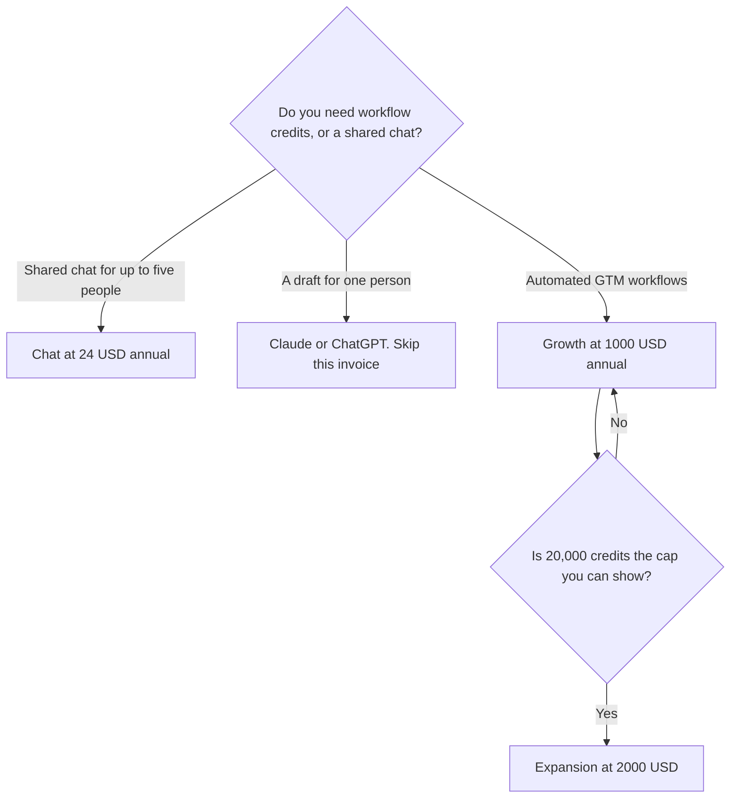

**Copy.ai pricing is a shared chat seat, then a cliff.** Chat is $29 a month, or $24 a month billed annually, and it includes 5 seats. The next published plans are workflow plans: Growth at $1,000 a month, Expansion at $2,000, and Scale at $3,000, all billed annually. If you needed a writing assistant, you are looking at the wrong side of that cliff.

The product page is [Copy.ai review](/blog/copy-ai-review-2026/). The way out is [Copy.ai alternatives](/blog/copy-ai-alternatives-2026/). The three-way is [Jasper vs Copy.ai vs Writesonic](/blog/jasper-vs-copy-ai-vs-writesonic-2026/).

Prices are US list prices excluding tax from the directory page checked October 16, 2026. Published October 24, 2026. We did not score copy.

## The ladder

| Plan | Price | Seats | Workflow credits |
|---|---|---|---|
| Chat | $29 a month, or $24 billed annually ($288 a year) | 5 | None on this row |
| Growth | $1,000 a month billed annually ($12,000 a year) | 75 | 20,000 a month |
| Expansion | $2,000 a month billed annually ($24,000 a year) | 150 | 45,000 a month |
| Scale | $3,000 a month billed annually ($36,000 a year) | 200 | 75,000 a month |

Chat at $24 × 12 is $288 a year for five seats, which is $57.60 a seat if you actually fill the seats, or $288 if you do not. Empty seats do not make the plan cheaper. They make the per-person story look better than the invoice. Growth is $1,000 a month billed annually, $12,000 a year, before any overage this directory did not print. The step from Chat's $24 a month to Growth's $1,000 a month is $976 a month, or $11,712 a year. Quote those two lines. Do not average them into a "typical" Copy.ai price.

Larger plans, on the directory page, include guided implementation and a designated account team. That is a services relationship. It is not a toggle you discover in settings the week you need it.

## What Chat is for

Chat is a multi-model workspace for a small group. Five seats is the recorded cap on that row. There is no workflow-credit allowance in the Chat line of the table. If a demo ran a list of 200 accounts through a workflow, the demo was not the Chat plan. Ask which plan the workflow runs on before you repeat the demo internally.

[ChatGPT](/tools/chatgpt/) Plus at $20 and [Claude](/tools/claude/) Pro at $20, or $17 billed annually, are the one-person drafts. They do not include four teammates. [Jasper](/tools/jasper/) Pro at $59 a seat billed yearly, or $69 monthly, is the stored brand voice. Pro includes 2 Brand Voices, 5 Knowledge assets, and 3 Audiences on the directory card. [Writesonic](/tools/writesonic/) Starter at $79 a month billed annually is the AI-answer tracker. Those three are the usual reasons to leave, and they are priced in [Jasper vs ChatGPT for marketing](/blog/jasper-vs-chatgpt-for-marketing-2026/) and [Writesonic pricing explained](/blog/writesonic-pricing-explained-2026/).

The marketing stack around the choice is [best AI tools for marketers](/blog/best-ai-tools-for-marketers-2026/). The writing aisle is [best AI writing assistants](/blog/best-ai-writing-assistants/).

## When the $1,000 plan is the point

Buy Growth when you already have a repeated go-to-market workflow, a person who will own it, and a volume that makes 20,000 credits a month a real number rather than a rounded slogan. Expansion and Scale raise seats and credits together: 150 seats and 45,000 credits, then 200 seats and 75,000 credits. A 10-person team does not need 75 seats. They need to know whether Chat is enough.

A workflow that researches accounts and drafts outreach can touch customer data and send mail. A person should approve the first sends. That control is [what human-in-the-loop AI is](/blog/what-is-human-in-the-loop-ai-2026/). A claim the workflow invented is still [a hallucination](/blog/what-is-ai-hallucination-2026/). The brand note, if you are not buying Jasper's vault, is [how to create a brand voice with AI](/blog/how-to-create-a-brand-voice-with-ai-2026/).

## FAQ

### How much is Copy.ai for a small team?

Chat is $29 a month or $24 billed annually, with 5 seats, on the October 16 page. A year on the annual toggle is $288. That is the small-team price. The next published step is $1,000 a month.

### Is there a free plan?

The directory card we are using does not list a permanent free plan for these tiers. ChatGPT and Claude do have free plans if the job is a draft. Use those to learn whether you needed Copy.ai at all.

### What is a workflow credit?

The table records 20,000, 45,000, and 75,000 a month on Growth, Expansion, and Scale. It does not record a credit on Chat. This page does not invent a credit-to-email conversion. Run one real workflow in a sales conversation and ask what it consumed before you forecast a year.

### Can I add a sixth person on Chat?

The recorded Chat row is 5 seats. A sixth person is either a different product or a workflow plan with a much larger seat count and a much larger bill. Get that in writing. Do not assume a $24 overage.

## Last verified

October 16, 2026, from the Copy.ai directory page. Comparison prices for Jasper, Writesonic, ChatGPT, and Claude are from the same directory check. Published October 24, 2026.

**Sources:** [Copy.ai pricing](https://www.copy.ai/prices), [Jasper pricing](https://www.jasper.ai/pricing), [ChatGPT pricing](https://chatgpt.com/pricing).

*Published by Andrew for [AI Tools Optimizer](https://aitoolsoptimizer.com).*

[Copy.ai](/tools/copy-ai/) is in the [writing directory](/tools/category/writing/). Directory pages may use affiliate links. A purchase through them may earn us a commission at no extra cost to you.
