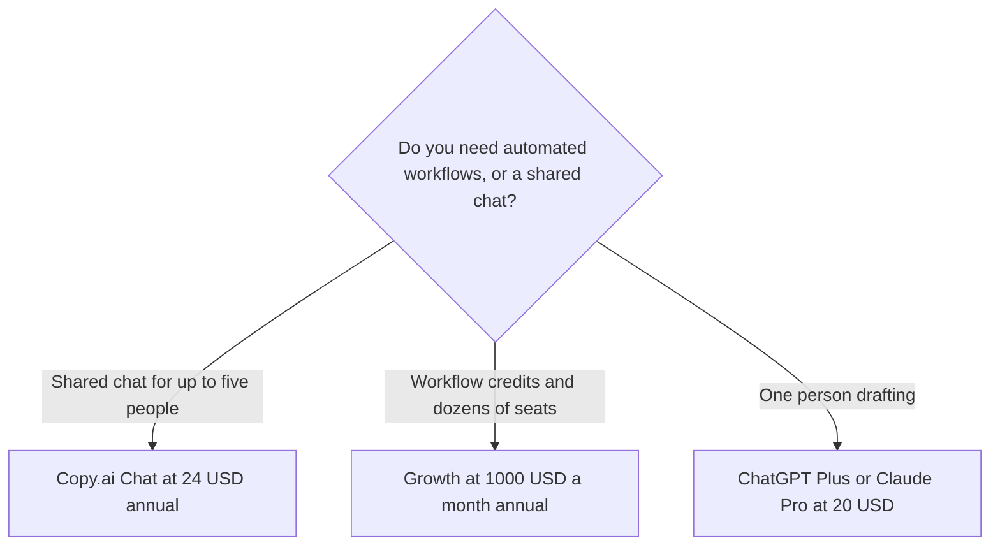

**[Copy.ai](/tools/copy-ai/) is a go-to-market platform with two prices that should not be compared as if they were one product.** Chat is $29 a month, or $24 a month billed annually ($288 a year), and it includes five seats. Growth, the first workflow plan, is $1,000 a month billed annually. Buying Chat does not put you on the path to "try workflows cheaply."

Those figures were read from Copy.ai's pricing page on October 24, 2026. The workflow plans are shown as annual totals. The page did not list a permanent free plan. Prices are in US dollars. We did not score copy against Jasper or ChatGPT. The writing shelf is [best AI writing assistants](/blog/best-ai-writing-assistants/).

## Two products on one pricing page

| Plan | Price on the page | What it lists |
|---|---|---|
| Chat, monthly | $29/month | 5 seats, unlimited words in chat, chat projects, OpenAI, Anthropic, and Gemini models |
| Chat, annual | $24/month, billed $288/year | The same Chat plan. The page says 20% off |
| Growth | $1,000/month, billed $12,000/year | 75 seats, unlimited chat words, 20,000 workflow credits a month |
| Expansion | $2,000/month, billed $24,000/year | 150 seats, 45,000 workflow credits |
| Scale | $3,000/month, billed $36,000/year | 200 seats, 75,000 workflow credits |
| Enterprise | Custom | API access, bulk workflow runs, a designated team, on the Enterprise card |

Five people on Chat annual is $288 a year for the group, not per person. One Jasper Pro seat, for a comparison that is not the same product, is $59 a month billed yearly in the [Jasper review](/blog/jasper-ai-review-2026/). Copy.ai Chat is the shared multi-model chat. Jasper is the brand-system seat. Do not pick the winner from the smaller number.

## What Chat is, and what it is not

Chat is a small-team subscription to several model vendors in one place, with a seat count of five included. It is a reasonable buy when a go-to-market group wants one login and does not want five separate $20 assistants. It is a poor buy when one person writes and already pays for [ChatGPT](/tools/chatgpt/) or [Claude](/tools/claude/). A second chat window does not become a brand system because the invoice says Copy.ai.

The workflow plans are the company product: credits, more seats, and the automation Copy.ai sells to revenue teams. Growth at $12,000 a year is the price to put next to a CRM or a sales engagement tool, not next to Grammarly. If a sales page quotes "starts at $24," ask whether that quote is Chat. If the work is "run this sequence every week without a person pasting the prompt," the quote is Growth or above.

Enterprise is sales. The card lists a guided implementation, API access, and security language. Get the price in writing. This page cannot compare a custom quote with $24.

## Who should pay

**Pay for Chat annual** if up to five people need a shared chat across more than one model vendor and a $20 assistant is already too individual. **Talk to sales, or budget Growth,** if the requirement is workflow credits. **Do not buy Copy.ai** for fiction, for a student paper, or for grammar in the browser. Grammar is [Grammarly](/tools/grammarly/). General drafting is the $20 assistants in [ChatGPT vs Claude for writing](/blog/chatgpt-vs-claude-for-writing-2026/).

## FAQ

### How much does Copy.ai cost?

Chat is $29 a month, or $24 a month billed annually, with five seats included. Workflow plans start at Growth, $1,000 a month billed annually. Enterprise is custom.

### Is there a free plan?

The pricing page we read did not list a permanent free plan. Chat is the entry price.

### Is Copy.ai cheaper than Jasper?

Chat can be cheaper for a group of five than one Jasper seat. The products are not equivalent. Jasper's workflow and brand controls, and Copy.ai's workflow tier, are both four-figure monthly decisions. Compare those, not Chat against Jasper Pro, if automation is the job.

## Last verified

October 24, 2026, from Copy.ai's pricing page. Seat counts and credit allotments are part of the plan name. Recheck them before you put a team on an annual workflow contract.

**Sources:** [Copy.ai pricing](https://www.copy.ai/prices), [Copy.ai](https://www.copy.ai/).

[Copy.ai](/tools/copy-ai/) is in the [writing directory](/tools/category/writing/). Directory pages may use affiliate links. A purchase through them may earn us a commission at no extra cost to you.
