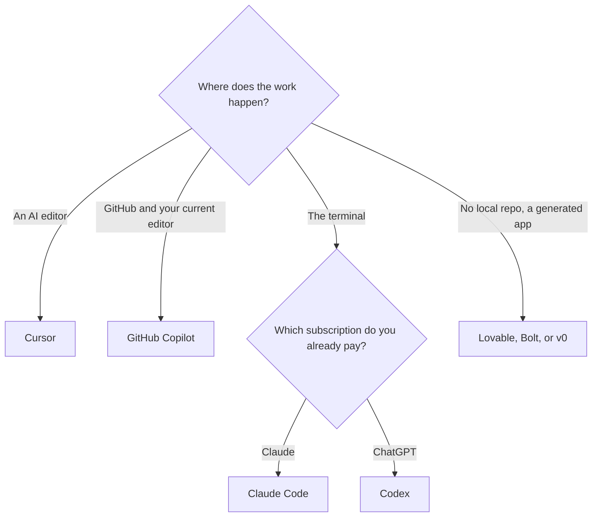

**Leave Cursor when you want completions inside the editor and GitHub you already use, a terminal agent on a Claude or ChatGPT plan, or an app builder that does not start from a local repo.** Stay when the editor itself is the agent and the new subscription price fits. We did not run a model bake-off. The choice is the surface and the bill.

[Cursor](/tools/cursor/) for new customers is The X Subscription, which also covers Grok and X. Plus is $8 a month, or $80 a year. Premium is $30 a month, or $300 a year. Super is $100. Ultra is $200. Free includes Agent, Chat, and Tab on Cursor models with limited usage. Legacy Pro at $20 remains for existing subscribers. The product page is [Cursor review](/blog/cursor-review-2026/). The head-to-head with Copilot is [Cursor vs GitHub Copilot](/blog/cursor-vs-github-copilot-2026/).

Prices are US list prices excluding tax from directory pages checked October 16, 2026.

## Pick by the surface

| You want | Open this | First paid step |
|---|---|---|
| Completions and a cloud agent where the code is already on GitHub | [GitHub Copilot](/tools/github-copilot/) | Pro is $10/user/month, with $15 of monthly credits. Free is 2,000 completions a month |
| A terminal agent on an Anthropic plan | [Claude Code](/tools/claude-code/) | Included with Claude Pro at $20/month, or $17 billed annually. Max starts at $100 |
| A terminal and IDE agent on a ChatGPT plan | [OpenAI Codex](/tools/openai-codex/) | Included in a serious way on Plus at $20/month. Free covers quick tasks |
| One IDE that dispatches several agents | [Devin Desktop](/tools/devin-desktop/) | Pro is $20/month. Max is $200. Free has a light agent quota and unlimited Tab |
| A working web app without a local editor | [Lovable](/tools/lovable/) or [Bolt.new](/tools/bolt-new/) | Lovable Pro starts at $25/month for 100 credits, or $21 billed annually. Bolt Pro starts at $25/month |
| React UI on Vercel | [v0](/tools/v0/) | Plus is $30/user/month. Free includes $5 of one-time credits for new users and 7 messages a day |

The three-way among Cursor, Claude Code, and Codex is [Cursor vs Claude Code vs Codex](/blog/cursor-vs-claude-code-vs-codex-2026/). The shortlist is [best AI coding assistants](/blog/best-ai-coding-assistants-2026/). A first weekend in Cursor, if you are staying, is [how to use Cursor for a side project](/blog/how-to-use-cursor-for-a-side-project-2026/).

## The coding seats, in plain prices

**GitHub Copilot** is the alternative when the repository, the pull requests, and the editor extension are the point. Pro at $10 is the individual plan. Pro+ is $39 with $70 of monthly credits. Business is $19 a user with pooled credits. The credit story is [GitHub Copilot pricing explained](/blog/github-copilot-pricing-explained-2026/). Copilot does not require The X Subscription. If you are paying for Cursor only to get completions, price Copilot Pro before Premium.

**Claude Code** ships with Claude Pro and Max. There is no separate Claude Code seat on the directory page. Pro is the short-sprint plan. Max 5x at $100 is the everyday larger-codebase plan, and it includes $100 a month of API credits. If you already pay for Claude, this is the alternative that does not add a second vendor.

**Codex** shares ChatGPT's plan. Plus at $20 covers the web, CLI, and IDE surfaces on the directory page. Pro at $100, $200, or $500 removes the five-hour limit described there, with Ultrafast on the $500 tier. Free is for quick tasks. If you already pay for Plus, try Codex before you add Cursor Premium.

**Devin Desktop** is the former Windsurf editor, now a command center for Devin and other agents. Pro is $20 a month. Teams is $80 a month plus $40 a month per full developer seat. Use it when you are dispatching more than one agent and want a board. A solo autocomplete habit does not need that board. The directory records a vendor note about token efficiency. This page does not repeat it as a measurement.

## When you did not want an editor

**Lovable and Bolt** generate an app from a prompt. Lovable's free plan is 5 build credits a day, up to 30 a month, plus 20 Cloud credits. Bolt's free plan is 1 million tokens a month with a 300,000 daily limit and Bolt branding. These are the alternatives when there is no repository yet. They are a poor fit when the code already exists and you need a careful edit. Reviews: [Lovable review](/blog/lovable-review-2026/) and [Bolt.new review](/blog/bolt-new-review-2026/).

**v0** is the Vercel-shaped UI builder. Plus at $30 a user a month is a higher entry than Copilot Pro. Use it when the output has to be a React interface you will deploy on Vercel. The review is [v0 review](/blog/v0-review-2026/).

[Replit](/tools/replit/) is the other "publish from a browser" option. Its pricing page did not load for this directory on October 16, 2026, so this article does not print a Replit price. Check replit.com/pricing before you compare it with Lovable.

## FAQ

### Is GitHub Copilot cheaper than Cursor?

Copilot Pro is $10 a user a month. Cursor Plus is $8 a month, or $80 a year, and it is a bundle with Grok and X. Cursor Premium is $30. Cheaper depends on which Cursor tier you were about to buy, and on whether you wanted the bundle.

### Can I use Claude Code instead of Cursor?

Yes, if a terminal agent on a Claude plan is the workflow. Claude Code requires a paid Claude plan or API usage. Pro is $20 a month, or $17 billed annually. The comparison is [Cursor vs Claude Code vs Codex](/blog/cursor-vs-claude-code-vs-codex-2026/).

### What if I do not want to code?

Use Lovable, Bolt, or v0. Cursor's free plan still assumes you are in an editor. An app builder assumes you will review generated code or a hosted app, which is a different kind of review.

### Did Cursor Pro go away?

Pro at $20 is a legacy plan for existing customers. New customers see The X Subscription. Switching off a legacy plan is described on Cursor's help page as permanent. Read that page before you switch.

## Last verified

October 16, 2026. Replit's current price was not available in that check. Published October 24, 2026.

**Sources:** [Cursor pricing](https://cursor.com/help/account-and-billing/pricing), [GitHub Copilot](https://github.com/features/copilot/plans), [Claude pricing](https://claude.com/pricing), [Lovable pricing](https://lovable.dev/pricing).

*Published by Andrew for [AI Tools Optimizer](https://aitoolsoptimizer.com).*

[Cursor](/tools/cursor/), [GitHub Copilot](/tools/github-copilot/), and [Claude Code](/tools/claude-code/) are in the [coding directory](/tools/category/coding/). Directory pages may use affiliate links. A purchase through them may earn us a commission at no extra cost to you.
