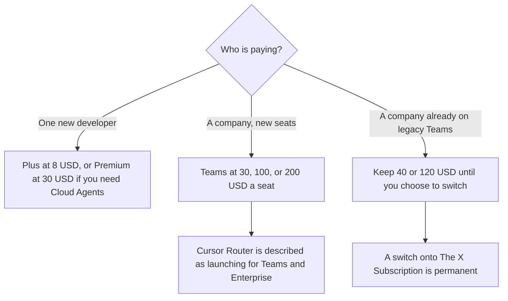

**Cursor does not sell a self-serve plan named Business on the help page fetched October 24, 2026. The company seat is Teams, at $30, $100, or $200 per seat a month, and the included usage matches that seat's tier.** Enterprise is contact sales. The individual ladder, from Free through Ultra, is [Cursor pricing explained](/blog/cursor-pricing-explained-2026/). This page is the seat you buy when more than one person should be on one Cursor bill.

Published October 24, 2026. Prices exclude tax, as that help page states. We did not score pull requests. A personal Plus plan at $8 is a real product. It is not "basically Teams."

## Teams next to the seats people confuse with it

| Plan | Price on the October 24 help page | The reason it is or is not the company seat |
|---|---|---|
| Plus | $8 a month, or $80 a year | An individual plan. The page says Plus omits Cloud Agents, Automations, Bugbot, Origin, and third-party models |
| Premium | $30 a month, or $300 a year | The individual plan Teams' $30 seat matches for usage. Still one person |
| Teams | $30, $100, or $200 per seat a month | The company seat. Usage matches the tier. No separate annual Teams price on the page we read |
| Legacy Teams Standard | $40 a user a month | Existing subscribers only. The page maps it to a Teams Premium seat |
| Legacy Teams Premium | $120 a user a month | Existing subscribers only. The page maps it to a Teams Super seat |
| Enterprise | Contact sales | Pooled usage, SCIM, audit logs, invoice billing |

The help page does not list an annual price for Teams. Do not multiply by twelve and then apply Plus's annual discount. Plus annual is $80, which is a different plan. If checkout shows a Teams annual figure, checkout wins, and this article does not invent one.

Every paid plan on that page includes a weekly pool for Cursor models, named there as Grok 4.7, Grok 4.6, Grok 4.5, and Composer 2.5, shared with Grok. Premium and above, which is the usage a $30 Teams seat matches, add Auto, Cloud Agents, Automations, Bugbot, Origin, and third-party models. Third-party models bill at API list price from prepaid credit. The $30 seat is not a promise that those models are free.

## What the company seat is for

**Admin and a shared plan, not a bigger personal pool.** Ultra at $200 a month is an individual pool, 50x Plus, on the same page. Teams at $200 a seat is the company shape of that usage tier. Buying Ultra for every developer and calling it a team is how you get many personal bills. The help page also says that when you join a team, billing state can change with the team setup. Read the dashboard after someone accepts the invite.

**Cursor Router.** The page says Cursor Router will launch for Teams and Enterprise. Enterprise teams start with it off, and an admin must opt in. Individual plans have Cost mode only. On Teams and Enterprise with Router on, Balance and Intelligence bill at the routed model's list price, from prepaid credit, plus a Cursor Token Rate the page tells you to read under Auto modes. This article does not copy that rate. It was not printed in the pricing section we used. Cost mode does not add the rate. A route to a model on the excluded list does not add it either.

**Legacy Teams.** If you already pay $40 or $120 a user, you can keep it. Switching from a legacy plan to The X Subscription is optional and permanent, with a prorated refund of the old plan. Move among legacy plans if that is all you need. Move to the new Teams seats if you want the bundle and you accept that you cannot return.

**Enterprise** is the row for SCIM, audit logs, pooled usage across Grok and Cursor, and invoicing. It is not a dollar on this page. A security review that asks for SCIM is asking for that conversation, not for a $30 seat.

**A neighboring company coding seat** is [GitHub Copilot](/tools/github-copilot/) Business at $19 a user a month on the October 16 directory card. That invoice is [GitHub Copilot Business pricing explained](/blog/github-copilot-business-pricing-explained-2026/). Copilot Business and Cursor Teams are two products. [Claude Code](/tools/claude-code/) is included with paid [Claude](/tools/claude/) plans. Claude Pro is $17 a month billed annually, $200 up front, or $20 monthly, on claude.com/pricing fetched October 24, 2026. The seat article is [Claude Code pricing explained](/blog/claude-code-pricing-explained-2026/).

## What not to assume

Do not quote a plan named Cursor Business at a dollar this page did not list. Do not treat Plus at $8 as the team price because it is the cheapest paid row. Do not assume Teams is billed annually at a discount. Do not convert the Cursor Token Rate into a number this fetch did not print. The India Start plan at ₹649 is a regional price on the same help page. This article stays on the USD Teams cards.

## FAQ

### How much is Cursor for a business?

On the October 24 help page, Teams is $30, $100, or $200 per seat a month, and usage matches the seat's tier. There is no self-serve plan named Business. Enterprise is contact sales. Legacy Teams prices, $40 and $120 a user a month, are for existing subscribers.

### Does the $30 Teams seat match Premium?

The page says Teams usage matches the seat's tier. The $30 seat is the one lined up with Premium usage. Premium for an individual is $30 a month or $300 a year. Teams at $30 is still the company seat, with the team billing path. It is not a coupon on Premium.

### Is there an annual Teams price?

Not on the help page we read. Annual figures on that page are for Plus, Premium, Super, and Ultra. Do not apply those discounts to a Teams seat unless checkout shows them.

### What happens to a personal plan when someone joins a team?

The page says billing state can change based on the team setup. If the plan looks wrong after the invite, Cursor's own note is to use the payment-completed troubleshooting steps. Do not assume the personal Ultra pool and the Teams seat stack.

## Last verified

October 24, 2026, from Cursor's help center at cursor.com/help/account-and-billing/pricing. GitHub Copilot's comparison price is the October 16 directory card. Claude's comparison price is claude.com/pricing on October 24. Published October 24, 2026.

**Sources:** [Cursor pricing](https://cursor.com/help/account-and-billing/pricing), [GitHub Copilot plans](https://github.com/features/copilot/plans), [Claude pricing](https://claude.com/pricing).

*Published by Andrew for [AI Tools Optimizer](https://aitoolsoptimizer.com).*

[Cursor](/tools/cursor/) is in the [coding directory](/tools/category/coding/). Directory pages may use affiliate links. A purchase through them may earn us a commission at no extra cost to you.
