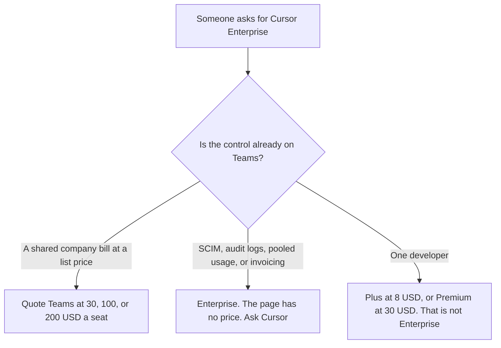

**Cursor Enterprise is contact sales.** The help page fetched October 24, 2026 lists pooled usage, SCIM, audit logs, and invoice billing on that row. It does not list a seat price. Teams, the company seat with a dollar, is $30, $100, or $200 per seat a month, and the included usage matches that seat's tier. The article that explains those three Teams prices is [Cursor Business pricing explained](/blog/cursor-business-pricing-explained-2026/). The individual ladder is [Cursor pricing explained](/blog/cursor-pricing-explained-2026/). This page is the sales row: what Teams does not include, and what not to invent when a security review says Enterprise.

Published October 24, 2026. Prices that do exist exclude tax, as that help page states. We did not score pull requests. We did not receive an Enterprise quote. A Teams seat is a real product. It is not "basically Enterprise."

## What the help page separates

| Plan | Price on the October 24 help page | Why it is or is not Enterprise |
|---|---|---|
| Plus, for contrast | $8 a month, or $80 a year | One person. The page says Plus omits Cloud Agents, Automations, Bugbot, Origin, and third-party models |
| Teams | $30, $100, or $200 per seat a month | The company seat with a list price. Usage matches the tier. No SCIM dollar |
| Legacy Teams | $40 or $120 a user a month | Existing subscribers only. Not a new Enterprise price |
| Enterprise | Contact sales | Pooled usage, SCIM, audit logs, invoice billing. No dollar on the page |

Premium for an individual is $30 a month or $300 a year. Super is $100 a month or $1,000 a year. Ultra is $200 a month or $2,000 a year. Teams at $30, $100, or $200 is the company shape of those usage tiers, as the Business article reads the page. Multiplying Ultra by a headcount does not produce an Enterprise price. Ten Ultra seats are ten individual bills, or a Teams conversation at the tier you select. They are not a SCIM contract.

The help page says Cursor Router will launch for Teams and Enterprise. Enterprise teams start with it off, and an admin must opt in. On Teams and Enterprise with Router on, Balance and Intelligence bill at the routed model's list price, from prepaid credit, plus a Cursor Token Rate the page tells you to read under Auto modes. The Business article does not copy that rate, because it was not printed in the pricing section that fetch used. This page does not invent the rate either. Cost mode does not add the rate.

There is no annual Teams price on the help page we read. There is no annual Enterprise price either. Do not apply Plus's annual discount to a sales contract.

## What the sales row is for

**SCIM, audit logs, and an invoice.** [Cursor](/tools/cursor/) Teams can be the right bill when the company only needs seats and the usage tier. A review that asks for SCIM or audit logs is asking for the Enterprise conversation. Pooled usage across Grok and Cursor is on that same row in the Business article. A $30 seat is not a promise of that pool.

**A neighboring company coding seat.** [GitHub Copilot](/tools/github-copilot/) Business is $19 a user a month on the October 16 directory card. Copilot Enterprise is a different invoice. This page does not restate a Copilot Enterprise dollar. The Business comparison is [GitHub Copilot Business pricing explained](/blog/github-copilot-business-pricing-explained-2026/).

**A terminal agent on a Claude plan.** [Claude Code](/tools/claude-code/) is included with paid Claude plans. Pro is $17 a month billed annually, $200 up front, or $20 monthly, on claude.com/pricing fetched October 24, 2026. Claude's own Enterprise contract is not a Cursor price. The seat article is [Claude Code pricing explained](/blog/claude-code-pricing-explained-2026/).

**The policy sentence, if you only need the words.** [Claude](/tools/claude/) Pro is the same seat. A paragraph that says "we require SCIM" does not create a Cursor SKU.

Switching from a legacy Cursor plan to The X Subscription is optional and permanent, with a prorated refund of the old plan, as the Business article records. That switch is not how you buy Enterprise.

## What not to assume

Do not print an Enterprise seat price. Do not describe Teams at $200 as Enterprise because it is the largest published number. Do not treat audit logs as included because you pay annually. Annual figures on that page are for individual plans. Do not convert the India Start plan at ₹649 into this contract. This article stays on the USD page, and Enterprise on that page has no USD figure.

## FAQ

### How much is Cursor Enterprise?

The October 24 help page says contact sales. There is no seat price. Teams at $30, $100, or $200 per seat a month is the last published company dollar. If a quote arrives, that quote is the price, and this page will not round it into a list.

### Does Teams include SCIM?

SCIM, audit logs, pooled usage, and invoice billing are the Enterprise lines on that page. Teams is the self-serve company seat at a list price. A company that needs a shared bill and the usage tier can quote Teams without calling the Enterprise row Enterprise.

### Does Enterprise include Cursor Router?

The page says Router will launch for Teams and Enterprise, and that Enterprise teams start with it off until an admin opts in. Opt-in is not a price. The Token Rate, if a mode adds one, has to be read on Cursor's page. This article does not supply a number the pricing section did not print.

### Does this page replace the Cursor Business article?

No. That article is Teams: $30, $100, or $200, legacy seats, and why there is no self-serve plan named Business. This article is the contact-sales row, and the controls you should not pretend Teams already includes.

## Last verified

October 24, 2026, from Cursor's help center at cursor.com/help/account-and-billing/pricing. GitHub Copilot's comparison price is the October 16 directory card. Claude's comparison price is claude.com/pricing on October 24. Published October 24, 2026. No Enterprise quote was received.

**Sources:** [Cursor pricing](https://cursor.com/help/account-and-billing/pricing), [GitHub Copilot plans](https://github.com/features/copilot/plans), [Claude pricing](https://claude.com/pricing).

*Published by Andrew for [AI Tools Optimizer](https://aitoolsoptimizer.com).*

[Cursor](/tools/cursor/) is in the [coding directory](/tools/category/coding/). Directory pages may use affiliate links. A purchase through them may earn us a commission at no extra cost to you.
