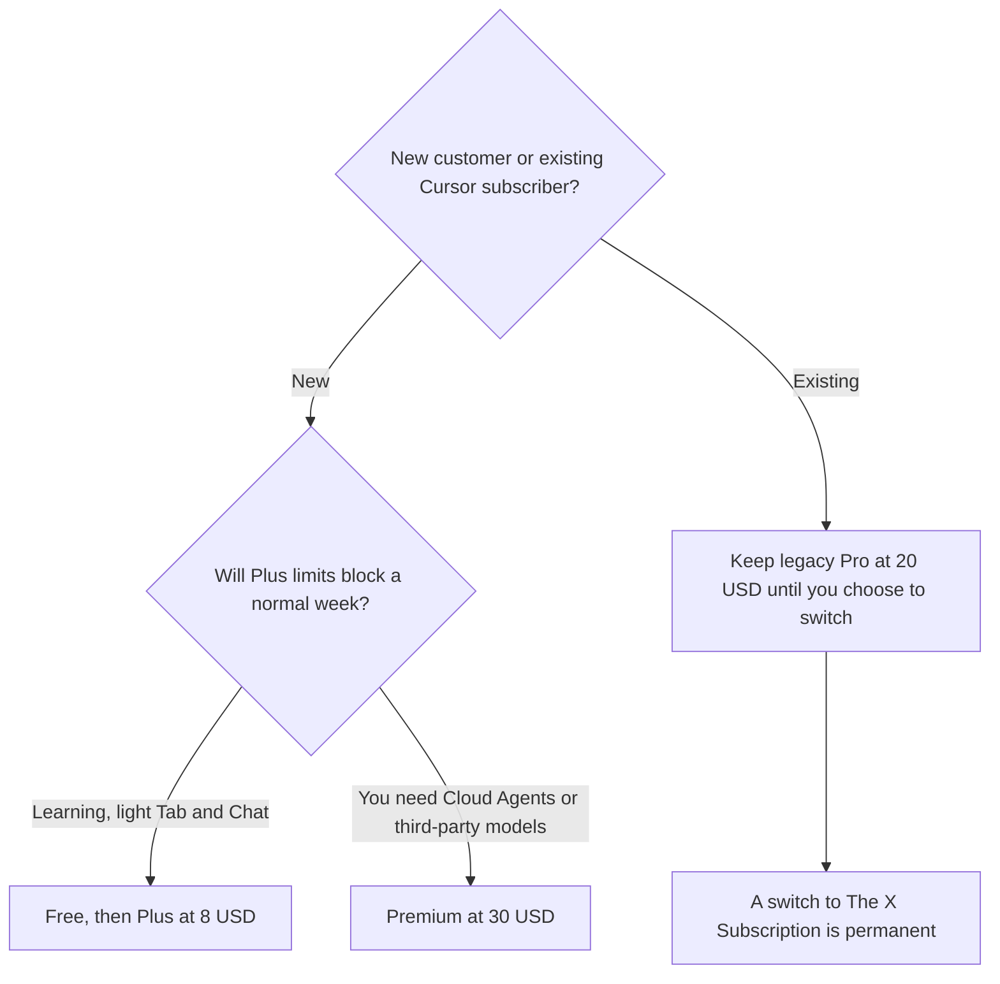

**New Cursor customers pay for The X Subscription: Plus is $8 a month or $80 a year, Premium is $30 or $300, Super is $100 or $1,000, and Ultra is $200 or $2,000.** Teams seats are $30, $100, or $200 a month, matching the usage tier. If you already subscribe to an older Cursor plan, you can keep it. Pro at $20 is a legacy price, and its comparable new plan is Premium at $30.

Those figures are US list prices excluding tax from Cursor's help center, read October 24, 2026. They match the directory card checked October 16, 2026, with more detail on what Plus leaves out. The product story is [Cursor review](/blog/cursor-review-2026/). The editor comparison is [Cursor vs GitHub Copilot](/blog/cursor-vs-github-copilot-2026/).

## The plans a new customer can buy

| Plan | Monthly | Annual | Included usage, as Cursor states it | The gate that matters |
|---|---|---|---|---|
| Free | $0 | $0 | Limited | Agent, Chat, and Tab on Cursor models, with the cap |
| Plus | $8 | $80 | Base. A weekly pool shared with Grok | Fixed settings only. The help page says Plus runs without Auto, Cloud Agents, Automations, Bugbot, Origin, or third-party models |
| Premium | $30 | $300 | 4x Plus | Adds the features Plus excludes. Third-party models bill at API list price from prepaid credit |
| Super | $100 | $1,000 | 15x Plus | The same feature set as Premium, with a larger pool |
| Ultra | $200 | $2,000 | 50x Plus | The top individual pool |
| Teams | $30, $100, or $200 per seat | Not listed as a separate annual rate on the help page we read | Matches the seat's tier | Admin and the team plans. Cursor Router is described as launching for Teams and Enterprise |

Plus annual is $16 less per year than twelve monthly payments ($96 versus $80). Premium annual is $60 less ($360 versus $300). Super annual is $200 less ($1,200 versus $1,000). Ultra annual is $400 less ($2,400 versus $2,000). Usage is still the real cap. "4x Plus" is a ratio, and the help page does not convert it into a request count. Budget the ratio, then read the usage screen in your account.

Every paid plan includes a weekly pool for Cursor models, named on the October 24 page as Grok 4.7, Grok 4.6, Grok 4.5, and Composer 2.5, shared across Cursor and Grok. Model names on that list can change. The durable fact is the pool, the share with Grok, and the Plus feature fence.

## Legacy plans you might already be on

| Legacy plan | Price | Comparable X Subscription plan |
|---|---|---|
| Hobby | Free | Free |
| Pro | $20/month | Premium |
| Pro+ | $60/month | Super |
| Ultra | $200/month | Ultra |
| Teams Standard | $40/user/month | Teams, Premium seat |
| Teams Premium | $120/user/month | Teams, Super seat |

Cursor's help page also lists a Start plan for India at ₹649 a month, tax inclusive, mapped to Plus. This site's recommendations stay on the USD cards. If you are in India and that plan is offered to you, read it on Cursor's site. It is a regional price, and it is not the default in this article.

Switching from a legacy plan to The X Subscription is optional and permanent. Cursor cancels the old subscription with a prorated refund, and you pick the new plan. You can still move among legacy plans, for example Pro to Pro+, without switching. Do that if Premium's feature list is the only reason you were about to move, and your legacy Pro still covers the work. Move if you want the Grok and X bundle and you accept that you cannot return to the legacy card.

Enterprise is the sales plan: pooled usage across Grok and Cursor, SCIM, audit logs, and invoicing. It is not on the self-serve ladder above.

## Where $8 is the wrong comparison

[GitHub Copilot](/tools/github-copilot/) Pro is $10 a month on the directory card checked October 16, 2026. [Claude Code](/tools/claude-code/) is included with Claude Pro at $20 a month, or $17 billed annually. [OpenAI Codex](/tools/openai-codex/) for full use sits on ChatGPT Plus at $20. The three-way is [Cursor vs Claude Code vs Codex](/blog/cursor-vs-claude-code-vs-codex-2026/). Copilot's invoice is [GitHub Copilot pricing explained](/blog/github-copilot-pricing-explained-2026/).

Plus at $8 is the cheapest paid editor seat in that set, and the help page is explicit about what it withholds: Auto, Cloud Agents, Automations, Bugbot, Origin, and third-party models. A developer who wants those buys Premium at $30, which is $10 more than legacy Pro at $20. The $8 price is real. It is the price of the fenced plan. The side-project path, which often fits in Free or Plus, is [how to use Cursor for a side project](/blog/how-to-use-cursor-for-a-side-project-2026/).

The alternatives, if the fence or the bundle is the problem, are [Cursor alternatives](/blog/cursor-alternatives-2026/).

## FAQ

### How much does Cursor cost in 2026?

For a new customer, Plus is $8 a month or $80 a year, Premium is $30 or $300, Super is $100 or $1,000, and Ultra is $200 or $2,000. Teams seats are $30, $100, or $200 a month. Free exists. Prices exclude tax.

### Is Cursor Pro still $20?

Pro at $20 is a legacy plan for existing subscribers. New customers do not buy it. The help page maps it to Premium at $30 on The X Subscription. You can keep Pro if you already have it.

### Does Plus include Cloud Agents?

No. The October 24 help page says Plus runs Cursor models at fixed settings and does not include Auto, Cloud Agents, Automations, Bugbot, Origin, or third-party models. Those start on Premium.

### Can I switch back from The X Subscription to Pro?

The help page says the switch is permanent. Stay on the legacy plan if you want to keep it. Change legacy tiers from the Cursor billing page without switching, if that is the adjustment you actually need.

## Last verified

October 24, 2026, from Cursor's pricing help page. Copilot, Claude, and ChatGPT comparison prices are from directory pages checked October 16, 2026. Published October 24, 2026.

**Sources:** [Cursor pricing](https://cursor.com/help/account-and-billing/pricing), [Cursor](https://cursor.com).

*Published by Andrew for [AI Tools Optimizer](https://aitoolsoptimizer.com).*

[Cursor](/tools/cursor/) is in the [coding directory](/tools/category/coding/). Directory pages may use affiliate links. A purchase through them may earn us a commission at no extra cost to you.
