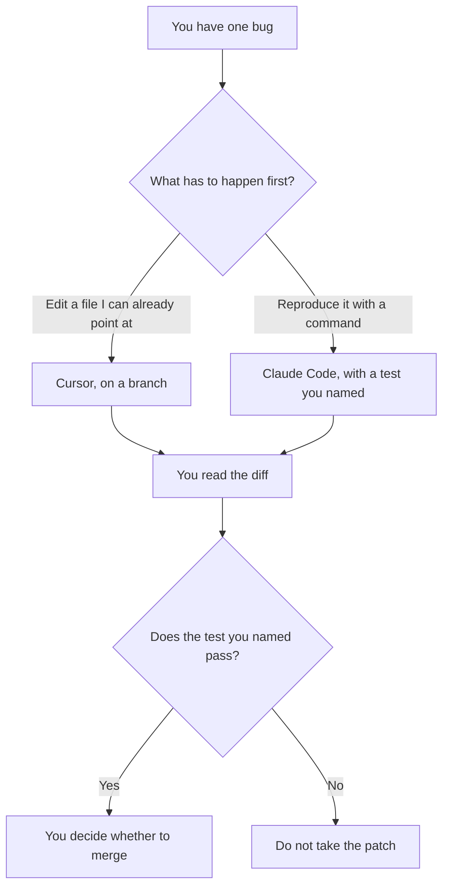

**Use Cursor when the bugfix should be a small diff you can read in the editor, on a branch you already control. Use Claude Code when the bug needs a multi-step pass in the terminal: reproduce, run the test you named, then propose a patch you still review.** The three-way with Codex, which is a different buying choice, is [Cursor vs Claude Code vs Codex](/blog/cursor-vs-claude-code-vs-codex-2026/). This page is one defect, one owner, and a diff a person can reject.

Cursor's ladder is [Cursor pricing explained](/blog/cursor-pricing-explained-2026/). Claude Code's seat is [Claude Code review](/blog/claude-code-review-2026/). The place a test is allowed to run is [what an AI tool sandbox is](/blog/what-is-ai-tool-sandbox-2026/).

Prices are US list prices excluding tax from directory pages checked October 16, 2026. Published October 24, 2026. We did not score bugs fixed or time to a patch.

## Which bug you actually have

| The bug | Start here | First paid step | Done when |
|---|---|---|---|
| A known file, a known failure, a small change | [Cursor](/tools/cursor/) Free | Plus is $8 a month, or $80 a year | You can read the diff and the test you named passes |
| A failure you have to reproduce with commands | [Claude Code](/tools/claude-code/) | Included with Claude Pro at $20 a month, or $17 billed annually. There is no free Claude Code plan on the directory card | The same test passes, and you read the commands it ran |
| A cloud review on a pull request | [OpenAI Codex](/tools/openai-codex/) | Included with ChatGPT plans. Plus is $20 a month for the fuller surfaces | The pricing article, then your review |
| Completions inside an editor you already pay for | [GitHub Copilot](/tools/github-copilot/) | Pro is $10 a user a month | You still write the assertion |

Claude Code on Pro is described on the directory card as a fit for short sprints in smaller codebases. Max is $100 or $200 a month when the daily pass is the job, and those plans include $100 or $200 a month in API credits on that card. A single bug does not require Max. A bug that needs the agent loose in production does not belong on any plan. The sandbox page is the boundary.

Cursor Premium is a higher rung on the pricing article. A one-file fix does not need it. Legacy Pro at $20 remains for existing customers, on the directory. New work on this page starts at Plus.

## What you hand the tool

The failing command or the error text, the file you suspect if you know it, and the test that should go red then green. You do not hand it production credentials. You do not ask it to "fix whatever else looks wrong" in the same change. A drive-by refactor hides the bugfix in a diff nobody can review. Refactors have their own page: [Cursor vs GitHub Copilot for refactors](/blog/cursor-vs-github-copilot-for-refactors-2026/).

**Cursor Plus** is the editor path. The change stays in the repo. You reject lines that do not serve the test.

**Claude Code on Pro** is the terminal path. Read the commands. A command you do not recognize does not get a yes because the summary sounded confident. Auto mode, on the directory card, can run longer with fewer prompts. That is a reason to watch the command list, not a reason to skip it.

**Codex** is the third seat if you already pay for ChatGPT and you want a cloud task or a GitHub review. The dollars are [OpenAI Codex pricing explained](/blog/openai-codex-pricing-explained-2026/). Do not add it only because the bug is annoying.

A prompt that holds the line:

"Reproduce the failure I pasted. Change only what the test I named requires. Do not refactor neighboring files. Stop and show the diff if the test cannot be run."

## What not to delegate

Do not merge a green test you did not read. Do not let the tool add a dependency to silence an error. Do not point either tool at production data to "see the real bug." A fixture you can delete is the input. The rollback if the fix ships and misbehaves is [how to create a rollback plan with AI](/blog/how-to-create-a-rollback-plan-with-ai-2026/).

## FAQ

### Which one fixes bugs more reliably?

We did not measure that. Cursor fits a diff you can see in the editor. Claude Code fits a repro that needs commands. The reliable part is the test you named and the review you do.

### Is Claude Code included with Claude Pro?

On the directory card checked October 16, 2026, yes. Pro is $20 a month, or $17 billed annually. There is no free Claude Code plan on that card. Heavy daily use is the Max conversation, at $100 or $200 a month.

### Do I need Codex too?

Only if the bug should become a cloud task or a GitHub review under a ChatGPT plan you already have. The three-way article is the buying guide. This page is the local fix.

### What if the test does not exist?

Write the smallest check that fails on the bug, or say the bug has no check and review the diff by hand. An agent that invents a test which cannot fail is not evidence.

## Last verified

October 16, 2026 for Cursor, Claude Code, OpenAI Codex, and GitHub Copilot. Published October 24, 2026.

**Sources:** [Cursor pricing](https://cursor.com/pricing), [Claude pricing](https://claude.com/pricing), [Claude Code](https://claude.com/product/claude-code), [GitHub Copilot](https://github.com/features/copilot).

*Published by Andrew for [AI Tools Optimizer](https://aitoolsoptimizer.com).*

[Cursor](/tools/cursor/) is in the [coding directory](/tools/category/coding/). Directory pages may use affiliate links. A purchase through them may earn us a commission at no extra cost to you.
