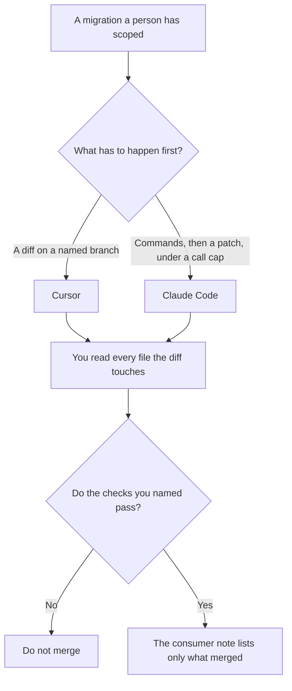

**Use Cursor when the migration is a reviewable diff on a branch you already named, in files you can point at. Use Claude Code when the migration is a sequence you still supervise: read the old path, run the checks you named, and stop when the tool-call count you set is spent.** A one-file bug is a different job: [Cursor vs Claude Code for bugfixes](/blog/cursor-vs-claude-code-for-bugfixes-2026/). The written plan for retiring a model, which is not the code move, is [how to write a model deprecation plan with AI](/blog/how-to-write-a-model-deprecation-plan-with-ai-2026/).

Cursor and GitHub Copilot prices are from directory pages checked October 16, 2026. Claude's prices, and the fact that Claude Code is on paid plans, are from claude.com/pricing on October 24, 2026. Notion's price is from the October 16 card. Published October 24, 2026. We did not score migrations.

## Which migration you actually have

| The move | Start here | First paid step | Done when |
|---|---|---|---|
| A known set of files, one branch, a diff a person can read | [Cursor](/tools/cursor/) | Plus is $8 a month, or $80 a year | You read the diff. The checks you named pass |
| A multi-step move that has to run commands and stop on a budget | [Claude Code](/tools/claude-code/) | Included with Claude Pro at $17 a month annual, $200 up front, or $20 monthly. No free Claude Code on the October 24 table | The same checks pass, and the call count stayed inside the cap you wrote |
| Completions beside a migration you are typing | [GitHub Copilot](/tools/github-copilot/) | Pro is $10 a user a month | You still own the branch |
| The note other teams will read | [Notion AI](/tools/notion-ai/) | Business is $20 a seat a month | The note matches the diff, not a plan the model invented |

The place those commands are allowed to run is [what an AI tool sandbox is](/blog/what-is-ai-tool-sandbox-2026/). The integer that stops a wandering agent is [what an AI tool call budget is](/blog/what-is-ai-tool-call-budget-2026/). A migration without both is how a codemod edits a directory you did not name.

## What each seat is for

**Cursor Plus** is the branch. Free includes Agent, Chat, and Tab with limited usage, on the October 16 card. Plus is the seat when the migration is the work of the week. You reject any hunk that widens the change. The ladder is [Cursor pricing explained](/blog/cursor-pricing-explained-2026/).

**Claude Code on Pro** is the supervised sequence. The October 24 compare table lists Claude Code as No on Free and Yes on Pro, Max, Team, and Enterprise. The page says Claude Code shares usage with the rest of the plan. Max from $100 a month is the seat when the move is all-day work, not the default for one migration. The review is [Claude Code review](/blog/claude-code-review-2026/). The seat math is [Claude Code pricing explained](/blog/claude-code-pricing-explained-2026/).

**GitHub Copilot Pro** is the assistant if the team already pays for it. Business at $19 a user a month is the card with access controls and IP indemnity. It does not replace the review.

**Notion Business** holds the consumer note: what moved, what did not, and the date. Plus at $10 is not the full AI tier on that card.

A prompt that holds the line:

"Migrate only the paths I listed, on this branch. Stop after the tool-call budget I wrote. Do not edit a path that is not on the list. Do not claim the checks passed unless you paste their output."

## What not to delegate

Do not ask which tool "migrates better." Do not let an agent run against production because the branch was slow. Do not send the consumer note before the diff is the one you merged. The message to customers, when the move is visible to them, is [how to write a customer migration notice with AI](/blog/how-to-write-a-customer-migration-notice-with-ai-2026/).

## FAQ

### Which one finishes a migration faster?

We did not measure that. Cursor fits a diff you can read in the editor. Claude Code fits a command sequence you cap and supervise. The migration is done when your checks pass on the branch you named.

### Do I need Max?

Not for a scoped move that fits Pro's shared usage. The October 24 page describes Max as the all-day plan, from $100 a month. If Pro stops mid-migration, that is a usage fact. It is not a reason to let the agent continue without a person.

### Can both edit the same branch?

Not at the same time. Two agents on one branch produce a diff nobody can explain. Pick the seat that matches the shape of the move. The other seat can wait.

### Who may merge?

The person who owns the branch. A green check the agent reported is not a merge. Read the output you asked it to paste.

## Last verified

October 24, 2026 for Claude pricing and for Claude Code on the plan table. October 16, 2026 for Cursor, GitHub Copilot, and Notion. Published October 24, 2026.

**Sources:** [Cursor pricing](https://cursor.com/help/account-and-billing/pricing), [Claude pricing](https://claude.com/pricing), [Claude Code](https://claude.com/product/claude-code), [GitHub Copilot](https://github.com/features/copilot).

*Published by Andrew for [AI Tools Optimizer](https://aitoolsoptimizer.com).*

[Cursor](/tools/cursor/) is in the [coding directory](/tools/category/coding/). Directory pages may use affiliate links. A purchase through them may earn us a commission at no extra cost to you.
