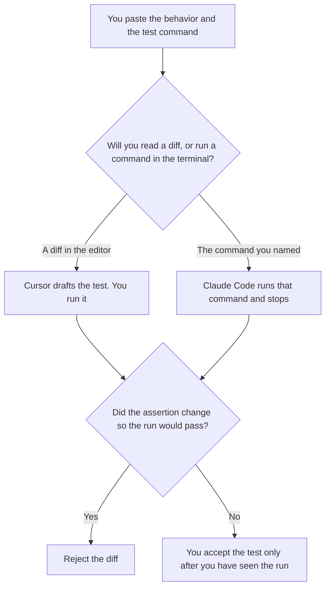

**Use Cursor when the test should be a diff you can read in the editor, on a branch you already control. Use Claude Code when the next step is a terminal command you named: run this test, stop, and show the output.** The model may draft the test from the behavior you wrote. It may not weaken an assertion so the run goes green, and it may not skip the test. The same job beside GitHub Copilot is [Cursor vs GitHub Copilot for tests](/blog/cursor-vs-github-copilot-for-tests-2026/). A defect, rather than a new test, is [Cursor vs Claude Code for bugfixes](/blog/cursor-vs-claude-code-for-bugfixes-2026/).

The place a test is allowed to run is [what an AI tool sandbox is](/blog/what-is-ai-tool-sandbox-2026/). How many tool calls that run may make is [what an AI tool call budget is](/blog/what-is-ai-tool-call-budget-2026/).

Cursor's Plus price is the October 24, 2026 help-center figure recorded in [Cursor pricing explained](/blog/cursor-pricing-explained-2026/). Claude Code's seat is the October 24 read of claude.com/pricing recorded in [Claude Code pricing explained](/blog/claude-code-pricing-explained-2026/). GitHub Copilot's comparison price is the October 16 directory card. Published October 24, 2026. We did not measure coverage. A test the model says is green, and that you did not run, is a comment.

## Which testing job you have

| The job | Start here | First paid step | The limit |
|---|---|---|---|
| A test diff you will read in the editor | [Cursor](/tools/cursor/) | Plus is $8 a month, or $80 a year | You run the test. The diff does not count as a run |
| Run the command you named, then stop | [Claude Code](/tools/claude-code/) | Included with Claude Pro at $17 a month billed annually, or $20 monthly | The command is the one you wrote. A shared usage pool is not a pass |
| Completions beside a test file in GitHub's editor | [GitHub Copilot](/tools/github-copilot/) | Pro is $10 a user a month on the October 16 card | That comparison is the other tests page |
| The behavior the test must lock | [Claude](/tools/claude/) | Pro is the same seat as above | The behavior is a sentence you pasted. It is not a guess |

Cursor's help page says Plus omits Cloud Agents, Automations, Bugbot, Origin, and third-party models. A test you draft and run locally can still be a Plus job. A cloud agent that keeps editing until something passes is a different spend, and it still does not get to weaken the assertion. Teams seats on that page are $30, $100, or $200 a seat a month. The company seat is [Cursor Business pricing explained](/blog/cursor-business-pricing-explained-2026/). This page is the test, not the invoice name.

Claude Code shares the Claude plan's usage with chat, on the October 24 page. Pro is $17 a month billed annually, $200 up front, or $20 monthly. That pool is not a coverage number. Max is a larger Claude plan. This page does not restate a Max dollar as a testing score. The review is [Claude Code review](/blog/claude-code-review-2026/).

GitHub Copilot Pro at $10 is the seat when the team standard is GitHub and you want completions beside the file. Business is $19 a user a month on the October 16 card. Use the Copilot comparison for that choice. Do not put Copilot's price on a Claude Code command.

## What the test is allowed to assert

The behavior you wrote, and the command you named. A fixture you did not paste stays out. A skip, a weaker expected value, or a deleted assertion is a failed review even if the process exits zero. The sandbox is where the command may run. Production is not a convenient environment because the fixture was missing.

**Cursor Plus** is the diff. The ladder is [Cursor pricing explained](/blog/cursor-pricing-explained-2026/).

**Claude Code on Pro** is the named command. The seat article is [Claude Code pricing explained](/blog/claude-code-pricing-explained-2026/).

**Copilot Pro** is the other editor path, on the other page. The invoice is [GitHub Copilot pricing explained](/blog/github-copilot-pricing-explained-2026/).

**Claude Pro** holds the behavior sentence when you are not in the repo yet. The review is [Claude review](/blog/claude-review-2026/).

A prompt that holds the line:

"Draft the test for the behavior I pasted. Run only the command I named. If the assertion would need to change for a pass, stop and say so. Do not weaken the assertion. Do not skip the test."

## What not to delegate

Do not ask which tool writes better tests. Do not accept a green run you did not see. Do not let a retry budget become permission to edit the expected value. You own the assertion. The tool drafts or runs what you named.

## FAQ

### How is this different from Cursor vs GitHub Copilot for tests?

That page is two editors: Cursor's diff, or Copilot completions beside a file in the editor the team already uses. This page is Cursor's diff against Claude Code's terminal, where the next step is a command you named. Copilot can still be the team's completion seat. It is not the command this page is choosing.

### How is this different from Cursor vs Claude Code for bugfixes?

That page is one defect: a small diff, or a reproduce-and-patch pass. This page is a test for a behavior you already wrote. A bugfix can add a test. A test page does not start from a stack trace and then invent the expected behavior. Paste the behavior. Then draft.

### Does a passing command mean the test is right?

No. It means that command exited the way the tool reported. You still read the assertion. A pass on a weakened expected value is a bad test that happened to exit zero. We did not measure coverage, and this page will not invent a percentage.

### Who may merge the test?

The person who read the diff and saw the run. A model comment that says the suite is green is not a review. An assertion you did not write stays out.

## Last verified

October 24, 2026 for Cursor's help page and for Claude, including Claude Code on paid plans, via the posts cited above. October 16, 2026 for GitHub Copilot. Published October 24, 2026. No coverage figure is published here.

**Sources:** [Cursor pricing](https://cursor.com/help/account-and-billing/pricing), [Claude pricing](https://claude.com/pricing), [Claude Code](https://claude.com/product/claude-code), [GitHub Copilot](https://github.com/features/copilot).

*Published by Andrew for [AI Tools Optimizer](https://aitoolsoptimizer.com).*

[Cursor](/tools/cursor/) is in the [coding directory](/tools/category/coding/). Directory pages may use affiliate links. A purchase through them may earn us a commission at no extra cost to you.
