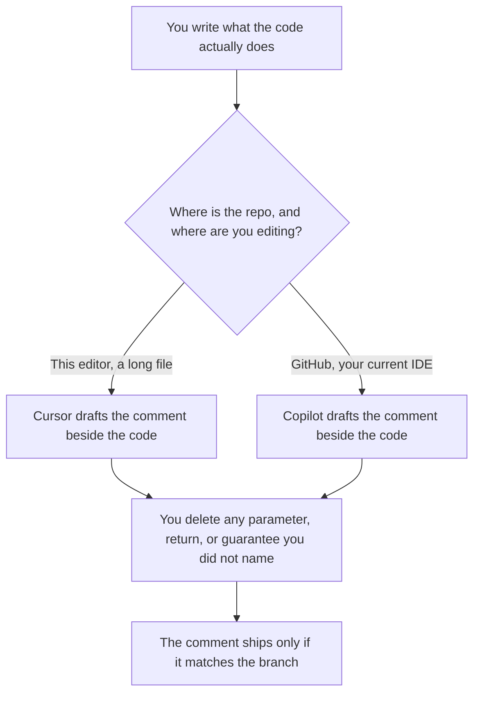

**Use Cursor when the comment has to follow a long file you are already editing in that editor. Use GitHub Copilot when the repo lives on GitHub and you want the comment drafted in the IDE you already use.** Both can write a docstring. Neither knows what the function does unless the code and your note say it. A comment that describes behavior the code does not implement is a bug with better grammar.

The wider product choice is [Cursor vs GitHub Copilot](/blog/cursor-vs-github-copilot-2026/). Team seats and admin controls are [Cursor vs GitHub Copilot for teams](/blog/cursor-vs-github-copilot-for-teams-2026/). The invoices are [Cursor pricing explained](/blog/cursor-pricing-explained-2026/) and [GitHub Copilot pricing explained](/blog/github-copilot-pricing-explained-2026/).

Prices are US list prices excluding tax from directory pages checked October 16, 2026. Published October 24, 2026. We did not score which comment a reviewer prefers.

## Which comment, which seat

| The writing job | Start here | First paid step | What you still do |
|---|---|---|---|
| A docstring on the function you have open | [Cursor](/tools/cursor/) Free, or [GitHub Copilot](/tools/github-copilot/) Free | Cursor Plus is $8 a month, or $80 a year. Copilot Pro is $10 a month | You name the behavior. Delete any parameter you did not list |
| The same comment style across a GitHub repo | Copilot Pro at $10, with code review on that plan | Business is $19 a user a month when you need admin controls and IP indemnity | The comment matches the code on the branch, not a hoped-for branch |
| A long file, and the comment must not contradict the rest of it | Cursor Plus. Premium is $30 a month if the included usage is not enough | Teams seats are $30, $100, or $200 a month | Read the neighboring functions before you accept the paragraph |
| A README section that is not code | [Claude](/tools/claude/) Pro at $20 a month, or $17 billed annually | Paste the public behavior only | A README is a promise. The model must not add a feature |
| The handbook that explains the module to new hires | [Notion AI](/tools/notion-ai/) Business at $20 a seat a month | The page is the record. The editor comment is the local note | Keep them from drifting. One of them is the copy |

Cursor's directory card, checked October 16, 2026, lists new plans on The X Subscription: Free, Plus $8, Premium $30, Super $100, and Ultra $200 a month. Annual figures on that card are $80, $300, $1,000, and $2,000. Legacy Pro at $20 remains for existing subscribers. Copilot Free includes 2,000 completions a month. Pro adds a cloud agent, code review, and $15 in monthly credits. Pro+ is $39. Those credits are not a comment quota. A docstring does not need Ultra or Copilot Max at $100.

## What the sentence is allowed to say

A useful comment names the behavior you described, the inputs you listed, the failure you listed, and nothing else. It does not narrate the implementation line by line. It does not promise thread safety, a latency bound, or a side effect you did not write down.

**Cursor** is the paid seat when you want the agent in the editor with the file open, and you will reject a comment that wandered into the next function. The review is [Cursor review](/blog/cursor-review-2026/). A small repo workflow is [how to use Cursor for a side project](/blog/how-to-use-cursor-for-a-side-project-2026/).

**Copilot** is the paid seat when the team already reviews on GitHub and the comment is part of that pull request. Business at $19 is the row for IP indemnity and budget controls, on the October 16 card. The review is [GitHub Copilot review](/blog/github-copilot-review-2026/). The shelf around both is [best AI coding assistants](/blog/best-ai-coding-assistants-2026/).

A prompt that holds the line:

"Write a doc comment for this function. Use only the behavior, parameters, and errors I pasted. If a return value is not in my notes, write Unknown. Do not describe code I did not include. Do not add an example that calls the network."

## What not to delegate

Do not ask the model to invent a public API from a private helper. Do not accept a comment that says the function validates input when the branch does not. Do not let a README and a docstring disagree. If they disagree, the code and the tests decide, then you fix the sentence. The shape of a machine-readable answer, when the comment is actually a schema, is [what an AI output schema is](/blog/what-is-ai-output-schema-2026/).

## FAQ

### Which one writes better comments?

We did not measure review comments. Pick Cursor when the long file is open in Cursor. Pick Copilot when the work is a GitHub pull request in your current editor. Read the sentence against the branch either way.

### Is a generated comment documentation?

It is a draft of documentation. Documentation is the sentence a person accepted because it matches the code. An unreviewed docstring will drift the first time the function changes.

### Do we need Premium or Pro+ for comments?

No. Plus or Copilot Pro is the first paid step if Free is too tight during a documentation pass. Higher tiers are for heavier agent use. A comment is a short generation.

### What if the code has no behavior note?

Then the model is guessing. Write one sentence of behavior yourself, or leave the comment as a TODO a person owns. A fluent guess is worse than a missing comment, because reviewers trust it.

## Last verified

October 16, 2026 for Cursor, GitHub Copilot, Claude, and Notion AI. Published October 24, 2026.

**Sources:** [Cursor pricing](https://cursor.com/help/account-and-billing/pricing), [GitHub Copilot plans](https://github.com/features/copilot), [Claude pricing](https://claude.com/pricing), [Notion pricing](https://www.notion.com/pricing).

*Published by Andrew for [AI Tools Optimizer](https://aitoolsoptimizer.com).*

[Cursor](/tools/cursor/) is in the [coding directory](/tools/category/coding/). Directory pages may use affiliate links. A purchase through them may earn us a commission at no extra cost to you.
