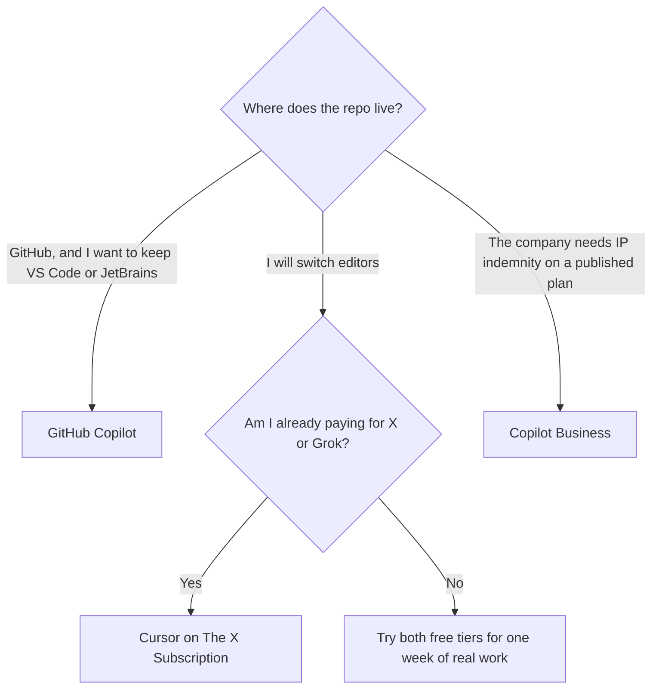

**Use GitHub Copilot when the code already lives in GitHub and you want the assistant inside the editor you have. Use Cursor when you want the editor itself to be the agent, or you are already paying for The X Subscription.** Daily coding is a habit problem: completions while you type, a chat that can see the repo, and a place to review what the agent changed. It is not a contest of which model writes better functions. We did not run that contest.

Prices are US list prices excluding tax, from vendor pages checked October 16, 2026, republished here on October 24, 2026. A live refetch of the pricing URLs that day did not return numbers, so these are the October 16 figures. Open the source before you subscribe.

The three-way with terminal agents is [Cursor vs Claude Code vs Codex](/blog/cursor-vs-claude-code-vs-codex-2026/). This page stays on the two products people compare for a workday in an editor. The shortlist around them is [best AI coding assistants](/blog/best-ai-coding-assistants-2026/).

## The workday, side by side

| | Cursor | GitHub Copilot |
|---|---|---|
| Shape | An AI-native editor, plus a CLI, Slack, GitHub reviews, and cloud agents | Completions, chat, a cloud agent, and code review inside editors you already use, and on GitHub |
| Free | Agent, Chat, and Tab on Cursor models, limited usage | 2,000 completions a month. Models such as Haiku 4.5 and GPT-5 mini |
| First paid plan most people mean | Plus $8/month, or $80/year, on The X Subscription. That bundle also covers [Grok](/tools/grok/) and X | Pro $10/user/month, with cloud agent, code review, model choice, third-party agents, and $15 of monthly credits |
| Next individual step | Premium $30/month ($300/year). Super is $100. Ultra is $200 | Pro+ $39/month with premium models including Opus and $70 of credits. Max is $100/month with $200 of credits |
| Team or company | Team seats $30, $100, or $200/month, matching Premium, Super, or Ultra usage | Business $19/user/month with governance, IP indemnity, and 1,900 credits per user. Enterprise $39/user/month |
| Where it assumes your code is | A local project, plus GitHub when you turn those integrations on | GitHub is the center. Other hosts are a weaker fit |
| What is easy to misunderstand | New customers buy The X Subscription. Legacy Cursor Pro at $20 still exists for people already on it. Switching off a legacy plan is permanent | Credits and premium models are not the same thing as "unlimited Copilot." Free is a completion cap, not a full agent plan |

## What you feel during a normal day

**Completions.** Copilot Free is explicitly a completion allowance: 2,000 a month. Copilot Pro removes that as the reason you upgrade and adds the agent surface. Cursor Free includes Tab as well as Agent and Chat, on Cursor's own models, with a usage cap the pricing page describes as limited rather than as a completion count. If your day is "accept the next line in the editor I already trust," Copilot matches that day with less migration.

**A task bigger than a line.** Both paid plans advertise an agent that can take work and come back with a change. Cursor's pitch is that the agent can use its own computer, and that you can run the same product from the terminal, Slack, and GitHub. Copilot's pitch is that the cloud agent opens a pull request in the GitHub flow your team already reviews. For a side project with no reviewers, the editor-agent loop in Cursor is the shorter path. The walkthrough is [how to use Cursor for a side project](/blog/how-to-use-cursor-for-a-side-project-2026/).

**Model choice.** Copilot Pro is where model selection and third-party agents, including [Claude Code](/tools/claude-code/) and [Codex](/tools/openai-codex/), show up, paid for with credits. Pro+ is where Opus-class models are listed. Cursor on The X Subscription draws from a shared usage pool with Grok. Premium is described as 4x Plus usage, Super as 15x, Ultra as 50x. Those multipliers are relative. They are not a promise of a number of agent runs. Measure a week. Do not buy Ultra because the multiple sounds like a performance score.

## Who pays for which

**A developer who will not change editors.** Copilot Pro at $10. Stay there until credits run out on the models you actually select. Pro+ at $39 is the premium-model plan, not a politeness upgrade. The plan math is [GitHub Copilot pricing explained](/blog/github-copilot-pricing-explained-2026/). The product page is [GitHub Copilot review](/blog/github-copilot-review-2026/).

**A developer who wants one subscription for chat and the editor.** Cursor Plus at $8, because The X Subscription is also the Grok plan. If you already pay for Grok Premium at $30, that tier is the Cursor Premium usage band. Buying Copilot Pro on top is a second assistant, which is reasonable only if you still want GitHub's review bot in a company repo. See [Cursor review](/blog/cursor-review-2026/) and [Grok review](/blog/grok-review-2026/).

**An engineering manager buying seats.** Copilot Business at $19 is the plan that publishes IP indemnity, access controls, and a credit allotment per user. Cursor's team seats start at the Premium usage band, $30. Those are different products: indemnity and GitHub admin on one side, an AI-native editor seat on the other. Pick the control your counsel asked for, then the interface.

**A student or a very light user.** Copilot Free, or the Copilot Student plan GitHub offers to verified students. We do not have a separate student price in the pages we checked. Cursor Free is the parallel test if you are willing to install the editor.

## What not to do with either

- Do not treat an agent pull request as reviewed because the diff is small. Read it.
- Do not paste production secrets into chat to "help it debug."
- Do not buy Max or Ultra in week one. Both vendors sell a cheap paid tier that covers a normal day. The expensive tiers are credit and usage pools.
- Do not assume Copilot's third-party agents replace a [Claude Code](/tools/claude-code/) subscription you already use in the terminal. They overlap. The beginner path for the terminal tool is [Claude Code for beginners](/blog/claude-code-for-beginners-2026/).

## FAQ

### Is Cursor cheaper than GitHub Copilot?

The first paid lists are Cursor Plus at $8 and Copilot Pro at $10. Cursor Plus is a bundle with Grok and X, not an editor-only discount. Copilot Business at $19 can be the cheaper company seat versus a Cursor team seat at $30, and it is the one that lists IP indemnity.

### Can I use both?

Yes. People do, and then they pay twice to solve the same completion. Use both during a one-week test. Keep the one that matches the editor and the host you will still be using next month.

### Which is better for a private company repo?

Copilot Business is the plan with a published indemnity and admin story. Cursor can work on a private repo on your machine. That is not the same as a vendor indemnity clause. Read the current terms before you put either in a vendor review.

### Do these plans include [Claude](/tools/claude/) and GPT-class models?

[GitHub Copilot](/tools/github-copilot/)'s paid plans include model choice and list third-party agents such as [Claude Code](/tools/claude-code/) and [Codex](/tools/openai-codex/), with premium models called out on Pro+. [Cursor](/tools/cursor/)'s new plans route through The X Subscription and Cursor's own model picker. The question is about [Claude](/tools/claude/) and GPT-class models, which show up as selectable models or agents, not as a second subscription you can assume is unlimited. The available model names move. The bill does not move with them unless you change tier.

## Last verified

October 16, 2026 for prices. Published October 24, 2026. The pricing pages did not return a fresh fetch that day.

**Sources:** [Cursor pricing](https://cursor.com/help/account-and-billing/pricing), [The X Subscription pricing](https://docs.x.ai/x-subscription/pricing), [GitHub Copilot plans](https://github.com/features/copilot/plans), [GitHub Copilot docs](https://docs.github.com/en/copilot).

Both tools are in the [coding directory](/tools/category/coding/). [Cursor](/tools/cursor/) and [GitHub Copilot](/tools/github-copilot/) may use affiliate links. A purchase through them may earn us a commission at no extra cost to you.
