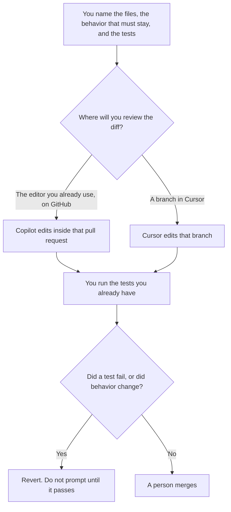

**Use Cursor when the refactor is a branch in an AI-native editor and you want the agent to touch the files you named. Use GitHub Copilot when the code stays in the editor you already use and the change should arrive as a pull request on GitHub.** A refactor here means a behavior-preserving edit: rename, extract, or move code you already own, with tests you already have. It is not a new feature, and it is not a test-writing session.

The general product split is [Cursor vs GitHub Copilot](/blog/cursor-vs-github-copilot-2026/). The seat-and-admin split is [Cursor vs GitHub Copilot for teams](/blog/cursor-vs-github-copilot-for-teams-2026/). The test-writing split is [Cursor vs GitHub Copilot for tests](/blog/cursor-vs-github-copilot-for-tests-2026/).

Prices are US list prices excluding tax from directory pages checked October 16, 2026. A live fetch of vendor pricing pages returned HTTP 401 on October 24, 2026, so this page stays on the directory record. Published October 24, 2026. We did not score refactor quality. You run the tests.

## Which seat matches the diff

| The change you actually have | Start here | What you still do |
|---|---|---|
| A rename in a few files, in your current editor | [GitHub Copilot](/tools/github-copilot/) Free, with 2,000 completions a month | You read the diff |
| A multi-file refactor you will review in GitHub | Copilot Pro at $10 a user a month | Pro includes the cloud agent and $15 in monthly credits |
| The work happens in Cursor's editor, on a branch | [Cursor](/tools/cursor/) Plus at $8 a month, or $80 a year | You throw the branch away if the tests fail |
| Heavier agent use on the Copilot card | Copilot Pro+ at $39, with $70 in credits, or Max at $100, with $200 | Credits are not a quality score |
| Heavier use on the new Cursor card | Premium at $30 a month, or $300 a year | Legacy Pro at $20 remains for existing subscribers |

Cursor's new plans are The X Subscription: Plus $8, Premium $30, Super $100, Ultra $200 a month, or $80, $300, $1,000, and $2,000 a year. Teams seats are $30, $100, or $200 a month. Switching off a legacy plan is permanent, on Cursor's help text in the directory. Copilot Business is $19 a user a month and Enterprise is $39, when you need the governance and the IP indemnity on that card. A solo refactor does not require Business. The invoices are [Cursor pricing explained](/blog/cursor-pricing-explained-2026/) and [GitHub Copilot pricing explained](/blog/github-copilot-pricing-explained-2026/).

## What the edit may change

Names, file layout, and duplication you pointed at. It may not change a return value, a public API, an error message a caller depends on, or a comment that documents a bug you have not fixed. If a test fails, the refactor is unfinished. Prompting until the test is deleted is a different change. Say so, and do not call it a refactor.

**Cursor Plus** is the paid path when you want the agent in that editor and the branch is disposable. The review is [Cursor review](/blog/cursor-review-2026/).

**Copilot Pro** is the paid path when completions and the cloud agent should stay inside GitHub and your IDE. Free's 2,000 completions can cover a small rename. They are a poor plan for a repo-wide move you will repeat.

A prompt that holds the line:

"Refactor only the files I named so that the behavior I described stays the same. Do not change public signatures, error strings, or tests unless I said the test itself is the bug. If you must change behavior, stop and list the line."

## What not to delegate

Do not ask the agent to "clean up the repo" with no file list. Do not accept a diff you did not read because the tests were green on a subset. Do not mix a refactor and a feature in one pull request. The feature has its own review. The place a risky edit can run without shipping is [what an AI tool sandbox is](/blog/what-is-ai-tool-sandbox-2026/). The version you place on a small slice later is [what an AI canary deployment is](/blog/what-is-ai-canary-deployment-2026/).

## FAQ

### Which one refactors better?

We did not measure that. Pick Cursor when the branch and the agent live in Cursor. Pick Copilot when the review lives in GitHub and the editor you already have. The refactor is done when the behavior you named still holds and a person has read the diff.

### Do I need both?

Only if they do different hours of your week and you can say which diff each one owns. Two agents editing the same branch is how a rename lands twice. One owner for the pull request.

### What if there are no tests?

Then the refactor is a reading task. Name the behaviors a person will click through, and keep the diff small enough to read. An agent that "knows it still works" is not a test. The test workflow, when you are ready to add coverage first, is the tests comparison.

### Are the credit dollars a usage cap I can predict?

Copilot Pro includes $15 in monthly credits on the October 16 card. Pro+ includes $70 and Max includes $200. Cursor's paid tiers are described as multiples of Plus usage, not as a fixed request count. Neither number tells you whether a refactor will fit. Watch the invoice on a branch you can delete.

## Last verified

October 16, 2026 for Cursor and GitHub Copilot. Published October 24, 2026. Live pricing fetches returned HTTP 401 that day.

**Sources:** [Cursor pricing](https://cursor.com/help/account-and-billing/pricing), [GitHub Copilot plans](https://github.com/features/copilot).

*Published by Andrew for [AI Tools Optimizer](https://aitoolsoptimizer.com).*

[Cursor](/tools/cursor/) is in the [coding directory](/tools/category/coding/). Directory pages may use affiliate links. A purchase through them may earn us a commission at no extra cost to you.
