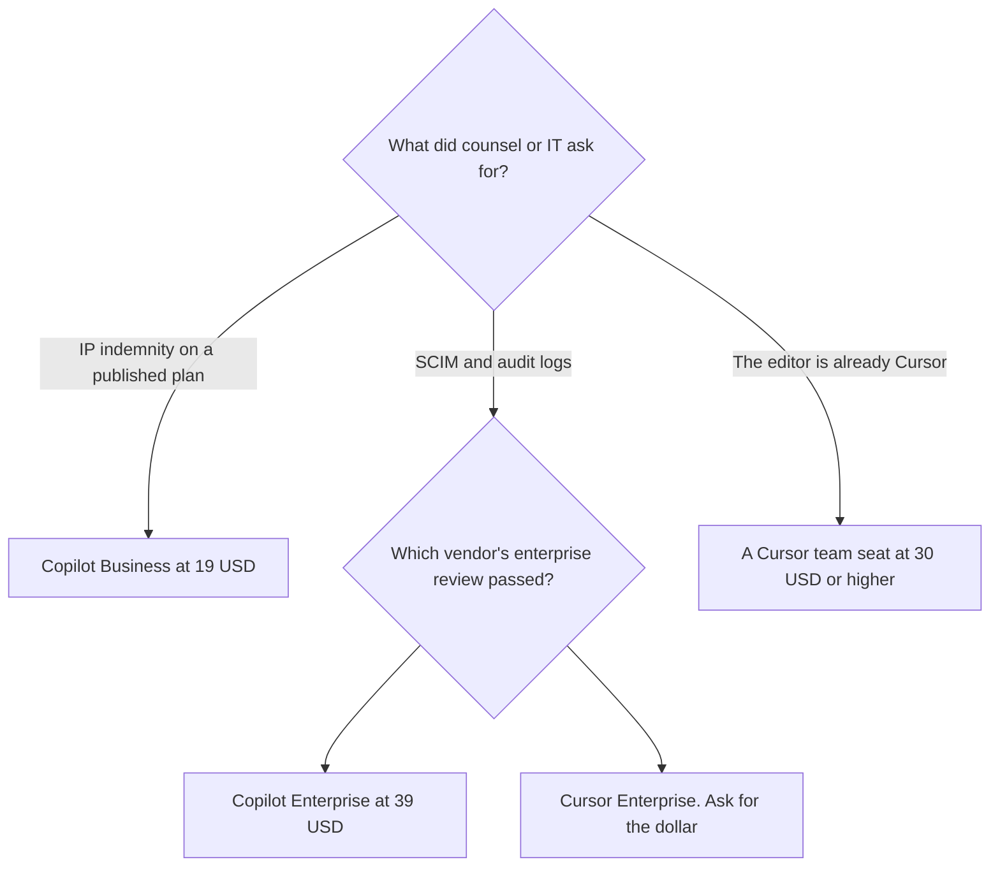

**Buy GitHub Copilot Business at $19 a user a month when the team needs a published admin seat on GitHub, with IP indemnity on that plan. Buy a Cursor team seat at $30, $100, or $200 a month when the standard editor is Cursor and you are buying usage that matches Premium, Super, or Ultra.** The individual habit, completions versus an AI-native editor, is a different article. This one is the invoice an engineering manager can defend.

The day-to-day comparison is [Cursor vs GitHub Copilot](/blog/cursor-vs-github-copilot-2026/). The sticker math for one person is [GitHub Copilot vs Cursor pricing](/blog/github-copilot-vs-cursor-pricing-2026/). The separate ladders are [GitHub Copilot pricing explained](/blog/github-copilot-pricing-explained-2026/) and [Cursor pricing explained](/blog/cursor-pricing-explained-2026/).

Prices are US list prices excluding tax from directory pages checked October 16, 2026. Published October 24, 2026. We did not score code quality.

## The team cards

| What finance will ask | [GitHub Copilot](/tools/github-copilot/) | [Cursor](/tools/cursor/), new customers |
|---|---|---|
| The company seat people mean | Business, $19 a user a month, with 1,900 credits, governance, and IP indemnity | Team seats at $30, $100, or $200 a month, matching Premium, Super, or Ultra usage |
| The heavier company seat | Enterprise, $39 a user a month, with 1,900 plus 2,000 credits and priority access to new features | Enterprise adds pooled usage across Grok and Cursor, SCIM, audit logs, and invoice billing. The card does not print an Enterprise dollar |
| A personal seat someone might expense | Pro, $10, with $15 in monthly credits. That is not the admin plan | Plus, $8 a month or $80 a year, on The X Subscription. That is not a team seat |
| Legacy, if you already have it | The card prices current plans. It does not list a legacy Copilot team price here | Teams Standard $40 a user and Teams Premium $120 a user, for existing customers. A move to The X Subscription is permanent once you switch |
| Where the code is assumed to live | GitHub | A local project, plus GitHub when you turn integrations on |

Ten people on Copilot Business are 10 × $19 = $190 a month. Ten people on the lowest new Cursor team seat are 10 × $30 = $300 a month. Ten people on Copilot Enterprise are 10 × $39 = $390 a month. Those totals buy different controls. Do not present them as the same product at three prices.

## What admin means on each card

**Copilot Business** is the plan that names access controls, budget controls, IP indemnity, and pooled credits on the directory card. Enterprise at $39 is the step when you need the extra credit pool and priority access to new features. A developer on Pro at $10 does not inherit indemnity because the company reimburses the card. The review is [GitHub Copilot review](/blog/github-copilot-review-2026/).

Pro+ at $39 and Max at $100 are individual credit tiers. They are the wrong line item for a team standard. If one person needs Opus-class models, that is a named exception, not a silent upgrade for the org.

**Cursor team seats** follow usage bands: $30 matches Premium, $100 matches Super, $200 matches Ultra. Premium is described as 4 times Plus usage, Super as 15 times, Ultra as 50 times. Those multiples are relative. They are not a count of pull requests. Enterprise is where the card lists SCIM, audit logs, pooled usage, and invoice billing, without a public price. Ask the vendor and write the number down. The directory's note that Cursor Router is launching for Teams and Enterprise does not include a router fee.

Existing Teams Standard at $40 and Teams Premium at $120 stay available for customers who already have them. Do not put $8 on a budget slide for that contract. Plus at $8 is the new individual entry. The review is [Cursor review](/blog/cursor-review-2026/).

Switching a legacy Cursor plan to The X Subscription is optional and permanent once you switch. Read that sentence before a renewal meeting.

## How a team should roll it out

Standardize one seat. A new hire who gets both Copilot Business and a Cursor team seat is $19 + $30 = $49 a month at the first team tiers, or $570 a year, before anyone asks whether both windows stay open. Pay for both only when you can name the hour: Copilot for review inside GitHub, Cursor for the editor the pod already adopted.

A terminal agent is a third bill. [Claude](/tools/claude/) Pro is $20 a month, or $17 billed annually, and includes Claude Code. There is no Claude Code on Free. The map is [Cursor vs Claude Code vs Codex](/blog/cursor-vs-claude-code-vs-codex-2026/). Do not add it as a default seat in the same purchase as the editor standard.

The person who merges still reviews the diff. The flag that limits a risky assistant feature to staff is [what AI feature flags are](/blog/what-is-ai-feature-flags-2026/). The prompt text in your own tools still needs a version: [what prompt versioning is](/blog/what-is-prompt-versioning-2026/).

## FAQ

### Is Copilot Business cheaper than Cursor for teams?

On the first published team stickers, yes: $19 versus $30. Copilot Enterprise at $39 can cost more than a $30 Cursor seat and less than a $100 Cursor seat. Compare the control you were asked for, then the usage band.

### Does Copilot Business include Cursor?

No. A GitHub org seat does not install Cursor. A Cursor team seat does not include Copilot's IP indemnity clause. Read the clause you were sent, not a summary of it.

### What if half the team is on legacy Cursor Teams at $40?

Keep the legacy invoice if it still fits, and do not describe those people as "on the $8 plan." New hires on The X Subscription are a different contract. Mixing the two in one average will be wrong at renewal.

### Who should not get a paid team seat yet?

Someone whose work is not in the repo. Copilot Free is 2,000 completions a month. Cursor Free includes Agent, Chat, and Tab with limited usage. Use the free tier until the cap, not a headcount plan, says the seat is real.

## Last verified

October 16, 2026 for GitHub Copilot and Cursor prices named above, including legacy Cursor team seats. Cursor Enterprise has no public dollar on the card. Published October 24, 2026.

**Sources:** [GitHub Copilot](https://github.com/features/copilot), [Cursor pricing](https://cursor.com/help/account-and-billing/pricing).

*Published by Andrew for [AI Tools Optimizer](https://aitoolsoptimizer.com).*

[GitHub Copilot](/tools/github-copilot/) is in the [coding directory](/tools/category/coding/). Directory pages may use affiliate links. A purchase through them may earn us a commission at no extra cost to you.
