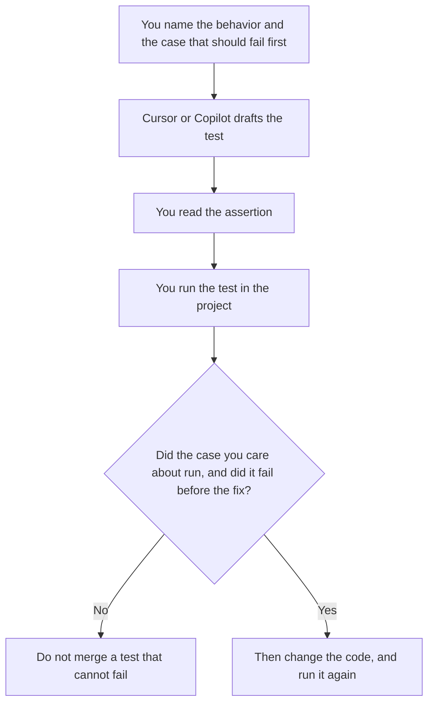

**Write the test in the editor you already use, then run it. Cursor Plus at $8 a month is the seat when the test is drafted in Cursor and you will read the diff. GitHub Copilot Pro at $10 a user a month is the seat when the team standard is GitHub and you want completions beside the test file.** A test the model says is green, and that you did not run, is a comment. We did not score which product writes better tests.

The editor choice, beyond tests, is [Cursor vs GitHub Copilot](/blog/cursor-vs-github-copilot-2026/). The team-admin version is [Cursor vs GitHub Copilot for teams](/blog/cursor-vs-github-copilot-for-teams-2026/). A failing Python trace, after a test exists, is [ChatGPT vs Claude for Python debugging](/blog/chatgpt-vs-claude-for-python-debugging-2026/).

Prices are US list prices excluding tax from directory pages checked October 16, 2026. Published October 24, 2026. We did not measure coverage or flake rates.

## What you are asking the tool to do

| The testing job | Start here | What you still do |
|---|---|---|
| A new unit test next to a function you can see | The editor you already open | Run the test. Reject a case that asserts a behavior you did not specify |
| You live in Cursor and want an agent to draft the file | [Cursor](/tools/cursor/) Plus, $8 a month or $80 a year | Read every hunk. Premium at $30 is 4x Plus usage, and a single test file rarely needs it |
| The repo and the reviews are on GitHub | [GitHub Copilot](/tools/github-copilot/) Pro at $10, which includes $15 in monthly credits on the card | A completion is a draft. The suite is yours to run |
| Several developers, with an admin and an indemnity question | Copilot Business at $19 a user a month | Business is the governance row. It does not run CI for you |
| You want a written explanation of a failure, not an edit | [Claude](/tools/claude/) or [ChatGPT](/tools/chatgpt/), then you return to the editor | Paste the failure. Do not let a chat rewrite the repo from memory |

A test that was generated green on the first try may be asserting the bug. Make it fail for the reason you care about, then make it pass. That order is the job. The model is allowed to type. You are the one who watches the runner.

## What the seats include

**Cursor Plus at $8 a month ($80 a year)** is the recorded base paid tier. Premium is $30 a month. Super is $100. Ultra is $200. Teams seats are $30, $100, or $200. Legacy Pro at $20 still appears for existing customers on the directory card. If you are on a legacy invoice, read that invoice. The public card and your renewal can differ. The invoice page is [Cursor pricing explained](/blog/cursor-pricing-explained-2026/).

**Copilot Free** includes 2,000 completions a month on the card. Pro at $10 adds a cloud agent, code review, and $15 in monthly credits. Pro+ is $39 with $70 in credits. Max is $100 with $200 in credits. Business is $19 a user a month. Enterprise is $39. A test-writing habit fits Pro unless the credit pool is what you are hitting. The invoice is [GitHub Copilot pricing explained](/blog/github-copilot-pricing-explained-2026/).

Buy the second product when the first one is not where the code review happens. A developer with Cursor and Copilot and a chat seat has three drafts and one runner. Pay for the runner's home.

Evals of a model are a different test. [AI eval testing](/blog/what-is-ai-eval-testing-2026/) scores prompts and answers. This page is a unit or integration test of your application. Do not point a model-eval harness at a function and call it CI.

A prompt that holds the line:

"Write one test for this behavior. Use the test framework already in the repo. Do not add a dependency. Do not change production code. The test must fail if the behavior is missing. If you need a fixture I did not provide, stop and say what is missing."

The person who runs CI is [what human-in-the-loop AI is](/blog/what-is-human-in-the-loop-ai-2026/). A confident test name with the wrong assertion is [what an AI hallucination is](/blog/what-is-ai-hallucination-2026/).

## What not to generate

Do not generate tests that call production, spend money, or hit a customer tenant. Do not accept a snapshot of the entire UI because the model needed an assertion. Do not lower a threshold so the new test passes. If the suite is already flaky, a generated test will join the flake. Fix the runner before you add volume.

If the failure is a product change, write the change down. The document is [how to draft a product spec with AI](/blog/how-to-draft-a-product-spec-with-ai-2026/). A test is not a spec. A spec addendum, when the behavior changed after the spec shipped, is [how to write a product spec addendum with AI](/blog/how-to-write-a-product-spec-addendum-with-ai-2026/).

## FAQ

### Which one gets coverage up faster?

We did not measure coverage. Coverage that asserts the wrong behavior is a liability. Run the new test, see it fail for the right reason, then keep it.

### Do I need Copilot Business to write a test?

Pro at $10 is the individual row. Business at $19 is the row for access control, budget controls, and IP indemnity, on the directory card. Match the row to the company's rule, not to the size of the test file.

### Should the agent update the code and the test together?

After you have seen the test fail. If the agent changes both before you run anything, you cannot tell whether the test can catch the bug. Split the diff.

### Is Free enough?

Copilot Free's 2,000 completions can cover a short period of test writing. Cursor's free tier is limited usage of Agent, Chat, and Tab. If the limit stops you mid-file, Plus or Pro is the next recorded step. Ultra and Max are for a heavier agent bill than one test file.

## Last verified

October 16, 2026 for Cursor and GitHub Copilot. Published October 24, 2026.

**Sources:** [Cursor pricing](https://cursor.com/help/account-and-billing/pricing), [GitHub Copilot plans](https://docs.github.com/en/copilot/about-github-copilot/subscription-plans-for-github-copilot).

*Published by Andrew for [AI Tools Optimizer](https://aitoolsoptimizer.com).*

[Cursor](/tools/cursor/) is in the [coding directory](/tools/category/coding/). Directory pages may use affiliate links. A purchase through them may earn us a commission at no extra cost to you.
