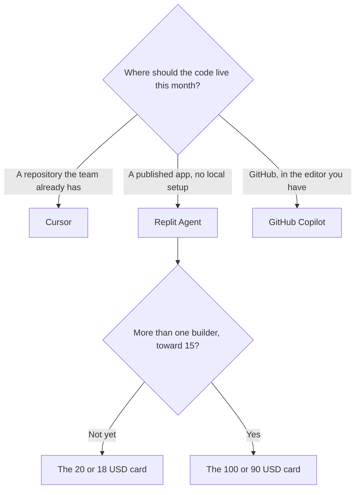

**Use Cursor when the code already lives in a repository you control and you want an AI editor on that repo. Use Replit Agent when you want to go from a prompt to a published app without a local setup.** Cursor maintains a project. Replit hosts the build. Treating them as two prices for the same IDE will put a prototype in the wrong place, or a production repo in a browser you did not mean to adopt.

Cursor's bill is [Cursor pricing explained](/blog/cursor-pricing-explained-2026/). Replit's bill, including the label caveat, is [Replit Agent pricing explained](/blog/replit-agent-pricing-explained-2026/). The editor neighbors are [Cursor vs GitHub Copilot](/blog/cursor-vs-github-copilot-2026/) and [Cursor vs Claude Code vs Codex](/blog/cursor-vs-claude-code-vs-codex-2026/).

Prices are US list prices excluding tax. Cursor's ladder is from the directory page checked October 16, 2026. Replit's dollar pairs are from the pricing page read October 24, 2026. Published October 24, 2026. We did not score code quality.

## Two products, two homes for the code

| The situation | Start here | First paid step | Not this |
|---|---|---|---|
| A repo you already clone | [Cursor](/tools/cursor/) | Plus is $8 a month, or $80 a year, on The X Subscription | A hosted app builder |
| An idea that should become a published app without local setup | [Replit](/tools/replit/) | Starter is free. The lower paid card read $20 a month or $18 billed annually | An editor on a laptop as the first step |
| Completions inside VS Code or JetBrains, on GitHub | [GitHub Copilot](/tools/github-copilot/) | Pro is $10. Business is $19 | A new IDE by default |
| An agent in the terminal, on the Claude seat | [Claude Code](/tools/claude-code/) | Included with Claude Pro at $20, or $17 billed annually. No free Claude Code | A cloud host |
| A generated UI that deploys to Vercel | [v0](/tools/v0/) or [Bolt.new](/tools/bolt-new/) | Bolt Pro is $25 month to month or $18 annually, on the October 24 card | Replit, if the target is not Replit |
| Several people sharing one credit pool for a prototype | [Lovable](/tools/lovable/) | Pro is $25 a month for 100 credits | A per-seat editor |

## The receipts

**Cursor's new plans** on The X Subscription are Free, Plus $8, Premium $30, Super $100, and Ultra $200 a month, or $80, $300, $1,000, and $2,000 a year. Premium is recorded as 4× Plus usage. Teams seats are $30, $100, or $200. Legacy Pro at $20 still exists for people who already have it. Plus is the manager-and-daily-editor step. Ultra is not a quality tier. It is headroom. Free includes Agent, Chat, and Tab with limited usage, on the directory card.

The risk with Cursor is the same as any agent in a repo: a diff you did not read. A copilot suggests. An agent edits. The definition is [what an AI copilot is](/blog/what-is-an-ai-copilot-2026/). The shelf is [best AI coding assistants](/blog/best-ai-coding-assistants-2026/).

**Replit Starter** is $0 in the docs read for the pricing explainer: daily Agent credits up to a monthly cap, monthly cloud credits, Lite build, and one published app that comes down after 30 days with a Made with Replit badge. The October 24 pricing page showed two paid dollar pairs, **$20 or $18 billed annually**, and **$100 or $90 billed annually**. The higher card said "Everything in Core plus" and "up to 15 collaborators." This site reads those cards as Core and Pro because those are the two self-serve prices and the second matches Pro's 15-builder limit. Replit's own Core doc, read the same day, does not print the dollar amount. If checkout labels them differently, checkout wins.

Annual Core, on that reading, is $216 a year against $240 month to month. Annual Pro is $1,080 against $1,200. Full build, the more autonomous Agent mode, still requires a paid plan on the Starter doc. The product story is [Replit Agent review](/blog/replit-agent-review-2026/). The prototype neighbors are [Lovable vs Bolt vs Replit](/blog/lovable-vs-bolt-vs-replit/).

An October 16 directory check could not load Replit's price and recorded no Core or Pro dollar. Use the October 24 article, not a guessed number from memory.

## How to choose without a bake-off

If the repository exists, start with Cursor Free or Copilot Free (2,000 completions a month) and see whether you are editing in that tree every day. Add Cursor Plus at $8 when the limit is the issue. Add Copilot Business at $19 when finance wants IP indemnity and admin controls more than a new editor.

If the repository does not exist and the point is to publish something this week, start on Replit Starter. Move to the $18 annual card when the badge, the single 30-day app, or the credit cap blocks a real user. Move to the $90 card when you are actually approaching a team, not because the higher card sounds more serious.

Do not run a production customer workflow on a prototype host and call it an editor migration. And do not rebuild a maintained repo inside Replit to avoid learning Cursor. The human who reads the change still has to exist. That step is [what human-in-the-loop AI is](/blog/what-is-human-in-the-loop-ai-2026/).

## FAQ

### Is Replit Agent cheaper than Cursor?

Starter is free, and Cursor has a free tier too. The first paid Replit card we could read was $20 or $18. Cursor Plus is $8. The cheaper paid seat is Cursor, and it does not host the app. Compare them after you know where the code should live.

### Can I use both?

Yes, on purpose. Replit for a throwaway prototype, Cursor once the code is in the repo you will maintain. Paying both to edit the same file is a duplicate.

### Does Cursor Plus include hosting?

No. Plus is the editor subscription on The X Subscription. Hosting, a database, and a public URL are a separate decision. Replit's paid plans are where that bundle starts in this comparison.

### Which one writes better code?

This page did not measure that. The model, the prompt, and whether you read the diff matter more than the logo. Run one task you already understand in each free tier. Keep the tool whose mistakes you can see.

## Last verified

October 16, 2026 for Cursor, GitHub Copilot, and Claude prices. October 24, 2026 for Replit's $20 / $18 and $100 / $90 cards and for Bolt Pro at $25 or $18. Published October 24, 2026.

**Sources:** [Cursor pricing](https://cursor.com/help/account-and-billing/pricing), [Replit pricing](https://replit.com/pricing), [GitHub Copilot](https://github.com/features/copilot).

*Published by Andrew for [AI Tools Optimizer](https://aitoolsoptimizer.com).*

[Cursor](/tools/cursor/) and [Replit](/tools/replit/) are in the [coding directory](/tools/category/coding/). Directory pages may use affiliate links. A purchase through them may earn us a commission at no extra cost to you.
