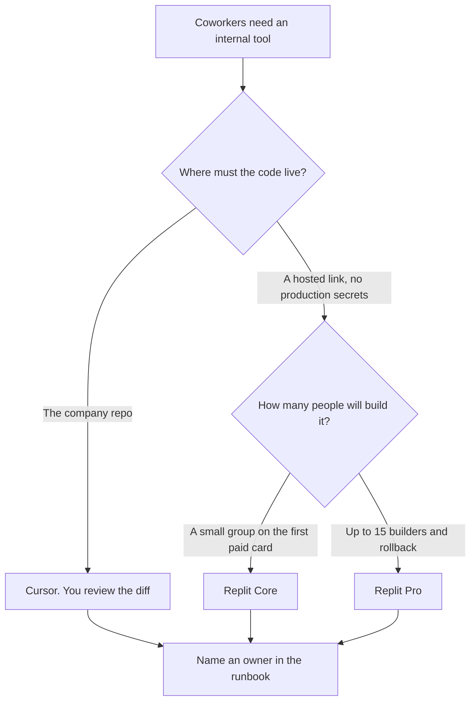

**Use Cursor when the internal tool should live in a repository the company already controls, and a coworker will review the diff. Use Replit when the tool should be a hosted app with a link, a small set of collaborators, and no production secrets.** A prototype you expect to delete on Friday is a different decision: [Cursor vs Replit for prototypes](/blog/cursor-vs-replit-for-prototypes-2026/). A bug in a repo you already have is [Cursor vs Claude Code for bugfixes](/blog/cursor-vs-claude-code-for-bugfixes-2026/).

Cursor's ladder is [Cursor pricing explained](/blog/cursor-pricing-explained-2026/). Replit's labeled cards are [Replit pricing explained](/blog/replit-pricing-explained-2026/). The place a tool is allowed to run is [what an AI tool sandbox is](/blog/what-is-ai-tool-sandbox-2026/).

Prices are US list prices excluding tax. Cursor's figures are from the directory, checked October 16, 2026. Replit's paid pairs are from the pricing-page read recorded on October 24, 2026: Core at $20 a month or $18 billed annually, and Pro at $100 or $90. An October 16 directory check could not load that page. A live fetch of several vendor pages on October 24 returned HTTP 401, and the Replit article is the record this page uses. Published October 24, 2026. We did not score apps.

## Which home matches the tool

| The tool coworkers will open | Start here | First paid step | The limit |
|---|---|---|---|
| A change in the company repo | [Cursor](/tools/cursor/) | Plus is $8 a month, or $80 a year | You still read the diff |
| A hosted app, one published link, no production keys | [Replit](/tools/replit/) | Core at $20, or $18 billed annually, on the October 24 read | Starter is free in the docs, with limits the Agent article describes |
| Up to 15 collaborators and a longer rollback | Replit Pro | $100, or $90 billed annually, on that read | 15 collaborators and 50 viewers were on the card. Do not plan a 16th builder |
| The runbook for who owns the tool | [Notion AI](/tools/notion-ai/) | Business is $20 a seat a month | The page is not the deployment |
| A written spec before anyone generates code | [Claude](/tools/claude/) | Pro is $20 a month, or $17 billed annually | The spec does not invent a permission |

Cursor Plus includes a base usage allowance. Premium is $30 a month, or $300 a year, and the directory calls it 4x Plus. An internal tool that is really a one-week script does not require Ultra at $200. The review of the diff is the control, at every tier.

Replit's October 24 card listed Core with Plan mode, AI integrations, and unlimited workspaces, and Pro with 10 parallel agents, up to 15 collaborators, up to 50 viewers, and database rollback up to 28 days. The October 16 directory still described a free Starter and said Core and Pro overage can accumulate until it crosses an invoice threshold that starts at $50 and can rise to $250. The October 24 text that article captured did not repeat the threshold. Confirm it on the billing page before you rely on it.

## What the tool is allowed to touch

Data a coworker is allowed to see, in an environment you named. Production credentials, customer extracts, and a shared admin token do not go into a hosted prototype so the demo "feels real." If the tool must read production, that is an access decision a person writes down, in the repo's environment, with an owner.

**Cursor** is the path when the tool will still be here next quarter and the company already reviews pull requests. A generated change that adds a secret to the client is a defect.

**Replit Core** is the path when you need a link this week and the data is fake or already approved for that host. **Replit Pro** is the path when the October 24 card's collaborator and rollback lines are the requirement. Enterprise is custom. This page does not quote a dollar for it.

**Claude** can draft the one-page spec: who uses the tool, what it must not do, and how you will know it failed. **Notion** holds that spec if the team already looks there.

A prompt that holds the line:

"Draft the internal-tool change from the behavior I pasted. Do not add a permission. If the data source is missing, write Data source missing and stop. Do not write a production secret into an example."

## What not to delegate

Do not put production keys in Replit because the agent asked for them. Do not merge a Cursor diff you have not run. Do not call a hosted app an internal tool of record until someone owns the login list. The login list is a page, not a prompt.

## FAQ

### How is this different from the prototype article?

That page is a thing you can delete. This page is a tool coworkers will open next month. The same products appear. The standard is an owner, a review, and a place the code lives after the demo.

### Which Replit plan is the internal-tool plan?

Core is the first paid card on the October 24 read. Pro is the card with up to 15 collaborators and database rollback up to 28 days. If you only need a link and Starter's limits are enough, read the Agent article before you skip Core. Checkout labels win if they differ from this site's reading.

### Do I need Cursor Premium?

Plus is the first paid Cursor card, at $8 a month or $80 a year. Premium is 4x Plus usage, at $30. Buy Premium when you are hitting the included usage, not because an internal tool sounds important.

### Can the agent decide the access model?

No. You name who can open the tool, and what data it may read. A generated "admin for everyone" default is the line you delete.

## Last verified

October 16, 2026 for Cursor, Claude, and Notion. October 24, 2026 for the Replit Core and Pro dollar pairs, as recorded in the Replit pricing article. Published October 24, 2026.

**Sources:** [Cursor pricing](https://cursor.com/help/account-and-billing/pricing), [Replit pricing](https://replit.com/pricing), [Claude pricing](https://claude.com/pricing), [Notion pricing](https://www.notion.com/pricing).

*Published by Andrew for [AI Tools Optimizer](https://aitoolsoptimizer.com).*

[Cursor](/tools/cursor/) is in the [coding directory](/tools/category/coding/). Directory pages may use affiliate links. A purchase through them may earn us a commission at no extra cost to you.
