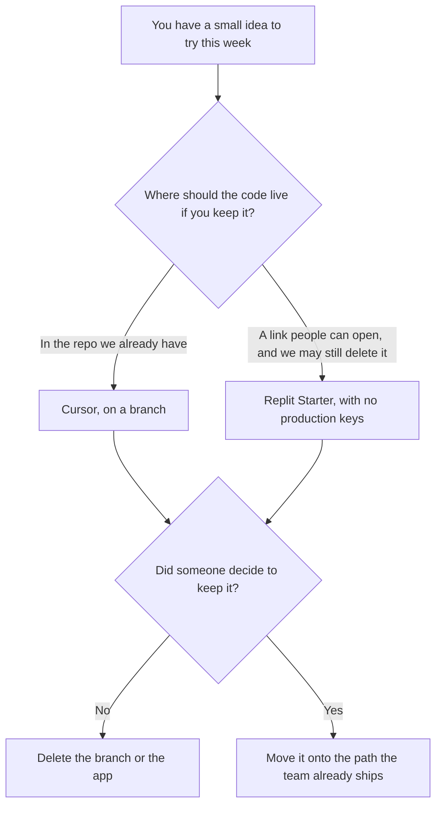

**Use Cursor when the prototype should be a branch in a repository you already control, and you will delete the branch if the idea fails. Use Replit when the prototype should be a hosted app you can click, with no local setup, and you have not put production keys in it.** The editor-versus-agent decision for a real codebase is [Cursor vs Replit Agent](/blog/cursor-vs-replit-agent-2026/). This page is the throwaway: a thing you can abandon on Friday without having adopted a platform.

Cursor's ladder is [Cursor pricing explained](/blog/cursor-pricing-explained-2026/). Replit's dollar pairs, including the label caveat, are [Replit Agent pricing explained](/blog/replit-agent-pricing-explained-2026/). The place a test is allowed to run is [what an AI tool sandbox is](/blog/what-is-ai-tool-sandbox-2026/).

Prices are US list prices excluding tax. Cursor's figures are from the directory, checked October 16, 2026. Replit Starter is free in the docs. The paid pairs are from the pricing-page read recorded on October 24, 2026: $20 or $18 billed annually, and $100 or $90. This site reads those as Core and Pro. If checkout labels them differently, checkout wins. Published October 24, 2026. We did not score prototypes.

## Which home matches the prototype

| The prototype you actually need | Start here | First paid step | Throw it away by |
|---|---|---|---|
| A change inside a repo you have | [Cursor](/tools/cursor/) Free | Plus at $8 a month, or $80 a year | Deleting the branch |
| A page someone can click, no repo yet | [Replit](/tools/replit/) Starter | The $20 or $18 card when you need connectors or the badge gone | Letting the Starter app expire, or deleting the Repl |
| Completions inside GitHub, not a new host | [GitHub Copilot](/tools/github-copilot/) Free, 2,000 completions a month | Pro at $10 a user a month | Closing the pull request |
| A token-metered app with a cleaner public card | [Bolt.new](/tools/bolt-new/) Free, 1 million tokens a month | Pro at $25 a month | Deleting the project |

Cursor Premium is $30 a month, or $300 a year. A prototype that exists to be deleted does not need Premium, Super, or Ultra. Replit's higher card, $100 or $90 on the October 24 read, is the team plan this site reads as Pro, up to 15 builders. A one-person prototype does not need it. Starter's published app comes down after 30 days and carries a badge, on the docs. That expiry is a feature for a throwaway, as long as you expected it.

## What the prototype may contain

A fake dataset you wrote, a button that does not charge a card, and a note that says this is not production. It may not contain production credentials, customer records, or a webhook that emails real users. The moment it does, it is a system, and the sandbox page applies.

**Cursor Plus** is the paid step when Free runs out and the code should stay in the repo. Legacy Pro at $20 remains for existing customers, on the directory. New customers are on the X Subscription ladder. The review path is the pricing article.

**Replit Starter** is the right start for a clickable demo. Move to the $18 annual card when you need the connectors, Plan Mode, or the badge removed, and you have decided the prototype will live longer than the Starter window. Confirm the label at checkout. The product page is [Replit Agent review](/blog/replit-agent-review-2026/).

**GitHub Copilot Pro** is the paid step when the prototype is a pull request in a repo you already review, and you do not want a second host. The invoice is [GitHub Copilot pricing explained](/blog/github-copilot-pricing-explained-2026/).

A prompt that holds the line:

"Build a prototype of the flow I described. Use sample data only. Do not add a login to a real service, a payment call, or a send-email step. Put a comment at the top that says prototype, not for production."

## What not to delegate

Do not ask the tool to "just hook up production so we can see real data." Do not leave a Starter app up and call it the beta. Do not merge the branch because the demo looked finished. A person who owns the product decides whether the prototype becomes a ticket. Until that decision, the branch and the Repl are disposable.

## FAQ

### Which one builds a better prototype?

We did not measure that. Pick Cursor when the code has to land in a repository you control. Pick Replit when the output of the week is a link, and you can tolerate Starter's limits. The prototype is successful if you can delete it.

### Are the Replit paid prices final?

The October 24, 2026 pricing-page read showed $20 or $18, and $100 or $90. The docs still point at the pricing page for the dollar. This article uses those pairs with the Core and Pro reading explained in the pricing article. Checkout is the price you pay.

### Do we need Bolt instead?

Bolt Pro at $25 a month is a different meter, tokens rather than Replit credits. Use it when you want that card and you do not need Replit's hosted workspace. Compare by building the same small screen on each free plan and reading the usage line. The three-way is [Lovable vs Bolt vs Replit](/blog/lovable-vs-bolt-vs-replit/).

### When does a prototype stop being a prototype?

When it has a customer, a production key, or an owner who will be paged. Move it then, on purpose, onto the stack you already operate. A prototype that quietly became production is the incident you will not have a runbook for.

## Last verified

October 16, 2026 for Cursor, GitHub Copilot, and Bolt.new. October 24, 2026 for the Replit dollar pairs recorded in the pricing article. Starter remains the free plan in the docs. Published October 24, 2026.

**Sources:** [Cursor pricing](https://cursor.com/pricing), [Replit pricing](https://replit.com/pricing), [GitHub Copilot](https://github.com/features/copilot), [Bolt.new pricing](https://bolt.new).

*Published by Andrew for [AI Tools Optimizer](https://aitoolsoptimizer.com).*

[Cursor](/tools/cursor/) is in the [coding directory](/tools/category/coding/). Directory pages may use affiliate links. A purchase through them may earn us a commission at no extra cost to you.
