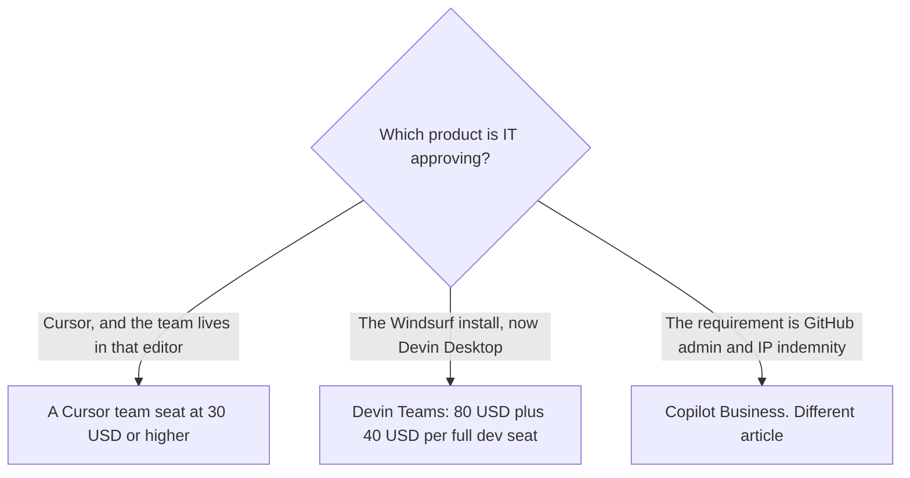

**Buy a Cursor team seat at $30, $100, or $200 a month when the standard editor is Cursor and you are matching Premium, Super, or Ultra usage. Buy Devin Desktop Teams, listed at $80 a month plus $40 a month per full developer seat, when the team wants the product that used to be Windsurf: one desktop that can dispatch more than one agent.** The directory records that rename. This page does not invent a separate Windsurf price that the card no longer lists.

The Cursor invoice is [Cursor pricing explained](/blog/cursor-pricing-explained-2026/). The GitHub admin seat, which is a third option, is [Cursor vs GitHub Copilot for teams](/blog/cursor-vs-github-copilot-for-teams-2026/). The wider shelf is [best AI coding assistants](/blog/best-ai-coding-assistants-2026/).

Prices are US list prices excluding tax. Cursor's team figures are from the help center as used in the October 24, 2026 pricing article, consistent with the directory card checked October 16, 2026. Devin Desktop figures are from devin.ai/pricing as recorded in the directory on October 16, 2026. Published October 24, 2026. We did not score completions or pull requests.

## The team cards

| What an engineering manager can quote | [Cursor](/tools/cursor/), new customers | [Devin Desktop](/tools/devin-desktop/), formerly Windsurf |
|---|---|---|
| The company plan | Team seats at $30, $100, or $200 a month, matching Premium, Super, or Ultra usage | Teams: $80 a month plus $40 a month per full developer seat, up to 200 users, with centralized billing |
| A personal seat someone might expense | Plus is $8 a month or $80 a year, and it withholds Cloud Agents and third-party models. Premium is $30 | Pro is $20 a month. Max is $200. Free includes unlimited Tab completions and a light agent quota |
| Legacy | Existing customers can keep Teams Standard at $40 a user or Teams Premium at $120. A switch to The X Subscription is permanent | The card does not list a leftover Windsurf SKU. It lists this product as the successor |
| Enterprise | Pooled usage, SCIM, audit logs, and invoicing. No Enterprise dollar on the card | Custom, for advanced security and support. No dollar on the card |
| What you are standardizing | Cursor as the editor | An agent command center that can also host other agents, on the directory description |

Ten full developer seats on the lowest new Cursor team plan are 10 × $30 = $300 a month. Ten full developer seats on Devin Desktop Teams are $80 + (10 × $40) = $480 a month, using the card's "plus" wording. Five seats are $150 on that Cursor plan and $80 + $200 = $280 on Devin Teams. Those totals are not the same product. Devin's $80 is a platform line on the card we used, not a seat that already includes a developer.

If some people only need Tab inside an editor they already have, do not put them on either team plan by default. [GitHub Copilot](/tools/github-copilot/) Business is $19 a user a month. That comparison is the article linked above.

## What "for teams" changes

**Admin and a bill.** Both team plans advertise a company seat rather than a pile of personal cards. Cursor's $30 seat is the usage tier, not a feature list this page should expand past the help center. Devin's card names collaboration and centralized billing on Teams. Ask for the security review in writing. Do not treat a blog summary as the DPA.

**People who already pay for Cursor.** Legacy team prices exist for existing customers. A move onto The X Subscription is permanent, including a prorated refund of the old plan, on the help page the pricing article cites. Read that page before a migration weekend.

**People still opening a Windsurf window.** The directory says Windsurf users can import settings into Devin Desktop. Budget the Teams line, not a Windsurf renewal you can no longer point at. Pro at $20 is the individual step when you are not ready for the platform fee.

**A terminal agent instead of a second IDE.** [Claude Code](/tools/claude-code/) is included with Claude Pro at $20 a month, or $17 billed annually. That is a different seat, for people who want the agent in the terminal. The three-way with Codex is [Cursor vs Claude Code vs Codex](/blog/cursor-vs-claude-code-vs-codex-2026/).

The side-project path, which often stays on Cursor Free or Plus, is [how to use Cursor for a side project](/blog/how-to-use-cursor-for-a-side-project-2026/). A team standard is the seat you can revoke.

## FAQ

### Did Windsurf shut down?

The directory, checked October 16, 2026, lists Devin Desktop as the former Windsurf editor from Cognition, with Windsurf and VS Code extension compatibility. Use the Devin card for a new team purchase. If a contract still says Windsurf, ask the vendor which SKU it maps to before you renew.

### Is Cursor's $8 plan a team plan?

No. Plus at $8 is an individual plan, and the help page says it does not include Cloud Agents, Automations, Bugbot, Origin, or third-party models. Those start on Premium at $30. Team seats start at $30.

### Why is Devin Teams more than $40 times headcount?

Because the recorded price is $80 a month plus $40 per full developer seat. Quote both lines. If a sales quote drops the platform fee, the quote wins for that contract. This page will not pretend the fee was never listed.

### Which one writes better code?

We did not score code. Pick from the editor you will standardize, the admin you can explain, and the invoice above. Run one real change on each trial before you roll a team.

## Last verified

October 16, 2026 for Devin Desktop, GitHub Copilot, and Claude. Cursor team prices match the help center as cited in the October 24, 2026 pricing article. Published October 24, 2026.

**Sources:** [Cursor pricing](https://cursor.com/help/account-and-billing/pricing), [Devin pricing](https://devin.ai/pricing), [GitHub Copilot](https://github.com/features/copilot).

*Published by Andrew for [AI Tools Optimizer](https://aitoolsoptimizer.com).*

[Cursor](/tools/cursor/) is in the [coding directory](/tools/category/coding/). Directory pages may use affiliate links. A purchase through them may earn us a commission at no extra cost to you.
