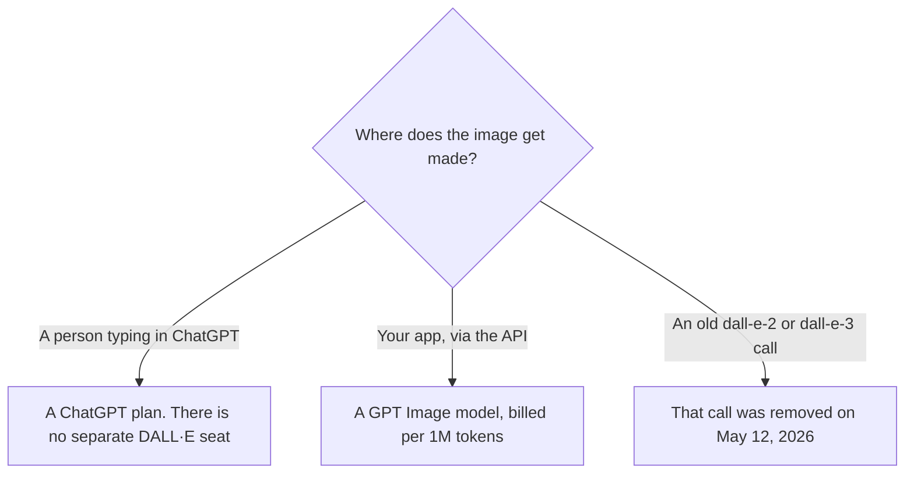

**DALL·E is not a separate subscription in 2026. OpenAI removed DALL·E 2 and DALL·E 3 from the API on May 12, 2026. Image creation for most people is a ChatGPT plan. Developers pay GPT Image token rates.** The shutdown date is from OpenAI's deprecations page on October 24, 2026. That page lists gpt-image-2, gpt-image-1, or gpt-image-1-mini as the recommended replacements for dall-e-2 and dall-e-3. The same day's API pricing page lists newer image models and says prices are per 1M tokens.

The product page is [ChatGPT Images, formerly DALL·E](/tools/dall-e/). A look study on a GPU plan is [Midjourney pricing explained](/blog/midjourney-pricing-explained-2026/). A mark a vendor embeds in an output is [what an AI output watermark is](/blog/what-is-ai-output-watermark-2026/).

ChatGPT seat prices below are from the directory page checked October 16, 2026, because chatgpt.com/pricing returned HTTP 403 on October 24. The API rates are from the pricing page we could read that day. Published October 24, 2026. We did not score images.

## Two bills, and neither is named DALL·E

| How you make the image | What you pay | Source date |
|---|---|---|
| Chat inside ChatGPT | The ChatGPT plan. Free includes limited image creation. Go is $8 a month. Plus is $20. Pro is $100, $200, or $500 | Directory, October 16, 2026. The card says Pro includes unlimited, faster image creation |
| API, standard, per 1M tokens | gpt-image-2.5-sunburst and gpt-image-2.5-flare: image input $8, image output $30, cached image input $2. Text input on those rows is $5, cached text $1.25 | API pricing page, October 24, 2026 |
| API, gpt-image-2, standard, per 1M tokens | Image input $4, image output $15, cached image input $1. Text input $2.50, cached text $0.625 | Same page |
| The old DALL·E API | Shut down May 12, 2026 | Deprecations page, October 24, 2026 |

The pricing page also lists batch rates and tells you to use the image generation calculator for a cost estimate. This article does not copy the batch table. If you need a batch number, read the page the day you ship. Regional processing and FedRAMP uplifts are named on that page for models released on or after March 5, 2026. Check whether your image model is in that set before you add 10% in a spreadsheet.

## The ChatGPT seat, from the October 16 card

**Free** includes limited image creation. The card does not print a monthly image count. Do not invent one.

**Go at $8** adds more image creation than Free, and the card says it may include ads.

**Plus at $20** is the professional seat on that card: more usage, projects, and the rest of the Plus line. It is not an unlimited image plan. The review is [ChatGPT review](/blog/chatgpt-review-2026/).

**Pro at $100, $200, or $500** is where the directory card says image creation is unlimited and faster, with Ultrafast mode named on the $500 tier. Buy Pro for volume you have already hit, not because a DALL·E brand still exists.

**Business** is $20 a user a month billed annually for two or more users, or $25 monthly, on that card. It is an admin and data-terms seat. It is not a cheaper image API.

## What you are comparing it with

**Midjourney** Basic is $10 a month, or $8 billed annually, on the October 16 directory card. There is no free plan. It is a different product, with its own privacy rules. Do not describe a ChatGPT image as a Midjourney plan.

**Adobe Firefly** Standard is $9.99 a month on the October 16 directory card. The invoice is [Adobe Firefly pricing explained](/blog/adobe-firefly-pricing-explained-2026/). Firefly's credit system is not OpenAI's token system.

**Leonardo** Essential is $12 a month on the October 16 card, with a free tier the card describes as casual. leonardo.ai/pricing returned HTTP 403 on October 24. The ladder is [Leonardo pricing explained](/blog/leonardo-ai-pricing-explained-2026/).

## What not to assume

Do not budget a DALL·E API price per image. That endpoint is gone. Do not multiply $30 by "images" as if $30 were the price of one picture. $30 is the October 24 standard price per 1M image output tokens for the 2.5 rows we read. A single image is a fraction of that, and the calculator on OpenAI's page is the estimate. Do not claim ChatGPT Free is unlimited. The directory says limited, and it does not print the cap.

## FAQ

### Is DALL·E still for sale?

Not as an API model. The deprecations page says DALL·E 2 and DALL·E 3 were removed on May 12, 2026. In ChatGPT, you still ask for an image. The bill is the ChatGPT plan. The directory's product name for that path is ChatGPT Images, formerly DALL·E.

### How much is the image API?

On October 24, 2026, standard prices per 1M tokens for gpt-image-2.5-sunburst and gpt-image-2.5-flare were $8 image input, $30 image output, and $2 cached image input. gpt-image-2 was $4, $15, and $1 on those same columns. Text-token columns on the same rows are lower. Use the calculator for one image.

### Which model replaced DALL·E 3?

The deprecations page names gpt-image-2, gpt-image-1, or gpt-image-1-mini. The pricing page the same day also lists gpt-image-2.5-sunburst and gpt-image-2.5-flare. Pick the model your account can call, and price that row. Do not assume the replacement list and the newest price row are the same model name.

### Does Plus include the API?

No. Plus is a ChatGPT subscription. API usage is billed on the API account. A developer who has Plus and an API key has two bills.

## Last verified

October 24, 2026 for the OpenAI deprecations page and the API pricing page. October 16, 2026 for ChatGPT plan prices, Midjourney, Firefly, and Leonardo. chatgpt.com/pricing returned HTTP 403 on October 24. Published October 24, 2026.

**Sources:** [OpenAI API deprecations](https://developers.openai.com/api/docs/deprecations), [OpenAI API pricing](https://developers.openai.com/api/docs/pricing), [ChatGPT pricing](https://chatgpt.com/pricing/).

*Published by Andrew for [AI Tools Optimizer](https://aitoolsoptimizer.com).*

[ChatGPT Images](/tools/dall-e/) is in the [image generation directory](/tools/category/image-generation/). Directory pages may use affiliate links. A purchase through them may earn us a commission at no extra cost to you.
