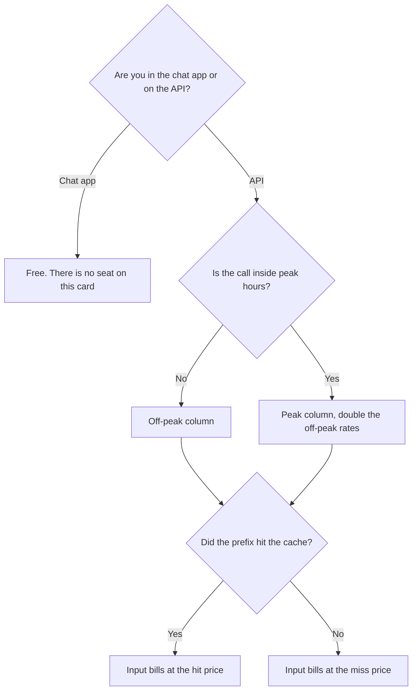

**DeepSeek's chat app is free. The API price this directory records is for deepseek-flash, the DeepSeek-V4.1-Flash model: $0.15 per 1 million input tokens off-peak on a cache miss, $0.003 on a cache hit, and $0.60 per 1 million output tokens off-peak.** Peak is double those three numbers: $0.30, $0.006, and $1.20. The bill is a prepaid balance, not a seat. A free chat and a production API are different products that share a name.

The ratio of hits to the tokens you hoped to cache is [what an AI prompt cache hit rate is](/blog/what-is-ai-prompt-cache-hit-rate-2026/). The unit is [what AI tokens are](/blog/what-are-ai-tokens-explained-2026/). The product page is [DeepSeek review](/blog/deepseek-review-2026/). A seat you already pay for a general assistant is [ChatGPT review](/blog/chatgpt-review-2026/) or [Claude review](/blog/claude-review-2026/).

Prices are US dollars per 1 million tokens, from DeepSeek's API docs as recorded in the directory on October 16, 2026. The directory says those prices took effect September 10, 2026. Published October 24, 2026. We did not run a bill. This page does not invent a price for a model the card does not list.

## The API card

| deepseek-flash (V4.1-Flash) | Off-peak | Peak |
|---|---|---|
| Input, cache hit | $0.003 | $0.006 |
| Input, cache miss | $0.15 | $0.30 |
| Output | $0.60 | $1.20 |
| Chat app | Free | Free. The app is not this table |

Peak hours on the card are 01:00–04:00 and 06:00–10:00 UTC, Monday to Friday, excluding Chinese public holidays. Other times, including weekends, are off-peak. A job you can move to the weekend uses the left column. A job that has to run at 02:00 UTC on a Wednesday uses the right column. Write that into the schedule before you multiply a monthly volume by the off-peak miss price and call it the budget.

Charges deduct from a prepaid balance, using any granted balance first, on the directory note. This page does not print a minimum top-up, because the card we used does not.

## How the three rates interact

**A cache miss is the planning price.** Off-peak, $0.15 per million input tokens is the number to use until you have measured a hit rate on your prefix. Peak miss is $0.30. If you quote $0.003 as "the input price," you are quoting the hit, and a rewritten prompt will not hit.

**A cache hit is a prefix match.** Off-peak hit is $0.003, which is 50 times smaller than the off-peak miss: $0.15 / $0.003 = 50. That is arithmetic on the recorded card. It is not a measured hit rate. Output does not get that discount on this table. Output stays $0.60 off-peak and $1.20 at peak, hit or miss.

**The chat app is not a discounted API.** Free chat on the web and mobile apps, plus the DeepSeek Harness desktop app, is the consumer product. Do not point a production workload at a personal chat and call it the API price. The API uses a key and a balance. The directory also says V4-Pro requests route to V4.1-Flash until V4.1-Pro launches. If your code still names an older model, read the current docs before you assume the table above is the one you are on.

Context on the card is 1 million tokens, with up to 384K output tokens. A long prompt can be a large miss. The length you can send is [what a context window is](/blog/what-is-a-context-window-2026/). Ordering the stable prefix first is [what context packing is](/blog/what-is-context-packing-2026/).

## What a seat costs somewhere else

[ChatGPT](/tools/chatgpt/) Plus is $20 a month. [Claude](/tools/claude/) Pro is $20 a month, or $17 billed annually. [Gemini](/tools/gemini/) on Google AI Plus is $4.99 a month. Those are seats with usage limits, not a published per-million price you can set next to $0.15. Compare them when the job is a person chatting. Compare the table above when the job is your own application. Data governance is a separate decision: the directory identifies DeepSeek as a Hangzhou-based company. A policy that restricts where prompts may be processed can rule the cheap token out. The policy list is [what an AI data retention policy is](/blog/what-is-ai-data-retention-policy-2026/).

## What not to assume

Do not average peak and off-peak into one rate unless your traffic actually splits that way. Do not ignore the cache column. Do not treat the free app as an SLA. Do not copy this table onto a different model name. When the docs retire a model, the old price is a story, not an invoice.

## FAQ

### Is DeepSeek free?

The chat assistant is free on the web and mobile apps, on the October 16 record. The API is paid per token, from a prepaid balance. Free chat does not include the prices in the table.

### When is off-peak?

All times outside 01:00–04:00 and 06:00–10:00 UTC on weekdays, excluding Chinese public holidays, including weekends. If your users are online during those UTC windows, budget the peak column for that slice.

### How do I estimate a month?

Count input tokens and output tokens separately. Price input at the miss rate until a real hit rate exists, then apply the hit price only to the share you measured. Add output at $0.60 or $1.20 per million depending on the hour. A worked example you have not measured is a guess. The ceiling on the result is [what AI budget caps are](/blog/what-is-ai-budget-caps-2026/).

### Does this page cover image or voice?

No. The directory says the consumer feature set is thinner than ChatGPT or Gemini on images and voice. This invoice is the text API on the card above. A different modality needs a different price page, and this one does not invent it.

## Last verified

October 16, 2026, from DeepSeek's API docs as recorded in the directory. Prices on that record took effect September 10, 2026. Published October 24, 2026.

**Sources:** [DeepSeek API pricing](https://api-docs.deepseek.com/quick_start/pricing), [DeepSeek](https://www.deepseek.com).

*Published by Andrew for [AI Tools Optimizer](https://aitoolsoptimizer.com).*

[DeepSeek](/tools/deepseek/) is in the [chatbots and assistants directory](/tools/category/chatbots-assistants/). Directory pages may use affiliate links. A purchase through them may earn us a commission at no extra cost to you.
