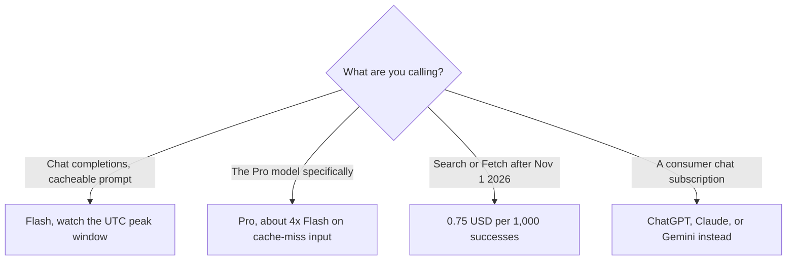

**[DeepSeek](/tools/deepseek/) publishes an API price list in USD per million tokens, with a peak window and a discount for cached input.** On October 24, 2026 the docs priced **deepseek-flash** (DeepSeek-V4.1-Flash) and **deepseek-v4-pro**. Flash input on a cache miss is **$0.15 per million tokens off-peak and $0.30 at peak**. Flash output is **$0.60 off-peak and $1.20 at peak**. A cached input token is far cheaper: **$0.003 off-peak and $0.006 at peak** per million on Flash. The chat app at deepseek.com is a separate surface. This review prices the API, which is the list with numbers on it.

We did not run a quality bake-off against GPT, Claude, or Gemini. [ChatGPT vs Gemini vs Claude](/blog/chatgpt-vs-gemini-vs-claude-2026/) is that map. DeepSeek's question is whether your workload can sit in the off-peak window and reuse a cache.

## The token table

Prices are USD per 1 million tokens. Off-peak is half of peak. Peak hours are **01:00–04:00 and 06:00–10:00 UTC, Monday through Friday**, excluding Chinese public holidays. Every other hour is off-peak, including weekends and those holidays in full.

| | Flash off-peak | Flash peak | Pro off-peak | Pro peak |
|---|---|---|---|---|
| Input, cache hit | $0.003 | $0.006 | $0.022 | $0.044 |
| Input, cache miss | $0.15 | $0.30 | $0.66 | $1.32 |
| Output | $0.60 | $1.20 | $1.98 | $3.96 |

The invoice is [DeepSeek pricing explained](/blog/deepseek-pricing-explained-2026/).

Flash's docs name the model id `deepseek-flash`. Older ids `deepseek-v4-flash` and `deepseek-v4-flash-vision-exp` are still accepted and are served by V4.1-Flash-1017 at the Flash price. Pro on the page is DeepSeek-V4-Pro-0813. Both list a 1 million token context and a maximum output of 384,000 tokens. Both support tools, JSON, and an Anthropic-compatible base URL at `https://api.deepseek.com/anthropic`. Vision is listed on Flash and not on Pro. Concurrency is listed at **2,500** for Flash and **500** for Pro.

Search and Fetch are separate from the chat models. Each is **$0.75 per 1,000 successful requests**. DeepSeek says that when those tools are invoked through DeepSeek Harness, Claude Code, or Codex, the calls are free until **00:00 Beijing time on November 1, 2026**, and per-request billing starts then. If you are wiring DeepSeek into an agent before that date, put a reminder on the calendar. A free tool call that becomes $0.75 per thousand is a small line until an agent loops.

## What the discount actually rewards

Cache-hit input on Flash off-peak is $0.003 per million. Cache-miss input is $0.15. That is a **50×** gap. A product that sends a long, stable system prompt and only changes the user turn will pay the cheap rate on the stable part if the cache hits. A product that rewrites the whole prompt every call will pay the miss rate and will not understand why the invoice moved. Peak makes both rates double, so a cache miss at peak is $0.30, still the number to design around.

A worked Flash example, off-peak, cache miss, no cache hit: 2 million input tokens and 0.5 million output tokens cost `2 × $0.15 + 0.5 × $0.60 = $0.60`. The same shape at peak is $1.20. The same shape on Pro off-peak is `2 × $0.66 + 0.5 × $1.98 = $2.31`. These are list-price sketches. Your tokenizer and your cache behavior decide the real invoice. They are still the right sketches to show a finance partner who thinks "per million" cannot matter. It matters when a batch job runs every hour inside the UTC peak window by accident. Shift the cron. The peak window is two blocks on weekday mornings and a short overnight block in UTC, which is daytime in parts of Asia and early morning or late night in the United States. A US afternoon batch is often off-peak. Check the clock in UTC, not in local time.

## Who it is for

DeepSeek's API is for developers and product teams who want a published token price and can tolerate a vendor whose peak calendar follows Chinese holidays. The Anthropic-compatible URL is there so existing agent code can point at it. That is a switching feature, not a quality claim. [Claude](/tools/claude/), [ChatGPT](/tools/chatgpt/), and [Gemini](/tools/gemini/) remain the subscriptions with a consumer app, an admin console, and a contract a larger company may already have. [Grok](/tools/grok/) is the other chat product in the directory. Use DeepSeek's API when the job is volume at a known rate. Use a subscription when the job is a person in a chat window with a support relationship.

Coding agents can call DeepSeek. [Best AI coding assistants](/blog/best-ai-coding-assistants-2026/) compares the products that wrap a model. The model bill and the assistant bill are different lines. If Claude Code is pointed at DeepSeek's Anthropic-compatible endpoint, you may pay DeepSeek for tokens and still pay Anthropic if the product requires its own seat. Read the credential, not the logo.

## Who should pay

**Pay the API** when you can log cache hits and you can schedule heavy jobs off-peak. **Prefer Flash** unless you have a reason to call Pro. Pro's cache-miss input is $0.66 off-peak against Flash's $0.15. **Budget Search after November 1, 2026** if an agent uses it, at $0.75 per 1,000 successes. **Skip the API** as a "cheap ChatGPT replacement" for a team that wants invoices, SSO, and a named support channel. Those are properties of a subscription, and they are priced on purpose. **Do not ignore peak.** Half-price off-peak is the entire point of the card. A job that always lands in 06:00–10:00 UTC never sees it.

## FAQ

### How much does the DeepSeek API cost?

For Flash, off-peak, a cache miss is $0.15 per million input tokens and output is $0.60 per million. Peak doubles those rates. Cache hits are $0.003 off-peak per million input tokens. Pro is higher, at $0.66 per million cache-miss input off-peak. Checked October 24, 2026.

### When is peak?

Weekdays 01:00–04:00 UTC and 06:00–10:00 UTC, excluding Chinese public holidays. Weekends and those holidays are off-peak all day.

### What does Search cost?

$0.75 per 1,000 successful Search requests, and the same for Fetch. Calls made through DeepSeek Harness, Claude Code, or Codex are described as free until 00:00 Beijing time on November 1, 2026.

### Is the chat app the same price?

The API docs are the price list. The chat product is separate. Confirm any app allowance on deepseek.com before you tell people the chatbot is included in these token rates. It is not.

### Which model id should I send?

`deepseek-flash` for the Flash price. Legacy Flash ids are accepted and billed as Flash. Pro is the other model on the same page, with a lower concurrency cap.

## Last verified

October 24, 2026, from DeepSeek's API pricing docs. Model versions on that page were V4.1-Flash-1017 and V4-Pro-0813. Recheck the version string when a changelog ships. The peak clock is the number teams get wrong.

**Sources:** [DeepSeek API pricing](https://api-docs.deepseek.com/quick_start/pricing), [DeepSeek](https://www.deepseek.com).

[DeepSeek](/tools/deepseek/) is in the [chatbots directory](/tools/category/chatbots-assistants/). Directory pages may use affiliate links. A purchase through them may earn us a commission at no extra cost to you.
