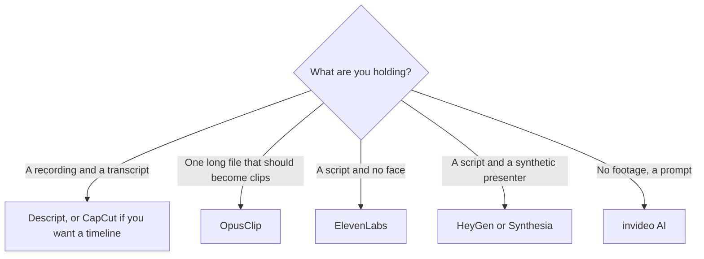

**Stay near Descript if you still edit by reading a transcript of footage you recorded. Switch only when the job changed: a timeline editor, a shorts cutter, a voice, or an avatar that was never in the room.** Replacing Descript with an avatar studio because the media-hour meter was annoying will not give you an editor. It will give you a synthetic presenter.

Descript's own bill is [Descript pricing explained](/blog/descript-pricing-explained-2026/). The timeline comparison is [Descript vs CapCut](/blog/descript-vs-capcut-2026/). The product page is [Descript review](/blog/descript-review-2026/). The filler-word pass is [how to remove filler words with Descript](/blog/how-to-remove-filler-words-with-descript-2026/).

Prices are US list prices excluding tax from directory pages checked October 16, 2026. Published October 24, 2026. We did not score edit quality.

## The job, then the tool

| The job | Start here | First price that matters | Not this |
|---|---|---|---|
| Text-based edit of a recording, another month on Descript | [Descript](/tools/descript/) | Hobbyist is $16 a person a month billed annually, or $24 monthly, for 10 media hours | An avatar |
| A timeline, captions, and templates | [CapCut](/tools/capcut/) | Pro is $19.99 a month, or $179.99 a year | A transcript as the only timeline |
| Shorts from a long episode | [OpusClip](/tools/opusclip/) | Starter is $15 a month, monthly only, on the directory card. Free includes 60 credits | A full episode editor |
| A voice, no picture edit | [ElevenLabs](/tools/elevenlabs/) | Starter is $6 a month | A video export by itself |
| A presenter who was not filmed | [HeyGen](/tools/heygen/) or [Synthesia](/tools/synthesia/) | HeyGen Creator is $29. Synthesia Starter is $29 billed monthly, shown as $19 yearly | A Descript replacement |
| A generated video from a prompt | [invideo AI](/tools/invideo-ai/) | Starter is $10 a seat billed annually, or $20 monthly | An edit of your interview |

## If you are leaving the transcript editor

[CapCut](/tools/capcut/) is the alternative when you think in a timeline, stickers, and captions more than in a transcript. Pro at $19.99 a month, or $179.99 a year, is the paid seat on the directory card. Free still edits. The review is [CapCut review](/blog/capcut-review-2026/). Use CapCut for the social cut. Use Descript when deleting a sentence should delete the video of that sentence. Plenty of shows do both, in that order: Descript for the talk, CapCut for the packaging.

[OpusClip](/tools/opusclip/) is the alternative when the episode is fine and the missing piece is shorts. Starter at $15 does not become a multitrack editor. Free's 60 credits are the test. The review is [OpusClip review](/blog/opusclip-review-2026/). The show stack is [best AI tools for podcasters](/blog/best-ai-tools-for-podcasters-2026/) and [best AI tools for YouTubers](/blog/best-ai-tools-for-youtubers-2026/).

[ElevenLabs](/tools/elevenlabs/) replaces a narration step, not the edit. Starter at $6 is the first paid voice seat in this directory. Pair it with footage you have rights to. The bill is [ElevenLabs pricing explained](/blog/elevenlabs-pricing-explained-2026/). The wider shelf is [ElevenLabs alternatives](/blog/elevenlabs-alternatives-2026/).

## Tools that are not Descript

**An avatar.** [HeyGen](/tools/heygen/) and [Synthesia](/tools/synthesia/) put a presenter on screen. That is a different consent problem and a different credit. The switch list is [HeyGen alternatives](/blog/heygen-alternatives-2026/) and [Synthesia alternatives](/blog/synthesia-alternatives-2026/). If you filmed the person, you do not need either one to remove an "um."

**A generator.** [invideo AI](/tools/invideo-ai/) builds a video from a prompt. [Runway](/tools/runway/) Standard is $12 a month billed annually when you want generated shots. Those are [best AI video generators](/blog/best-ai-video-generators-2026/), not transcript editors. Runway's card is [Runway pricing explained](/blog/runway-pricing-explained-2026/).

**A meeting notetaker.** [Otter](/tools/otter-ai/) records a meeting. It does not publish your podcast. Pro is $16.99 a month or $8.33 billed annually. The card is [Otter.ai pricing explained](/blog/otter-ai-pricing-explained-2026/).

Descript Free is still the honest test: 60 media minutes a month. Hobbyist at $16 annually is the first plan the pricing explainer marks for 1080p without a watermark. Creator at $24 annually is the 4K and 30-hour step. Leave Descript when the metaphor is wrong, not when you have not tried Hobbyist on one real episode. The episode workflow is [how to edit podcasts with Descript](/blog/how-to-edit-podcasts-with-descript-2026/).

## FAQ

### What is the closest Descript alternative?

CapCut, if you are willing to edit on a timeline. There is no second transcript-first editor in this directory that matches Descript's job. OpusClip is closer if the only output you needed was clips.

### Is CapCut cheaper?

CapCut Pro is $19.99 a month, or $179.99 a year. Descript Hobbyist is $16 a month billed annually, or $24 monthly. The cheaper annual seat can still be the wrong tool. Compare them on one episode you already recorded.

### Can HeyGen replace Descript?

Only if you stopped editing a real recording. HeyGen creates avatar video. It does not cut an interview. Keep Descript, or CapCut, for footage of a person who was there.

### Is there a free path?

Descript Free includes 60 media minutes. CapCut's free plan edits. OpusClip Free includes 60 credits. ElevenLabs and the avatar tools have their own tight free tiers, recorded on their pricing pages. A free test is a test. It is not a back catalog.

## Last verified

October 16, 2026 for Descript, CapCut, OpusClip, ElevenLabs, HeyGen, Synthesia, invideo, Runway, and Otter list prices named above. Published October 24, 2026.

**Sources:** [Descript pricing](https://www.descript.com/pricing), [CapCut](https://www.capcut.com/), [ElevenLabs pricing](https://elevenlabs.io/pricing).

*Published by Andrew for [AI Tools Optimizer](https://aitoolsoptimizer.com).*

[Descript](/tools/descript/) is in the [video directory](/tools/category/video/). Directory pages may use affiliate links. A purchase through them may earn us a commission at no extra cost to you.
