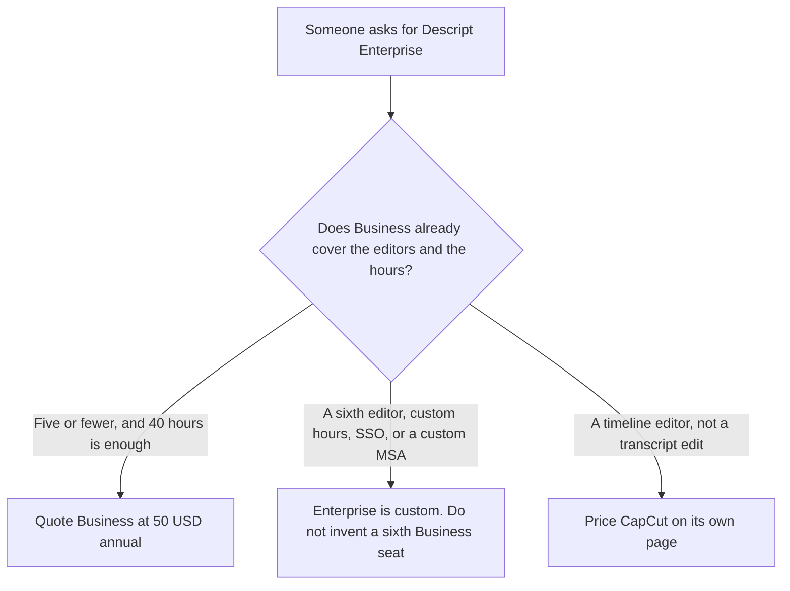

**Descript Enterprise is custom.** On descript.com/pricing fetched October 24, 2026, the Enterprise card says media hours and AI credits are sized to the team. It lists Brand Studio with company-wide guardrails, AI and data controls including opt-out of training and custom retention, SOC 2 Type II with SSO, SCIM, and audit logs, a custom MSA and flexible billing, and a dedicated customer success manager. Business, the priced seat under that, is $50 a person a month billed annually, or $65 monthly, with 40 media hours, 1,500 AI credits, team-wide Brand Studio, and a scale of 5 people billed separately. The full ladder is [Descript pricing explained](/blog/descript-pricing-explained-2026/). This page is the Enterprise name.

The product page is [Descript review](/blog/descript-review-2026/). The edit order is [how to edit podcasts with Descript](/blog/how-to-edit-podcasts-with-descript-2026/). A retention rule you write yourself, which is not this invoice, is [how to write an AI data retention policy with AI](/blog/how-to-write-an-ai-data-retention-policy-with-ai-2026/).

The Hobbyist, Creator, and Business dollars below are US list prices from that October 24 page. They match the October 16 directory card. Annual prices save up to 35% versus monthly, on both records. Published October 24, 2026. We did not score edits. We did not receive an Enterprise quote.

## What the October 24 page separates

| Plan | Price on the October 24 page | What you may quote as Enterprise |
|---|---|---|
| Hobbyist, for contrast | $16 a person a month billed annually, or $24 monthly. 10 media hours, 400 AI credits | Watermark-free 1080p. Not a company contract |
| Creator, for contrast | $24 annually, or $35 monthly. 30 hours, 800 credits | 4K and full Underlord. Scales to a team of 3, billed separately |
| Business, for contrast | $50 annually, or $65 monthly. 40 hours, 1,500 credits | Team-wide Brand Studio, dubbing in 30+ languages, priority support with an SLA. Scales to 5 people, billed separately |
| Enterprise | Custom | Hours and credits sized to the team. Training opt-out, custom retention, SSO, SCIM, audit logs, a custom MSA, flexible billing, a dedicated CSM |

Brand Studio is on Business: the card says team-wide access. Enterprise also says Brand Studio, and it adds company-wide guardrails and, in a second block on the same page, granular brand controls. Buying Enterprise to get Brand Studio pays for a row Business already lists, at $50 annually, unless the guardrails, the sixth editor, or the security lines are the reason.

Business includes priority support with an SLA. Enterprise lists a dedicated CSM, onboarding, and priority response. Those are different support sentences. The page does not say the Business SLA and the Enterprise CSM are the same person.

The FAQ says Hobbyist, Creator, and Business charge the card you provide. Users who need custom invoicing, and the FAQ names ACH as the example, are sent to the Enterprise team. A purchase order is not a sixth Business seat.

Creator scales to 3. Business scales to 5. The page does not print a price for editor number 6. A 6th person is an Enterprise conversation, or a checkout fact you can read, not a number this page will multiply. Five people on Business annual are 5 times $50, which is $250 a month. That arithmetic is Business. It is not Enterprise.

Media hours are imported or recorded media, per editor, including files you do not transcribe. The FAQ on the October 24 page says that. A two-hour raw tape still counts as two hours. Enterprise's "sized to your team" line is the place the 40-hour cap stops being the contract. It is not a published hour count.

SOC 2 Type II appears in two places. The privacy FAQ says Descript is SOC 2 Type II as a company statement. The Enterprise card lists SOC 2 Type II together with SSO, SCIM, and audit logs. Do not tell a buyer that Business files are outside the company statement. Do tell them SSO, SCIM, and audit logs are written on the Enterprise card, not on the Business feature list we read.

## What a neighboring invoice does, and does not, tell you

**A timeline editor.** [CapCut](/tools/capcut/) is a different edit. This page does not restate a CapCut dollar. The comparison is [Descript vs CapCut](/blog/descript-vs-capcut-2026/). Enterprise Descript is not a CapCut seat.

**Short clips.** [Opus Clip](/tools/opusclip/) Starter is $15 a month on the October 16 record in the base Descript article. That is not a Descript hour. The steps are [how to create shorts with Opus Clip](/blog/how-to-create-shorts-with-opus-clip-2026/).

**Generated narration.** [ElevenLabs](/tools/elevenlabs/) Starter at $6 a month is the first plan with a commercial license on that same record. It does not include Descript SSO. The invoice is [ElevenLabs pricing explained](/blog/elevenlabs-pricing-explained-2026/).

## What not to assume

Do not print an Enterprise price. Do not call Business the enterprise plan because it has Brand Studio. Do not say training opt-out is on Business. The October 24 Enterprise card is where opt-out of training and custom retention are written. Do not convert a non-USD checkout into $50. Do not treat a student or nonprofit form, which the FAQ says exists, as an Enterprise dollar.

## FAQ

### How much is Descript Enterprise?

Custom, on the October 24 pricing page. There is no seat price. Business at $50 a person a month billed annually, or $65 monthly, is the highest published dollar, with 40 media hours, 1,500 AI credits, and a scale of 5 people. A quote you receive is the Enterprise price.

### Does Business include SSO?

Not on the feature list we read. SSO, SCIM, and audit logs are on the Enterprise card, grouped with the SOC 2 Type II line. The privacy FAQ also calls Descript SOC 2 Type II as a company statement. The company statement is not the same sentence as SSO.

### Does Enterprise replace Brand Studio on Business?

Business already includes team-wide Brand Studio. Enterprise adds the words company-wide guardrails and granular brand controls. If the team fits in 5 people and the Business hours are enough, Brand Studio is the $50 seat.

### Does this page replace the main Descript pricing article?

No. That article is Free through Business, and what a media hour counts. This article is the contract: sized hours, training opt-out, custom retention, SSO, a custom MSA, and a dedicated CSM, none of which have a list price on the page we fetched.

## Last verified

October 24, 2026, from Descript's pricing page. The Hobbyist, Creator, and Business dollars match the October 16 directory card. Published October 24, 2026. No Enterprise quote was received.

**Sources:** [Descript pricing](https://www.descript.com/pricing), [Descript](https://www.descript.com/).

*Published by Andrew for [AI Tools Optimizer](https://aitoolsoptimizer.com).*

[Descript](/tools/descript/) is in the [video directory](/tools/category/video/). Directory pages may use affiliate links. A purchase through them may earn us a commission at no extra cost to you.
