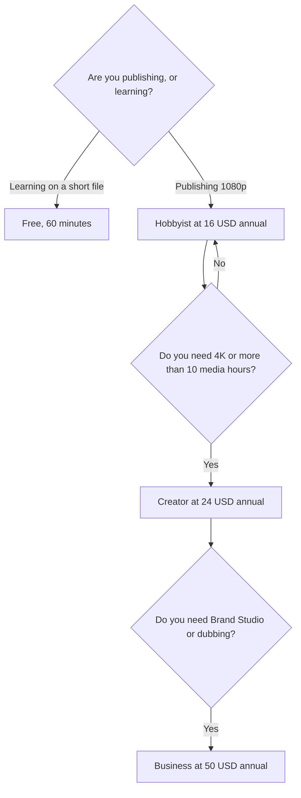

**Descript pricing is a per-person seat with two meters: media hours and AI credits.** Free is 60 media minutes a month. Hobbyist is $16 a person a month billed annually, or $24 monthly, with 10 media hours and 400 AI credits. Creator is $24 annually or $35 monthly, with 30 hours and 800 credits. Business is $50 annually or $65 monthly, with 40 hours and 1,500 credits.

Annual prices save up to 35% versus monthly, on the page recorded October 16, 2026. Prices are US list prices excluding tax. Published here October 24, 2026. The product review is [Descript review](/blog/descript-review-2026/). The editing order is [how to edit podcasts with Descript](/blog/how-to-edit-podcasts-with-descript-2026/).

## The ladder

| Plan | Annual, per person | Monthly | Media | AI credits | The gate that matters |
|---|---|---|---|---|---|
| Free | $0 | $0 | 60 minutes | A trial of the AI tools | Learn the transcript edit. No card |
| Hobbyist | $16 | $24 | 10 hours | 400 | 1080p export without a watermark. Underlord access |
| Creator | $24 | $35 | 30 hours | 800 | 4K, full Underlord, unlimited royalty-free stock, top-ups |
| Business | $50 | $65 | 40 hours | 1,500 | Brand Studio, translation and dubbing in 30+ languages |
| Enterprise | Custom | Custom | Sized to the team | Sized to the team | SSO, SCIM, audit logs, training opt-out |

Transcription in 25 languages is on every plan, including Free. Creator scales to a team of 3, billed separately. Business scales to 5. Do not buy Business for a solo English-language show.

## Media hours are the raw file, not the finished cut

Media hours are the imported or recorded media Descript processes for you each month, per editor. A two-hour raw recording counts as two hours even if the published episode is 30 minutes. Hobbyist's 10 hours is about five of those raw tapes, not ten finished episodes, if you import the whole session.

That is the usual reason a Hobbyist month runs out. The fix is a shorter recording, or Creator's 30 hours, after you have seen a month of real imports. It is not a reason to start on Business.

AI credits spend on tools such as Studio Sound, filler-word removal, and clips. Hobbyist includes those tools and Underlord. Creator is where the directory page says full Underlord access lives, plus 20+ AI tools and AI video generation. Run filler removal after you have cut the structure, so you are not spending credits on audio you will delete. The podcast order is the how-to linked above.

## Four buyers

**A person learning the transcript edit.** Free. One hour is enough for a short episode or a meeting excerpt. It is not a weekly hour-long raw tape.

**A podcaster publishing 1080p.** Hobbyist. The watermark comes off here. Annual at $16 is the price once the second episode ships. Monthly at $24 is the price while you are still deciding. The timeline editor for a short you will caption and post is [CapCut](/tools/capcut/). The comparison is [Descript vs CapCut](/blog/descript-vs-capcut-2026/).

**A YouTuber who needs 4K, or anyone importing more than 10 hours.** Creator at $24 annual. Top-ups exist on this tier. Price them after a heavy month, not before.

**A team dubbing training videos.** Business. Translation and dubbing in 30+ languages, with proofreading, is the Business line. If the training video is an avatar from a script, price [Synthesia](/tools/synthesia/) as well. Starter there is $29 a month. The training workflow is [how to make training videos with Synthesia](/blog/how-to-make-training-videos-with-synthesia-2026/).

Voice-only narration, generated rather than recorded, is [ElevenLabs](/tools/elevenlabs/). Starter at $6 a month is the first plan with a commercial license. The credit card for that product is [ElevenLabs pricing explained](/blog/elevenlabs-pricing-explained-2026/).

Short clips from a long cut can go to [Opus Clip](/tools/opusclip/). Free is 60 credits, and free clips stop being exportable after 3 days. Starter is $15 a month. The steps are [how to create shorts with Opus Clip](/blog/how-to-create-shorts-with-opus-clip-2026/).

A meeting you only need notes from is not a Descript hour. [Otter](/tools/otter-ai/) Basic includes 300 transcription minutes a month. That bill is [Otter pricing explained](/blog/otter-ai-pricing-explained-2026/).

## FAQ

### How much is Descript Hobbyist?

$16 per person per month billed annually, or $24 month to month, with 10 media hours, 400 AI credits, and 1080p export without a watermark.

### How much is Descript Creator?

$24 per person per month billed annually, or $35 monthly, with 30 media hours, 800 AI credits, and 4K export. Full Underlord access is listed on Creator and above.

### Does the free plan have a watermark?

Free is for learning, with 60 media minutes. Watermark-free 1080p export is a Hobbyist line on the page we used. Read the export dialog on the plan you are on before you promise a client a clean file.

### Do media hours roll over?

The directory page describes a monthly allowance per editor. It does not promise rollover. Plan from the hours you will import this month.

## Last verified

October 16, 2026. Published October 24, 2026.

**Sources:** [Descript pricing](https://www.descript.com/pricing), [Descript](https://www.descript.com/).

*Published by Andrew for [AI Tools Optimizer](https://aitoolsoptimizer.com).*

[Descript](/tools/descript/) is in the [video directory](/tools/category/video/). Directory pages may use affiliate links. A purchase through them may earn us a commission at no extra cost to you.
