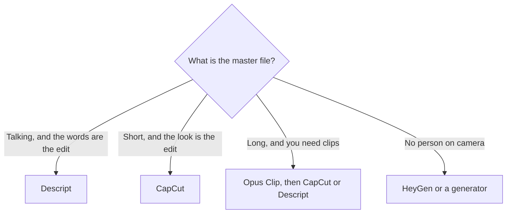

**Use Descript when the edit is "delete this sentence." Use CapCut when the edit is "make this look like the short that is working this month."** Both can take a talking-head file and ship a video. They charge for different scarce things: media hours and a transcript on one side, templates and monthly AI credits on the other.

Prices are US list prices excluding tax, from vendor pages checked October 16, 2026, and published here on October 24, 2026. A refetch of the pricing URLs on the publish date did not return numbers. CapCut also says the price on its site is a reference and the charge appears after you sign in, and it can differ by platform. Use the in-app price.

The product pages are [Descript review](/blog/descript-review-2026/) and [CapCut review](/blog/capcut-review-2026/). A YouTube stack that often uses both is [best AI tools for YouTubers](/blog/best-ai-tools-for-youtubers-2026/).

## The cut, not the logo

| The file in front of you | Use | First plan that matches the job |
|---|---|---|
| A podcast or interview you will tighten by removing words | [Descript](/tools/descript/) | Free to learn, on 60 media minutes. Hobbyist to publish without a watermark |
| Filler words, retakes, and a noisy room | Descript | Studio Sound and filler removal are part of the edit. Creator if you want full Underlord and 4K |
| A vertical short with captions, effects, and a template | [CapCut](/tools/capcut/) | Free covers basic edits and templates. Pro for the premium kit and AI credits |
| A long video that must become five shorts | Neither, first | [Opus Clip](/tools/opusclip/) is the clip finder. Starter is $15/month and removes the watermark |
| A presenter who was never on camera | Neither | [HeyGen](/tools/heygen/) replaces the camera. These two edit a camera you used |

## The meters

| | Descript | CapCut |
|---|---|---|
| Free | $0, 60 media minutes a month, no card. Enough to learn text editing | Free templates and basic editing on desktop, mobile, and web |
| First paid individual plan | Hobbyist $16/person/month billed annually, or $24 monthly. 10 media hours, 400 AI credits, 1080p, watermark removed | Pro listed at $19.99/month or $179.99/year in the US |
| The plan regular publishers hit | Creator $24 annually or $35 monthly. 30 media hours, 800 AI credits, 4K, full Underlord | Ultra, for a larger monthly AI-credit pool and exclusive AI features. The page we checked did not print a single US Ultra price |
| Team | Business $50 annually or $65 monthly per person. 40 media hours, 1,500 AI credits, Brand Studio, translation and dubbing in 30+ languages | Teams, per seat, bought through CapCut Online. Annual is described as about 20% less. The seat price varies |
| What runs out | Media hours on imported or recorded media, and AI credits on AI tools | AI credits on generation. Premium templates and effects sit behind the subscription |
| Where you edit | Web | Windows, macOS, iOS, Android, and web |
| Weak fit | Color, VFX, and a cinematic timeline | A two-hour interview you want to cut by reading the transcript |

Descript prices are per person. Two editors on Creator, billed annually, are $48 a month before tax, not $24. CapCut's reference Pro price is per account, and a phone purchase can show a different number than the desktop.

## Podcasts and talking videos

Descript transcribes the recording and lets you edit the footage by editing the text. Delete a false start in the transcript and the region goes with it. That is the whole reason to choose it over a traditional timeline for speech.

A practical path, with the plan choice included, is [how to edit podcasts with Descript](/blog/how-to-edit-podcasts-with-descript-2026/). The short version: learn on Free inside the 60-minute cap, move to Hobbyist when the export has to be clean 1080p, and move to Creator when 4K or a month of Underlord instructions is the work. Underlord is the co-editor that can turn a raw recording into a tighter cut from instructions. Hobbyist has access. Creator and above have full access. Do not buy Business for a solo podcast. Business is translation, brand kit, and more hours.

Transcription on Descript covers 25 languages on every plan. Translation and dubbing in 30+ languages is a Business line. A dubbed show is a different product from a cleaned interview.

If the "podcast" is really a voiceover you will still edit elsewhere, the voice belongs to [ElevenLabs](/tools/elevenlabs/) first. Starter at $6/month is the first plan with a commercial license. Descript then edits the file. The license detail is [ElevenLabs pricing explained](/blog/elevenlabs-pricing-explained-2026/).

## Shorts, Reels, and the phone

CapCut is the timeline people already know from short-form video: templates, auto captions, background removal, and effects that match the current format. The free plan is a real editor. Pro is the point where premium assets and the monthly AI-credit pool show up, including AI video generation. Credits can be topped up. Generation is the part that runs out, not the razor blade on a normal cut.

CapCut is the wrong place to do a transcript-first podcast edit, even if you can drop captions on a talking video. Captions are not the same control as "remove every um and the sentence where I restarted." Descript is that control.

If you record on the phone and finish on the phone, CapCut wins on availability alone. Descript's app surface in the pages we used is the web editor, plus recording in Descript and Rooms for remote guests. Record where the guest is. Edit the words in Descript. Cut the teaser in CapCut.

## A week that uses both

1. Record the interview in Descript or import the file.
2. Cut for content in Descript. Export a clean master.
3. Make the social cut in CapCut, or send the master through Opus Clip and finish the caption style in CapCut.
4. Keep the voiceover, if you add one, on a paid ElevenLabs plan when the channel is monetized.

That is three tools and it is still cheaper than forcing one of them to do the other's job. Opus Clip Starter at $15 plus Descript Hobbyist at $16 annually plus CapCut's free plan is a $31 publishing stack before you add CapCut Pro.

## FAQ

### Is Descript or CapCut better for podcasts?

Descript. The edit is the transcript. CapCut can caption a podcast clip. It does not replace text-based cutting of a full episode.

### Is Descript or CapCut better for TikTok and Reels?

CapCut. Templates, the phone apps, and caption styling are the product. Use Descript first only when the short is a lift from a long, wordy recording.

### Which free plan is enough?

Descript Free is enough to learn on under an hour of media a month. It is not a weekly show. CapCut Free is enough for many basic social edits. It is not the premium template library or a deep AI-generation pool.

### Why do people say CapCut costs more than $19.99?

Because CapCut says the displayed price is a reference. Region, platform, and the signed-in offer can change it. Quote $19.99 only as the US list we saw, then check the account you will be charged on.

## Last verified

October 16, 2026 for the figures above. Published October 24, 2026. Pricing pages did not refresh successfully that day. CapCut's in-app price remains the one that bills you.

**Sources:** [Descript pricing](https://www.descript.com/pricing), [CapCut pricing](https://www.capcut.com/pricing), [CapCut Teams price help](https://www.capcut.com/help/capcut-teams-price).

Both are in the [video directory](/tools/category/video/). [Descript](/tools/descript/) and [CapCut](/tools/capcut/) may use affiliate links. A purchase through them may earn us a commission at no extra cost to you.
