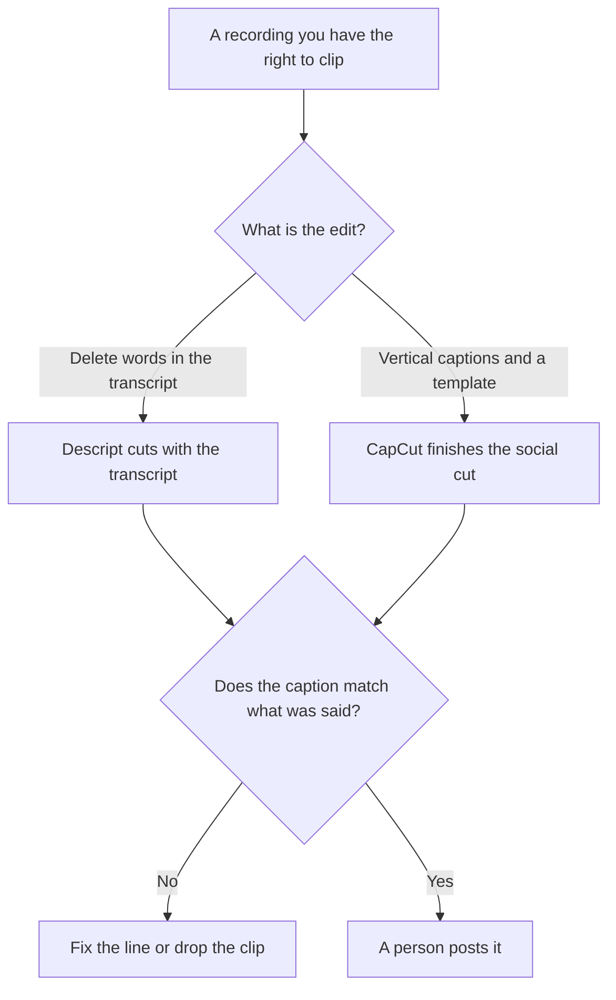

**Use Descript when the clip starts from a transcript and you cut by deleting words. Use CapCut when the clip is a vertical social edit with captions and templates, often finished on a phone.** A podcast clip is a short piece of a recording you have the right to use, with a caption that matches what was said. It is not a new episode, and it is not a generated voice reading a script the guest did not say.

The full-episode workflow is [how to edit podcasts with Descript](/blog/how-to-edit-podcasts-with-descript-2026/). The map from one recording to later assets is [how to create a content repurposing plan with AI](/blog/how-to-create-a-content-repurposing-plan-with-ai-2026/). The podcaster shelf is [best AI tools for podcasters](/blog/best-ai-tools-for-podcasters-2026/).

Prices are US list prices excluding tax from directory pages checked October 16, 2026. A live fetch of vendor pricing pages returned HTTP 401 on October 24, 2026, so this page stays on the directory record. Published October 24, 2026. We did not score watch time, captions, or which editor "finds the best moment."

## Which seat matches the clip

| The cut you actually have | Start here | What you still do |
|---|---|---|
| Learn the transcript cut | [Descript](/tools/descript/) Free, 60 media minutes a month | You pick the moment |
| Watermark-free 1080p from the transcript | Descript Hobbyist at $16 a person a month billed annually, or $24 monthly | 10 media hours and 400 AI credits |
| 4K and more hours | Descript Creator at $24 annually, or $35 monthly | 30 media hours and 800 AI credits |
| A vertical clip with templates | [CapCut](/tools/capcut/) Free for basic editing | You still match the caption to the words |
| Pro templates and AI credits | CapCut Pro at $19.99 a month, or $179.99 a year | CapCut says displayed prices are reference prices. Checkout can differ |
| Auto-suggested clips from a long file | [Opus Clip](/tools/opusclip/) Starter at $15 a month, monthly only | Free is 60 credits. You still reject a bad cut |

Descript Business is $50 a person a month billed annually, or $65 monthly, with 40 media hours and 1,500 AI credits. Buy it when you need that card's translation and brand tools, not because a clip sounds important. CapCut Ultra is a higher tier on the directory card. The directory does not print an Ultra dollar, so this page does not. Teams pricing varies by region. The invoices are [Descript pricing explained](/blog/descript-pricing-explained-2026/) and [CapCut pricing explained](/blog/capcut-pricing-explained-2026/).

## What the clip may change

In and out points, filler you are willing to remove, and a caption that quotes the cut. It may not rearrange a guest into a claim they did not make, dub them, or add a title card with a statistic that was not said. Studio Sound and a template are polish. They are not a new interview.

**Descript Hobbyist** is the paid path when text-based editing is the reason you are here. Underlord can rough-cut from instructions. You still listen. The review is [Descript review](/blog/descript-review-2026/).

**CapCut Pro** is the paid path when the deliverable is a phone-native social clip and you want the paid templates and credits. Free is enough to learn the timeline. The review is [CapCut review](/blog/capcut-review-2026/).

**Opus Clip Starter** is the paid path when you want suggested clips from a long recording and you will reject most of them. It does not replace the transcript edit when the words have to be exact.

A prompt that holds the line:

"Propose clip ranges from this transcript using only sentences that appear in the transcript. Quote the line that would be the caption. Do not write a hook that the speaker did not say. If a range crosses two topics, split it."

## What not to delegate

Do not publish a clip the guest's release does not allow. Do not let a title overclaim the sentence. Do not generate a new voice for the guest. A voice tool is a different product and a different permission. [ElevenLabs](/tools/elevenlabs/) Starter is $6 a month and Creator is $22, for voice work you have rights to. It is not the clip editor. The invoice is [ElevenLabs pricing explained](/blog/elevenlabs-pricing-explained-2026/).

## FAQ

### Which one makes better podcast clips?

We did not measure that. Pick Descript when the source of truth is the transcript. Pick CapCut when the source of truth is the vertical timeline and the template. Many shows use both: the words in Descript, the social finish in CapCut. The caption still has to match the mouth.

### Does CapCut replace Descript for a full episode?

No. CapCut is built for short social video. A full episode edit that depends on deleting a sentence in the transcript is the Descript workflow. A cinematic grade is a third tool this page does not pick for you.

### What do media hours and AI credits buy on Descript?

Media hours are the imported or recorded media processed per editor each month. AI credits are spent on AI tools. Hobbyist is 10 hours and 400 credits. Creator is 30 hours and 800. A clip still counts against the hours of media you brought in.

### Can we clip a guest we did not ask?

Only under the release you already have. The model does not know your contract. If the release is missing, the clip stays in the project. The repurposing plan is where you write which moments are allowed out.

## Last verified

October 16, 2026 for Descript, CapCut, Opus Clip, and ElevenLabs. Published October 24, 2026. Live pricing fetches returned HTTP 401 that day.

**Sources:** [Descript pricing](https://www.descript.com/pricing), [CapCut pricing](https://www.capcut.com/pricing), [Opus Clip](https://www.opus.pro/), [ElevenLabs pricing](https://elevenlabs.io/pricing).

*Published by Andrew for [AI Tools Optimizer](https://aitoolsoptimizer.com).*

[Descript](/tools/descript/) is in the [video directory](/tools/category/video/). Directory pages may use affiliate links. A purchase through them may earn us a commission at no extra cost to you.
