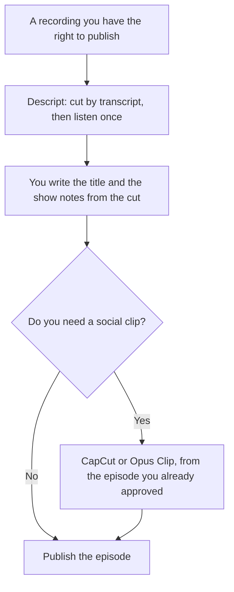

**Edit the podcast episode in Descript, where deleting a sentence deletes the audio. Cut the vertical clip in CapCut, where the template and the captions are the job.** A podcast week is two files: the episode people subscribe to, and the short piece that points at it. One editor can attempt both. The bill and the bottleneck are different.

The wider editor choice, including ordinary video, is [Descript vs CapCut](/blog/descript-vs-capcut-2026/). The click-by-click episode edit is [how to edit podcasts with Descript](/blog/how-to-edit-podcasts-with-descript-2026/). Filler words, as their own pass, are [how to remove filler words with Descript](/blog/how-to-remove-filler-words-with-descript-2026/). The creator shelf is [best AI tools for podcasters](/blog/best-ai-tools-for-podcasters-2026/).

Prices are US list prices excluding tax from directory pages checked October 16, 2026. CapCut says the price on its site is a reference and the charge appears after you sign in, and it can differ by platform. Published October 24, 2026. We did not score sound quality.

## The podcast week

| The file | Use | First plan that matches |
|---|---|---|
| A recorded conversation you will tighten by deleting words | [Descript](/tools/descript/) | Free to learn, on 60 media minutes. Hobbyist to export without a watermark |
| Filler words, retakes, and a noisy room on that episode | Descript | Studio Sound and filler removal are part of the edit. Creator is the card's full Underlord step |
| A 20 to 60 second vertical clip with captions | [CapCut](/tools/capcut/) | Free covers basic edits and templates. Pro for the premium kit and AI credits |
| A long episode that must become several candidate clips | [Opus Clip](/tools/opusclip/) first | Starter is $15 a month and removes the watermark. Then finish the look in CapCut if you need it |
| A host who was never recorded | Neither | An avatar or a generated voice is a different product. Do not pretend an editor filmed the show |

Show notes are yours. A model can draft them from a transcript you paste. It may not invent a guest quote. The check is [how to fact-check AI writing](/blog/how-to-fact-check-ai-writing-2026/).

## What the episode actually costs

**Descript Free** is 60 media minutes a month and a trial of the AI tools. That is one short episode if the raw file is short. A weekly hour, plus the raw before you cut, will not stay on Free. **Hobbyist is $16 a person a month billed annually, or $24 monthly**, with 10 media hours, 400 AI credits, and 1080p export without a watermark. A year at the annual rate is 12 × $16 = $192. A year of monthly Hobbyist is 12 × $24 = $288.

**Creator is $24 a person a month billed annually, or $35 monthly**, with 30 media hours, 800 AI credits, and full Underlord access on the card. Underlord is the co-editor. Hobbyist has access. Creator is the full-access row. Buy Creator when the hour count or the 4K and Underlord lines on the card are the constraint, not because a podcast sounds more serious on a higher tier. **Business is $50 a person a month billed annually, or $65 monthly**, with 40 media hours and 1,500 AI credits. The invoice is [Descript pricing explained](/blog/descript-pricing-explained-2026/). The product page is [Descript review](/blog/descript-review-2026/).

**CapCut Free** includes templates and basic editing. **Pro lists at $19.99 a month or $179.99 a year** in the US reference prices. A year of monthly Pro is 12 × $19.99 = $239.88, against $179.99 annual. Divide $179.99 by 12 and you get $15.00 to the cent. Ultra is a higher tier on the card, and this page does not print an Ultra dollar the directory did not record. Teams pricing varies. The product page is [CapCut review](/blog/capcut-review-2026/). The plan math is [CapCut pricing explained](/blog/capcut-pricing-explained-2026/).

**Opus Clip Starter is $15 a month**, monthly only on the card, and Free is 60 credits a month. Use it when finding the clip is the bottleneck. The invoice is [Opus Clip pricing explained](/blog/opusclip-pricing-explained-2026/).

## A week that does not need both subscriptions

One interview a month, published as audio, with no short video: Descript Hobbyist can be the whole stack. Confirm the media hours against the raw file, not the finished length.

A daily vertical show that was never a long episode: CapCut may be the only editor. You do not need a transcript editor for a clip you shot in the template.

A generated narration instead of a host: that is [ElevenLabs](/tools/elevenlabs/) Starter at $6 a month for a commercial license, or a Murf API rate. The explainer-voice choice is [ElevenLabs vs Murf for explainers](/blog/elevenlabs-vs-murf-for-explainers-2026/). It is not a podcast edit.

## FAQ

### Can CapCut replace Descript for the episode?

Not for the job this page is about. CapCut's own directory notes say it is not built for transcript-based editing of podcasts. Use it on the clip after the episode exists. If your "podcast" is only a short vertical, you may never open Descript. That is a different show.

### Do I need Creator to remove filler words?

The directory lists filler-word removal and Studio Sound as Descript tools, and it says Hobbyist has Underlord access while Creator and above get full access. It does not say filler removal is locked to Creator. Check the plan screen before you upgrade for one button. The workflow is the filler-word guide linked above.

### How many media hours does a weekly show use?

Count the raw import, not the published file. An hour published from two hours of tape is two media hours if both were imported. Ten media hours on Hobbyist is the recorded pool. This page will not turn that into "you get N episodes," because your raw length is yours.

### Should the model write the episode title?

It can propose titles from the transcript. You pick one that the episode actually supports. A title that promises a guest claim you cut is a correction you will make in public.

## Last verified

October 16, 2026 for Descript, CapCut, Opus Clip, and ElevenLabs. CapCut's figures are the US reference prices on the directory card. Published October 24, 2026.

**Sources:** [Descript pricing](https://www.descript.com/pricing), [CapCut pricing](https://www.capcut.com/pricing), [Opus Clip pricing](https://www.opus.pro/pricing).

*Published by Andrew for [AI Tools Optimizer](https://aitoolsoptimizer.com).*

[Descript](/tools/descript/) is in the [video directory](/tools/category/video/). Directory pages may use affiliate links. A purchase through them may earn us a commission at no extra cost to you.
