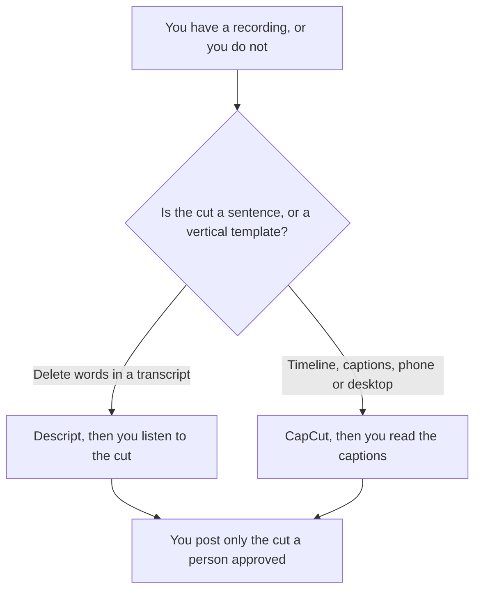

**Use Descript when the short comes from a talking-head recording and you will delete words in the transcript. Use CapCut when the short is a vertical timeline with templates, captions, and effects, including on a phone.** The general pair, without this short-form cut, is [Descript vs CapCut](/blog/descript-vs-capcut-2026/). A long spoken edit is [Descript vs CapCut for podcasts](/blog/descript-vs-capcut-for-podcasts-2026/). This page is the short you will actually post.

The invoices are [Descript pricing explained](/blog/descript-pricing-explained-2026/) and [CapCut pricing explained](/blog/capcut-pricing-explained-2026/). A tool that proposes clips from a long file, instead of you cutting them, is [OpusClip pricing explained](/blog/opusclip-pricing-explained-2026/).

Prices are US list prices excluding tax from directory pages checked October 16, 2026. Published October 24, 2026. We did not score watch time. CapCut says displayed prices are for reference and the final price appears after you sign in.

## The short, then the editor

| The footage you have | Start here | First paid step | What you still do |
|---|---|---|---|
| A person talking, and the cut is "delete this sentence" | [Descript](/tools/descript/) Free, 60 media minutes a month | Hobbyist is $16 a person a month billed annually, or $24 monthly, with 10 media hours and 1080p without a watermark | You listen. A deleted word can remove the point |
| A vertical edit with templates, stickers, and auto captions | [CapCut](/tools/capcut/) Free for basic editing | Pro lists at $19.99 a month or $179.99 a year in the US | You read the caption. Auto captions are a draft |
| Many candidate clips from one long recording | [OpusClip](/tools/opusclip/) Free is 60 credits a month. Free clips cannot be exported after 3 days | Starter is $15 a month, monthly billing only, with 150 credits and no watermark | You pick the clip. A suggested range is not the story |
| A short generated from a prompt, not from your footage | [invideo AI](/tools/invideo-ai/) | Starter is $10 a seat a month billed annually on the October 24 pricing page, or $20 monthly beside it | That invoice is [invideo AI pricing explained](/blog/invideo-ai-pricing-explained-2026/). It is a different job |

Descript Creator is $24 a month billed annually, or $35 monthly, with 30 media hours and 4K export, on the October 16 card. Business is $50 annually or $65 monthly. Underlord is the AI co-editor on that card. Hobbyist has access. Creator and above get full access. Media hours and AI credits are the cap. A short week can fit in Hobbyist. A library of long recordings may not.

CapCut's free plan includes templates and basic editing. Ultra is a higher tier with more monthly AI credits. The October 16 card does not print an Ultra dollar price, so this page does not either. Teams pricing varies. Pro's listed US price is a reference price. Check the account before you budget the year at $179.99.

## What you are paying for on a short

**Descript** when the talent is a voice and the edit is language. Filler-word removal is a tool, not a taste decision. The click path is [how to remove filler words with Descript](/blog/how-to-remove-filler-words-with-descript-2026/). Listen to the join. A cleaned sentence can still sound like a jump cut.

**CapCut** when the short needs the format of a social timeline: vertical, captioned, templated, edited on a phone between shoots. It is the wrong primary tool for a transcript-first podcast. That is the other article.

**OpusClip** when you want candidate ranges, not when you already know the sentence. Starter's 150 credits are not Descript media hours. Do not add the meters. Pro is $29 a month, or $14.50 billed annually, with 300 credits, on the October 16 card.

A prompt that holds the line, in whichever editor accepts one:

"Cut this to the lines I marked. Do not add a sentence. Do not change the offer in the captions. If a word is unclear, leave a marker instead of guessing it."

## FAQ

### Which one gets more views?

We did not measure distribution. Pick Descript when you are editing speech as text. Pick CapCut when you are editing a vertical timeline. Views are the cut you approved and the place you posted it.

### Can I start in Descript and finish in CapCut?

Yes, if you export a cut you have listened to, then do captions and format in CapCut. Do not treat two timelines as the master. The transcript cut is the master until you decide the picture is.

### Is CapCut Pro required for a short?

Not for a basic edit. Pay when you need the premium template, the effect, or the AI credits the free plan does not include. Confirm the price in the account. The list price is a reference.

### What if the short is generated, not filmed?

Then you are in a generator, not in this edit pair. invideo, Runway, and the avatar tools are different meters. Use this page when the footage is yours and the job is the cut.

## Last verified

October 16, 2026 for Descript, CapCut, and OpusClip. invideo's annual Starter figure is from the pricing page fetched October 24, 2026. Published October 24, 2026.

**Sources:** [Descript pricing](https://www.descript.com/pricing), [CapCut](https://www.capcut.com), [OpusClip](https://www.opus.pro), [invideo pricing](https://invideo.io/pricing).

*Published by Andrew for [AI Tools Optimizer](https://aitoolsoptimizer.com).*

[Descript](/tools/descript/) is in the [video directory](/tools/category/video/). Directory pages may use affiliate links. A purchase through them may earn us a commission at no extra cost to you.
